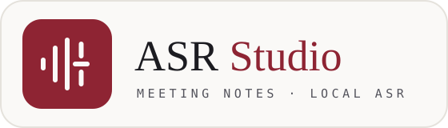
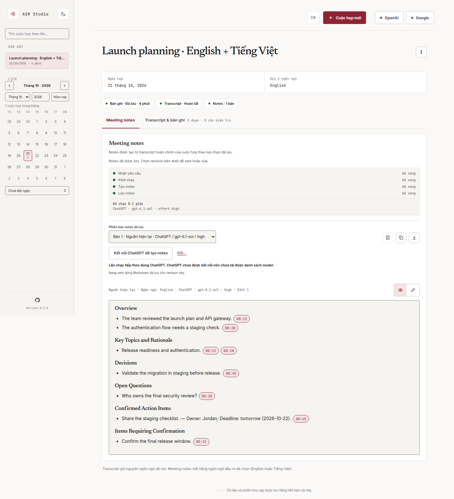
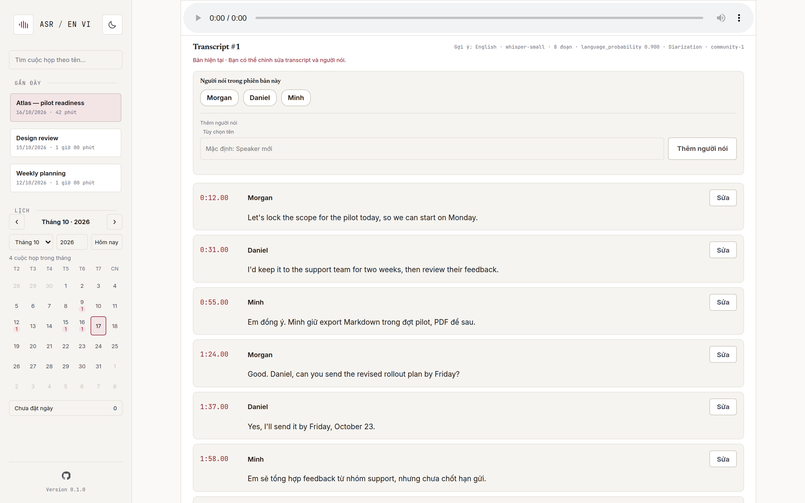

<div align="center">



**Private meeting transcription and notes for English and Vietnamese**

_Recordings are transcribed on your own machine. Only the transcript goes to the notes
provider you choose, and every note links back to the moment in the recording it came from._

[](https://github.com/nguyencanhtrung/asr-en-vi/actions/workflows/pipeline.yml)
[](https://github.com/nguyencanhtrung/asr-en-vi/releases)
[](#license)
[](pyproject.toml)
[](https://github.com/nguyencanhtrung/asr-en-vi/commits/main)

[Quickstart](#quickstart) · [Features](#features) · [Docs](#documentation) · [License](#license)



</div>

## Screenshot provenance

The two README screenshots are reproducible synthetic examples, not acceptance evidence. Regenerate
them with:

```sh
uv run python scripts/capture-readme.py
```

The script reads only the repository [synthetic fixture](tests/fixtures/readme-demo.json), starts a
fresh temporary local app, uses a stub notes provider, captures at 1440 × 1000, and rejects
non-loopback browser requests. It does not read recordings, credentials or provider sessions, run
ASR/inference, or use a user's browser.

## Overview

ASR EN VI is a self-hosted web app for meeting recordings. You upload a recording and get back a
transcript with speaker labels. From that transcript the app writes structured meeting notes.
Speech recognition and speaker diarization run locally in Docker, on a GPU if one is available and
on the CPU otherwise.

## Features

- **Local transcription.** Uses [faster-whisper](https://github.com/SYSTRAN/faster-whisper), with
  Whisper large-v3 on a GPU or Whisper small on a CPU. Language is detected for each segment, so
  meetings that mix English and Vietnamese are transcribed as spoken.
- **Speaker diarization.** Uses
  [pyannote Community-1](https://huggingface.co/pyannote/speaker-diarization-community-1). Speakers
  get default names that you can change, and segments with overlapping speech or low confidence are
  flagged for review.
- **Editable transcripts.** You can correct the text and speaker of each segment. Running a
  transcription again creates a new version and keeps the previous one.
- **AI meeting notes.** Notes are generated in English or Vietnamese through ChatGPT or Google
  Antigravity (via OMP). They include an overview, key topics, decisions, open questions and action
  items.
- **Timestamp citations.** Each note item links to its source segments, so you can jump to that
  point in the recording and play it.
- **Versioned Markdown notes.** You can edit notes in Markdown, keep earlier versions, and copy or
  download them.
- **Private by default.** The app is published only on the host's loopback address and is accessed
  with a token link. Audio and models stay on the host.

<p align="center">
  
</p>

## Prerequisites

- Docker Engine with Docker Compose 2.30 or later
- `git-lfs`, and a Hugging Face account that has accepted the
  [Community-1 conditions](https://huggingface.co/pyannote/speaker-diarization-community-1)
- Optional: an NVIDIA GPU with the NVIDIA driver and NVIDIA Container Toolkit
- Optional, for notes: a ChatGPT account, or OMP with Google Antigravity

## Quickstart

```sh
cp .env.example .env

# Download the diarization model (enter a Hugging Face access token when prompted)
git lfs install
git clone https://hf.co/pyannote/speaker-diarization-community-1 \
  ./models/speaker-diarization-community-1

./scripts/start.sh
```

`start.sh` downloads any missing Whisper model, builds the image and starts the `app` and `worker`
services. On an interactive terminal it prints an access link and a QR code. When stdout is a
pipe, redirect or CI log, access details are withheld; run `docker compose exec -T app python -m
asr_en_vi.cli access show` explicitly when you want to display them. Open that exact link (the
default address is `http://127.0.0.1:8765`), then connect ChatGPT or Google from the workspace
header.

To install a release, check out its tag and run `./scripts/start.sh --pull` with a versioned
`ASR_IMAGE` such as `ghcr.io/nguyencanhtrung/asr-en-vi:v0.1.1`, or `--source` to build it.
After setup, `--offline` starts without network access. See
[Install a release](docs/user-guide.md#install-a-release).

## Documentation

The project documentation is written in Vietnamese.

| Topic | Document |
| --- | --- |
| Operations: configuration, models, notes providers, tokens, CI/CD | [User guide](docs/user-guide.md) |
| Public release: component inventory, remaining gates, draft notes | [Release dossier](docs/release/README.md) · [Release notes](docs/release/notes-v1.md) |
| Product context and vocabulary | [PRODUCT.md](PRODUCT.md) · [CONTEXT.md](CONTEXT.md) |
| Specification | [Specification v1](docs/specification-v1.md) |
| Design | [Design system](DESIGN.md) · [Frontend](docs/frontend-design-v1.md) · [Backend](docs/backend-design-v1.md) · [Backend contract](docs/backend-contract-v1.md) |
| Architecture decisions | [ADRs](docs/adr/) |
| Contributing | [Coding standards](CODING_STANDARDS.md) · [Agent guide](AGENTS.md) · [Development checks](docs/agents/development.md) |

## License

Original project code is licensed under [PolyForm Noncommercial 1.0.0](LICENSE).
The **English license is authoritative**; a [Vietnamese reference translation](LICENSE.vi)
is provided. Commercial use, including use for a commercial business's internal meetings,
requires separate permission from [the owner](https://github.com/nguyencanhtrung).
Uses expressly permitted by the license's Noncommercial Organizations section remain permitted.
Third-party dependencies, fonts and models retain their own licenses.

Mã gốc của dự án dùng [PolyForm Noncommercial 1.0.0](LICENSE). **Bản tiếng Anh là bản chính**;
[bản tiếng Việt](LICENSE.vi) chỉ để tham khảo. Dùng cho mục đích thương mại, kể cả tổng kết
cuộc họp nội bộ phục vụ kinh doanh, cần được [chủ sở hữu](https://github.com/nguyencanhtrung)
cho phép riêng. Các mục đích được cho phép rõ ràng trong phần Tổ chức phi thương mại vẫn
được phép. Dependency, font và model bên thứ ba giữ license riêng.
