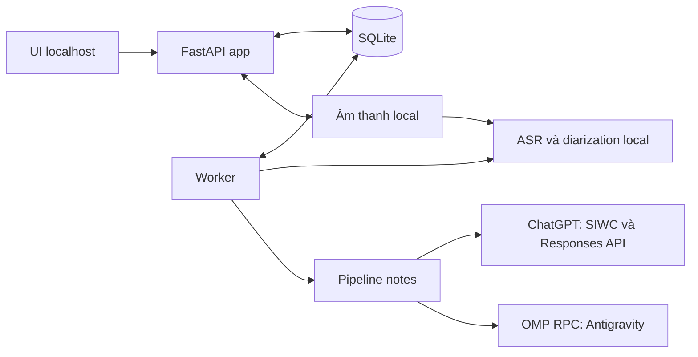

# Backend contract v1 — bản thiết kế kỹ thuật

Tài liệu cụ thể hóa Q1–Q27 đã thống nhất trong [backend design](backend-design-v1.md), hoàn tất tổng hợp ngày 2026-10-16. Đây là bản thiết kế trước triển khai, không phải mô tả API/database đang tồn tại. Tên bảng, endpoint và các giá trị cấu hình bên dưới là lựa chọn kỹ thuật ban đầu; các hành vi sản phẩm đã chốt là ràng buộc khi triển khai. [Spec](specification-v1.md) là nguồn yêu cầu nghiệm thu.

## 1. Ranh giới và luồng dữ liệu

| Module | Trách nhiệm và dữ liệu sở hữu |
| --- | --- |
| Meetings | Metadata, các thế hệ transcript, speaker, phiên bản chỉnh sửa, bản chụp nguồn, các bản notes; kiểm tra đích sửa và tính mới của notes |
| Recording storage | Upload tạm, xác minh đầu vào, file âm thanh bền, đường dẫn nội bộ và nghe lại; dọn file dở theo trạng thái bền |
| Processing | Nhận/claim tác vụ, slot xử lý toàn hệ thống, ownership, tiến độ, hủy, công bố kết quả và phục hồi sau restart |
| Notes | Ngân sách context, chia/trích/hợp nhất, kiểm tra schema/ID nguồn, một lượt sửa tối đa và render Markdown; gọi adapter provider theo cấu hình cố định của tác vụ |
| Access and connections | Token/cookie localhost; các kết nối provider độc lập, OAuth/refresh/logout, trạng thái tài khoản và credential riêng của bản cài |

`app` tiếp nhận thao tác UI; `worker` thực hiện pipeline và ghi tiến độ/kết quả qua cùng lớp nghiệp vụ/lưu trữ. Không sao chép các quy tắc khóa, phiên bản và công bố kết quả thành hai triển khai khác nhau. Giao dịch DB chỉ bao quanh thay đổi dữ liệu ngắn, không bao quanh upload, decode, inference hoặc gọi mạng.

## 2. Mô hình lưu trữ

| Dữ liệu | Các trường/quan hệ chính và bất biến |
| --- | --- |
| `meetings` | ID, title, meeting date có thể trống, metadata version, current generation ID, trạng thái xóa; ngày họp là ngày lịch, không phải timestamp upload |
| `recordings` / `uploads` | Meeting ID, đường dẫn do backend tạo, trạng thái nhận/kiểm tra/ready, metadata âm thanh; upload chưa ready không được xử lý |
| `transcript_generations` | ID, meeting ID, ngôn ngữ gợi ý và cấu hình model của lần chạy, source version, thời điểm hoàn tất; chỉ current generation hoàn tất được sửa |
| `segments` / `speakers` | Thuộc generation, ID ổn định, thời gian đoạn, văn bản, `original_speaker_id` do model gán và `speaker_id` đang dùng, display name và dấu chưa chắc chắn. Cho thêm nhãn thủ công trong generation; không sửa original assignment hoặc ghép speaker giữa hai generation |
| `notes_sources` | ID, meeting/generation ID, phiên bản nguồn, payload bất biến chứa đầy đủ text/ID/timestamp, `speaker_id` đã dùng cho từng segment, tên người nói và ngày họp tại thời điểm tạo notes; giữ cả `original_speaker_id` để đối chiếu. Không đọc lại nội dung hoặc mapping speaker mutable để dựng bằng chứng của notes cũ |
| `notes_revisions` | ID, source snapshot ID, Markdown, edit version, provider/model thực dùng, prompt/schema version và task ID; sửa Markdown tăng edit version, tạo lại thêm row mới |
| `tasks` | Kind `recording` hoặc `notes`, meeting, provider (`chatgpt` hoặc `antigravity`)/model/effort/account version đã chọn khi có bước notes, source snapshot ID, trạng thái/giai đoạn/tiến độ, owner, heartbeat, yêu cầu hủy, kết quả và lỗi |
| `processing_slot` | Một row giữ active task ID hoặc trống; nhận tác vụ và chiếm slot trong cùng giao dịch để không nhận hai tác vụ từ hai tab |
| `provider_connections` | Provider ID, định danh tài khoản hiển thị, connection version và trạng thái không chứa secret; credential nằm trong vùng lưu riêng, không trả cho UI |
| `notes_preferences` | Một row giữ provider dùng gần nhất (`chatgpt`, `antigravity` hoặc trống); model gần nhất của từng provider (và effort của ChatGPT) nằm trong store riêng của provider đó. Chỉ dùng để chọn sẵn trên UI, không cập nhật cấu hình tác vụ đã nhận |

Một nguồn có thể đã được sửa nhiều lần trước khi tạo notes; không cần lưu mỗi lần gõ thành snapshot. Bản chụp được tạo khi nhận bước notes, trong cùng giao dịch xác nhận nguồn và khóa sửa. Khi công bố transcript của một lần xử lý có bước notes tiếp theo, công bố generation, chuyển current generation và chuẩn bị nguồn/khóa notes phải nhất quán, không để tab khác sửa chen vào giữa.

Phiên bản ghi gắn với đối tượng đang sửa: source version cho text, gán speaker, nhãn/tên người nói của generation; metadata version cho tên/ngày họp; edit version riêng cho từng bản notes. Sửa notes cũ vẫn nhắm notes ID cũ khi một bản mới vừa tạo xong. Notes thuộc generation cũ hiển thị là nguồn lịch sử; notes cùng generation nhưng source version hoặc ngày họp khác snapshot hiển thị cần cập nhật. Đổi riêng title không làm nguồn notes khác; không dùng mọi thay đổi metadata version làm điều kiện stale.

Đổi ngày và nhận tác vụ notes kiểm tra khóa trong cùng cơ chế giao dịch. Nếu một PATCH chứa cả title và ngày trong lúc ngày bị khóa, từ chối cả PATCH, không lưu một phần rồi báo lỗi. Gán speaker chỉ nhận nhãn cùng generation, kiểm tra source version và trạng thái current/unlocked; nhãn model gán gốc có thể trống khi model không xác định được, vẫn giữ nguyên sau sửa. Timestamp/ranh giới đoạn không phải trường được sửa trong v1. Ngôn ngữ gợi ý nằm trong cấu hình của lần xử lý mới, không cập nhật ngược generation đã tạo.

## 3. Tác vụ, hủy và phục hồi

Trạng thái điều phối: `accepted` → `running` → `succeeded`, `failed`, `canceled` hoặc `interrupted`. Khi hủy tác vụ đang chạy, chuyển qua `stopping`; chỉ chuyển terminal và nhường slot sau khi các tiến trình/request do lần chạy đó quản lý đã kết thúc. `accepted` là khoảng chuyển giao duy nhất giữa app và worker, không phải hàng đợi nhận nhiều việc.

- Khi nhận: kiểm tra meeting chưa xóa, nguồn/version hợp lệ, slot trống và worker sẵn sàng; lưu cấu hình tác vụ, chiếm slot và khóa nguồn nếu đây là tác vụ notes. Hai yêu cầu tranh cùng slot chỉ một yêu cầu được nhận.
- Khi claim: worker nhận bằng điều kiện nguyên tử trên ID/trạng thái và gắn owner của lần khởi động. Mỗi lần ghi tiến độ/kết quả phải khớp task ID, owner và trạng thái đang cho phép ghi; kết quả đến muộn từ lần chạy cũ bị từ chối.
- Pipeline recording: kiểm tra/chuẩn bị audio → ASR/diarization → công bố transcript đầy đủ → notes nếu đã chọn chạy bước này. Các bước GPU chạy lần lượt; dữ liệu transcript còn dở không thay current generation.
- Nếu từ đầu provider chưa dùng được và chạy chép lời trước, tác vụ kết thúc với phạm vi kết quả `transcript_only`; UI ghi rõ chưa có notes. Đây không phải tác vụ notes đang chờ. Nếu đã bắt đầu bước notes nhưng nó thất bại, tác vụ báo lỗi dù transcript đã hoàn tất vẫn dùng được.
- Pipeline notes: tạo snapshot/khóa → chia/trích/hợp nhất khi cần → kiểm tra/sửa một lượt tối đa → render → lưu notes mới. Chỉ công bố notes hoàn chỉnh qua giao dịch sau khi kiểm tra lại ownership và trạng thái hủy.
- Hoàn tất và hủy cạnh tranh qua trạng thái DB: tác vụ đã commit hoàn tất không bị đổi thành canceled; tác vụ đã nhận hủy không được công bố một kết quả đến muộn thành notes mới.
- Hủy subprocess phải thu hồi cả nhóm tiến trình con do tác vụ sở hữu. Hủy cloud chấm dứt request/client local và bỏ kết quả đến muộn; không giả định nhà cung cấp đã hoàn lại quota hay dừng toàn bộ công việc phía họ.
- Mất heartbeat không chứng minh runner đã dừng. Trong khi chưa xác nhận, giữ slot và báo đang kiểm tra worker; không chỉ hết hạn heartbeat là chạy một tác vụ GPU mới. Sau restart/recovery đã loại bỏ runner cũ, đánh dấu tác vụ dở `interrupted`, mở khóa và cho người dùng chủ động chạy lại.
- Đóng tab, đổi token truy cập ứng dụng hoặc polling lỗi không làm thay đổi ownership/tác vụ. Không tự xử lý lại khi worker trở lại; tác vụ notes mới từ transcript đã lưu khác với chạy lại từ đầu bản ghi.

Worker quản lý các runtime bằng tiến trình/request riêng có deadline và đường hủy. Ngưỡng heartbeat, deadline model, thời gian chờ dừng và thời hạn auth là cấu hình vận hành cần đo; mục tiêu 30 phút cho bản ghi hai giờ không tự trở thành hard timeout làm hủy kết quả đang tiến triển. Theo Q25, không tự gửi lại inference khi lỗi mạng, kể cả chưa nhận được kết quả; tắt các cơ chế resend tương ứng trong SDK/harness. Giữ kết quả hoàn tất và kết thúc lỗi để người dùng chủ động tạo tác vụ mới. Lượt sửa Q18 chỉ áp dụng cho đầu ra đã nhận đầy đủ nhưng không hợp lệ, không dùng để gửi lại request mất phản hồi.

## 4. API và cập nhật UI

Chọn HTTP JSON cho thao tác và polling trạng thái khi có tác vụ; chu kỳ ban đầu khoảng một giây, có điều chỉnh khi tab ẩn/mất mạng. Polling chỉ đọc DB, không gọi model để hỏi tiến độ. UI hiển thị giai đoạn, lượng audio/đoạn đã xử lý khi có số đo và trạng thái hủy; không tạo phần trăm tổng hoặc ETA giả. Sau reconnect lấy trạng thái hiện tại, không phát lại lệnh tạo tác vụ. Có thể thay transport tiến độ sau mà không đổi vòng đời tác vụ.

| Endpoint dự kiến | Hành vi |
| --- | --- |
| `POST /api/access/session` | Đổi token local hợp lệ lấy cookie; loại token khỏi URL theo ADR 0002 |
| `GET /api/meetings` và `GET /api/meetings/{id}` | Lịch sử, lịch ngày/chưa đặt ngày, metadata và các kết quả hiện có |
| `POST /api/uploads`, upload nội dung, hoàn tất upload | Tạo vùng tạm bằng ID backend cấp, nhận đủ file rồi kiểm tra; chưa hoàn tất không tạo recording ready |
| `POST /api/meetings` và `PATCH /api/meetings/{id}` | Tạo meeting từ upload hợp lệ; sửa title/ngày với expected metadata version. Đổi ngày phải kiểm tra khóa nguồn và làm notes cần cập nhật |
| `GET /api/meetings/{id}/audio` | Phát/tua audio được cấp quyền, không lộ đường dẫn filesystem |
| `GET /api/meetings/{id}/generations` và `GET /api/generations/{id}` | Chọn current generation hoặc đọc lịch sử; trạng thái readonly do backend trả và kiểm tra khi ghi |
| `PATCH /api/generations/{id}/segments/{segment_id}` | Sửa text hoặc speaker đang gán với expected source version; chỉ nhận nhãn cùng generation, không sửa timestamp/ranh giới hoặc nhãn model gán gốc |
| `POST /api/generations/{id}/speakers` và `PATCH /api/generations/{id}/speakers/{speaker_id}` | Thêm nhãn bị thiếu hoặc sửa/xóa display name; cùng kiểm tra source version, current generation và khóa nguồn |
| `POST /api/meetings/{id}/notes-runs` | Body: `request_id`, `expected_generation_id`, `expected_source_version`, `expected_metadata_version`, tùy chọn `output_language` (`en`/`vi`), `provider` (`chatgpt` mặc định, hoặc `antigravity`), `expected_model` (chuỗi 1–200 ký tự) và `expected_reasoning_effort` (chuỗi; ChatGPT theo model, Antigravity nhận `high`/`medium`/`default`, `default` được coi là `high` trước khi so sánh) là lựa chọn UI đã hiển thị. Chỉ ghim trạng thái của provider được chọn: connection version, model đã lưu và effort (Antigravity: `high` hoặc `medium` đã lưu; giá trị cũ `default` đọc là `high`); không đọc store của provider kia. Khi có `expected_model`/`expected_reasoning_effort` khác giá trị đã lưu được ghim thì từ chối `notes_preference_changed` 409 (model đã lưu đã đổi; tải lại và xác nhận lại), không tạo tác vụ, snapshot hay chiếm slot; vắng field thì giữ hành vi cũ. Lỗi: `invalid_provider`, `invalid_expected_model`, `invalid_reasoning_effort` 400; `provider_disconnected`, `reconnect_required`, `notes_model_unselected`, `notes_preference_changed`, `login_in_progress` 409 (không bao giờ tự chọn model, provider hoặc tài khoản khác). `login_in_progress`: đang có phiên đăng nhập Antigravity chờ hoàn tất; hoàn tất hoặc hủy trước khi tạo notes. `request_hash` chỉ thêm provider khi khác `chatgpt`, và chỉ thêm `expected_model`/`expected_reasoning_effort` khi có, nên request cũ vẫn idempotent. Tóm tắt tác vụ notes có thêm `provider`, `model`, `reasoning_effort` đã ghim |
| `GET /api/notes/{id}`, `PATCH /api/notes/{id}`, `GET /api/notes/{id}/export` | Đọc/sửa/xuất đúng bản notes; PATCH có expected edit version; export/copy lấy cùng Markdown |
| `GET /api/notes-sources/{id}` | Lấy bản chụp nguồn chỉ đọc để đối chiếu timestamp; mọi dữ liệu vẫn cần xác thực ứng dụng |
| `POST /api/tasks`, `GET /api/tasks/{id}`, `POST /api/tasks/{id}/cancel` | Nhận một tác vụ, đọc trạng thái hoặc yêu cầu hủy; không trả thành công trước khi ghi bền |
| `GET /api/providers`, `GET /api/providers/{id}/models`, tạo/đọc/hủy login session, `DELETE /api/providers/{id}/connection` | UI kết nối và chọn model đúng provider; không trả OAuth credential; ngắt/đổi account phải kiểm tra Q22 trong backend |
| `GET /api/notes-preferences` và `PUT /api/notes-preferences` | `GET` trả `{provider: dùng gần nhất hoặc null, models: {chatgpt?, antigravity?}, reasoning_effort: effort ChatGPT, reasoning_efforts: {chatgpt, antigravity}}` (`reasoning_effort` giữ nguyên cho client cũ). `PUT {provider, model, reasoning_effort?}` chỉ kiểm tra tĩnh (không mạng, không inference, không chặn bởi tác vụ đang chạy): ChatGPT kiểm tra độ dài model và effort theo model; Antigravity kiểm tra ID an toàn và chỉ nhận effort `high`/`medium` (`default` = `high`), giá trị khác trả `invalid_reasoning_effort`. Lỗi: `invalid_provider`, `invalid_preference`, `invalid_model`, `invalid_reasoning_effort` (400). `PUT /api/providers/antigravity/preference {model, reasoning_effort?}` lưu cùng model (vắng field thì giữ mức đã lưu) và trả `reasoning_effort`; `GET /api/providers/antigravity/models` và `GET /api/providers` (mục Antigravity) trả mức đã lưu. Mỗi lần gọi OMP của tác vụ gửi `set_thinking_level` sau `set_model` rồi đọc lại bằng `get_state`; không khớp thì dừng trước khi gửi prompt với `thinking_level_unavailable` 422. Lỗi OMP có `httpStatus` 404 hoặc "Requested entity was not found" (kiểm tra sau auth/quota) được báo là `model_unavailable` 422, không phải `provider_unavailable`. Model về sau không còn dùng được được báo khi chạy (`model_unavailable`), không bị thay thế. Không đổi tác vụ đã nhận |
| `DELETE /api/meetings/{id}` | Từ chối meeting có tác vụ; đánh dấu xóa và dọn dữ liệu đúng phạm vi một cách có thể tiếp tục sau restart |

Mỗi yêu cầu tạo tác vụ mang request ID để retry HTTP do mất phản hồi trả lại cùng tác vụ đã nhận, không tạo thêm lần gọi model. Cùng request ID nhưng payload khác phải bị từ chối; retry không được trở thành tác vụ mới chỉ vì tác vụ cũ đã kết thúc. Đây khác tự gửi lại inference bị Q25 cấm. Ghi từ phiên bản cũ hoặc trạng thái đang khóa trả lỗi có mã phân biệt (`stale_version`, `source_locked`, `system_busy`, `provider_in_use`); UI giữ bản nháp khi xung đột. Lỗi provider cần đăng nhập không được diễn giải thành mất cookie đăng nhập ứng dụng.

Cookie/token tiếp tục theo [ADR 0002](adr/0002-localhost-reusable-token.md). Các thao tác thay đổi trạng thái cần kiểm soát nguồn request và phiên hợp lệ; callback OAuth xác minh state/PKCE theo provider. Các endpoint nghe audio, snapshot và export không phải đường vòng bỏ xác thực.

## 5. Notes và tham chiếu nguồn

Schema trung gian có phiên bản, giữ sáu nhóm nội dung trong spec. Quyết định và action item phải có ít nhất một ID nguồn hợp lệ trong snapshot; người phụ trách/thời hạn cho phép chưa xác định. Thời hạn giữ cả cách nói gốc và ngày quy đổi khi đủ điều kiện. Model không tự sinh URL, đường dẫn audio hay timestamp dùng để seek: renderer dựng chúng từ ID đã kiểm tra.

Ngân sách mỗi lượt gọi gồm prompt, nguồn, phần hợp nhất khi có, phần đầu ra và khoảng dự phòng. Khi chia đoạn, lưu thông tin đoạn nguồn nào đã được đưa vào xử lý; các ID nguồn gốc tồn tại xuyên các bước. Nếu danh sách kết quả trích xuất vẫn quá dài để hợp nhất, hợp nhất theo các nhóm vừa ngân sách và tiếp tục giữ ID, không cắt danh sách. Bộ kiểm thử cần trường hợp quyết định bị đổi ở cuối cuộc họp và action item qua ranh giới đoạn.

Nếu riêng một segment vượt ngân sách, chia phần văn bản cho việc gửi model nhưng giữ tham chiếu về cùng segment gốc; không tự tạo timestamp theo từ hoặc đổi ranh giới transcript đã lưu. Dữ liệu nằm trong phần chồng có thể được đọc nhiều lần, nên hợp nhất phải xử lý mục trùng và không biến phát biểu lặp thành nhiều action item độc lập.

Bộ đếm sửa đầu ra nằm ở tác vụ notes và dùng chung cho toàn bộ các lượt trích/hợp nhất. Không nhờ SDK/harness tự thử lại thêm ngoài chính sách đã chọn. Mọi chunk thành công chưa tạo ra một bản notes người dùng có thể nhầm là kết quả đầy đủ.

Liên kết Markdown do renderer tạo có nhãn timestamp đọc được và đích chứa snapshot/segment ID, dùng đường dẫn ứng dụng không chứa token. UI mở đúng snapshot và seek cùng bản audio; export vẫn giữ timestamp đọc được dù bên đọc Markdown ngoài ứng dụng không có trình phát. Với Markdown do người dùng sửa, backend cho lưu nguyên văn và trả cảnh báo về tham chiếu không hợp lệ; UI không mở nguồn ở link hỏng và không đoán ID thay thế. Copy/export vẫn lấy cùng Markdown đã lưu. Không ép nội dung chỉnh tay ngược về schema model hoặc coi cảnh báo link là quyền công bố đầu ra model chưa hợp lệ.

## 6. Kết nối provider và file bền

ChatGPT dùng direct SIWC, OMP RPC dành cho Antigravity; model và provider cố định trong mỗi tác vụ. Dùng store riêng của bản cài, giữ định danh đăng ký/host và phiên qua restart. UI chỉ nhận trạng thái kết nối, thông tin tài khoản cần hiển thị và URL/code của luồng auth; không nhận credential inference/refresh. Không mount cấu hình coding cá nhân của người dùng vào runner.

Q27 cho chọn provider + model trước khi chạy, chọn sẵn lựa chọn gần nhất và hiển thị rõ. Danh sách model dựa trên kết nối và khả năng adapter; catalog không chứng minh quyền inference hoặc quota. Model đã nhớ không còn dùng được phải báo để người dùng chọn lại, không tự chọn model thay thế. Tác vụ lưu provider/model ID thực dùng, không đọc lại preference giữa các chunk/hợp nhất. Thay preference khi đang chạy chỉ áp dụng cho lần chạy sau.

OMP runner chỉ nhận prompt và các chức năng cần cho inference; tắt tools/extensions/skills/MCP, tự nạp ngữ cảnh dự án và auto-compaction. Phải kiểm chứng các cờ/cấu hình, logging và đường ghi của bản OMP được pin. Đăng nhập là luồng riêng có thể hủy/hết hạn; không chiếm slot model chỉ để chờ người dùng. Với Antigravity, đoạn đổi credential (từ `adapter.login` đến lúc ghi trạng thái) giữ khóa thao tác liên tiến trình, cùng khóa với lúc nhận tác vụ và lúc runner chạy, và kiểm tra lại guard tác vụ đang chạy sau khi lấy khóa (`provider_in_use`); nên đăng nhập không thể thay tài khoản giữa lúc chạy, và nhận tác vụ khi còn phiên đăng nhập chờ bị từ chối (`login_in_progress`). Bắt đầu đăng nhập mới sẽ hủy phiên chờ cũ; trong lúc phiên đăng nhập giữ khóa, liệt kê/kiểm tra model và ngắt kết nối trả `provider_busy`. Tác vụ đã gắn provider/account version chặn login, logout, liệt kê/kiểm tra model và đổi model Antigravity của chính provider đó (`provider_in_use`); provider còn lại vẫn dùng được bình thường trong lúc chạy. Runner chỉ kiểm tra provider còn kết nối đúng connection version đã ghim (`provider_disconnected`, `reconnect_required`, `connection_changed`), không so với preference hiện tại. Mỗi lần gọi Antigravity là một tiến trình OMP mới (không giữ hội thoại), cùng nhóm tiến trình với runner nên hủy nhóm runner dừng cả OMP; external revoke vẫn có thể làm tác vụ lỗi, không tự chọn tài khoản khác.

Audio bền được tách khỏi audio tạm đã chuẩn hóa cho model. Chuẩn codec lưu/phát, định dạng upload và giới hạn dung lượng/thời lượng phải được xác định với file thật; repo hiện chỉ có dữ liệu prototype. Chưa có kết quả chứng minh decode, playback hoặc model xử lý bản hai giờ.

Upload và kết quả file có trạng thái bền để nhận biết file chưa hoàn tất; không công bố file sẵn sàng trước khi lưu thành công. Xóa meeting kiểm tra active task và đánh dấu trạng thái xóa trong cùng giao dịch; từ đó từ chối tác vụ mới cho meeting. Dọn file ngoài giao dịch DB, có thể thử lại sau restart theo dấu xóa, chỉ nhắm file ứng dụng quản lý; báo đang xóa/lỗi khi chưa dọn xong, không báo thành công giả. Không dọn file tạm còn thuộc tác vụ đang hoạt động chỉ dựa trên tuổi file.

## 7. Kiểm chứng trước triển khai/phát hành

- Review các bất biến và tình huống cạnh tranh: nhận hai tác vụ, ghi từ tab cũ, hủy cạnh tranh hoàn tất, publish generation mới, ngắt tài khoản và xóa meeting.
- Thử nghiệm có chủ đích sau giai đoạn thiết kế: SIWC/OMP auth trong Docker, refresh/restart/disconnect, hủy, một request notes và ghi nhận model/quota; chọn mẫu được phép gửi provider. Chưa thực hiện bước này.
- Với mẫu thật: EN, VI xen thuật ngữ, code-switch, nhiều người nói và ít nhất một bản hai giờ; kiểm tra timestamp, decisions/owners/deadlines, VRAM, thời gian và quota theo AC.
- Q23–Q27 đã chốt; kiểm tra riêng sửa metadata/speaker theo phiên bản, retry HTTP không tạo thêm tác vụ, không tự gửi lại inference lỗi mạng, link chỉnh tay hỏng và giữ model trong suốt tác vụ. Những giới hạn kỹ thuật phụ thuộc phép đo được ghi thành kết quả đạt/chưa đạt, không yêu cầu người dùng tự đoán cấu hình.
