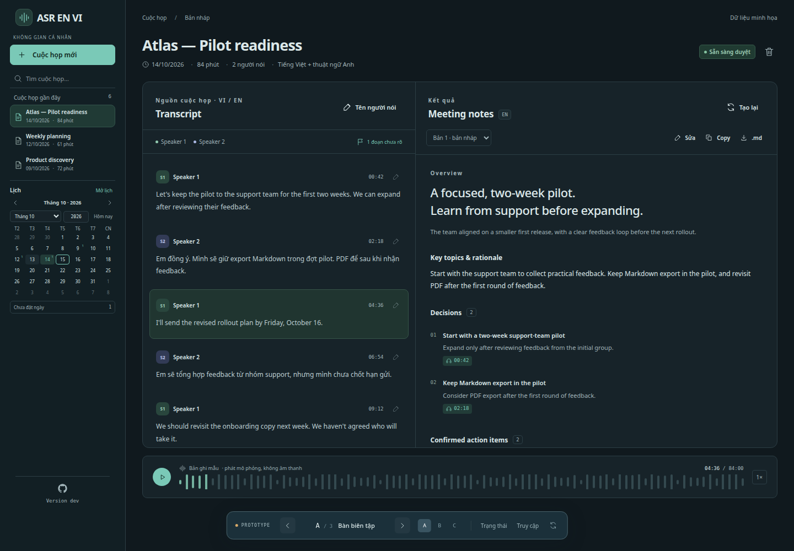
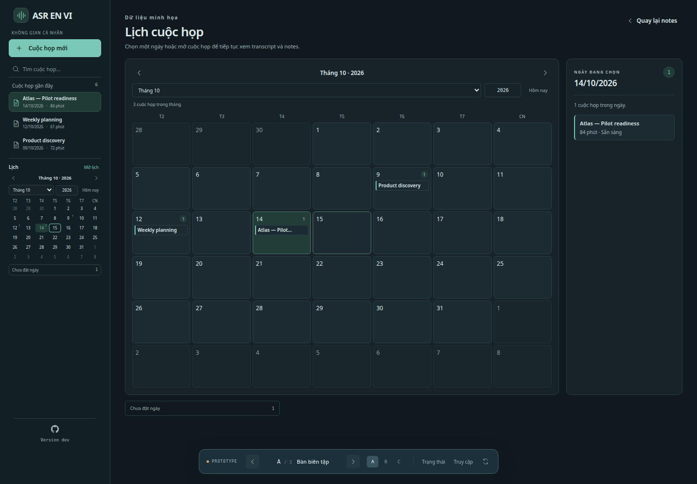

# Frontend design v1 — ASR EN VI

> **Cập nhật ngày 18/10/2026.** Tài liệu này tiếp tục là chuẩn cho kiến trúc thông tin và hành vi vận hành của phương án **A — Bàn biên tập**. Ngôn ngữ thị giác dark/teal cũ đã được thay thế bởi hệ editorial-engineering light/dark trong [`DESIGN.md`](../DESIGN.md); khi có xung đột về màu, font, bề mặt, radius, theme hoặc responsive, `DESIGN.md` là nguồn chuẩn.

Tài liệu này là chuẩn thiết kế frontend v1 để triển khai. [Đặc tả sản phẩm](specification-v1.md) quy định hành vi, dữ liệu, xác thực và phạm vi nghiệm thu; tài liệu này cụ thể hóa cách trình bày và tương tác. Việc duyệt thiết kế không có nghĩa backend, model, lưu trữ hoặc xác thực đã được triển khai.

## 1. Bản thiết kế được chọn

- Ứng dụng web dùng trên trình duyệt laptop/desktop; v1 truy cập qua localhost bằng token.
- Giao diện điều khiển bằng tiếng Việt, giữ các nhãn quen thuộc như **Transcript**, **Meeting notes**, **Speaker 1** và **English**. Nội dung notes viết bằng ngôn ngữ đầu ra đã chọn (English hoặc Tiếng Việt); transcript giữ ngôn ngữ đã nói.
- Bố cục chính gồm sidebar bên trái và vùng làm việc. Trang cuộc họp chia hai tab, **Meeting notes** và **Transcript & bản ghi**; trình phát là thanh dính ở mép trên tab Transcript & bản ghi, luôn trong tầm nhìn khi cuộn transcript.
- Light/dark theme áp dụng thống nhất cho màn hình duyệt, lịch, trang truy cập, các hộp thoại và thông báo. Mặc định theo hệ điều hành; lựa chọn thủ công được ghi nhớ trên trình duyệt.
- Phương án B/C chỉ là các phương án so sánh trong prototype. Frontend v1 triển khai phương án A; không có bộ chuyển bố cục A/B/C.
- Chưa chọn framework frontend, thư viện component hoặc cách tổ chức API trong tài liệu này.

### 1.1. Nguồn tham chiếu

- [Hướng dẫn chạy prototype](../prototype/ui/README.md).
- [Markup và tương tác](../prototype/ui/app.js), [stylesheet](../prototype/ui/styles.css).
- URL khi chạy server prototype: `http://localhost:8765/prototype/meeting-notes/?variant=A`.
- Hai ảnh dưới đây lưu trạng thái thiết kế đã duyệt ở viewport 1440 × 1000. Nội dung cuộc họp là dữ liệu mẫu. Thanh **PROTOTYPE** ở đáy ảnh là công cụ thử thiết kế, không thuộc frontend sản phẩm.

**Màn hình duyệt transcript và notes** (prototype ban đầu: transcript và notes ở hai vùng cạnh nhau; sản phẩm tách thành hai tab, xem mục 6.0):

**Màn hình lịch sử theo tháng:**

## 2. Bố cục và điều hướng

| Vùng | Nội dung và hành vi |
| --- | --- |
| Sidebar | Logo và tên phần mềm, chuyển theme, tìm kiếm, danh sách gần đây, lịch nhỏ, footer; cố định cao bằng viewport |
| Đầu vùng duyệt | Tiêu đề chung **Cuộc họp**, trạng thái kết nối **OpenAI** và **Google** (hai nút riêng), nút **Lịch** ở màn hình hẹp và điểm vào tạo cuộc họp toàn cục |
| Đầu trang cuộc họp | Tên cuộc họp (chỉ hiện một lần, không lặp ở tiêu đề chung), nút **Sửa tên và ngày**, ngày họp, gợi ý ngôn ngữ và dải trạng thái ngắn **Bản ghi · Transcript · Notes** |
| Hai tab | Danh sách tab **Meeting notes** và **Transcript & bản ghi** ngay dưới phần đầu trang (mục 6.0); mỗi lúc chỉ một tab hiện |
| Tab Transcript & bản ghi: transcript | Khối chép lời (nút chép lời/hủy, tiến độ, lỗi), danh sách đoạn ở chế độ đọc (timestamp, người nói, nội dung, dấu cần kiểm tra), danh sách người nói dạng chip và nút **Sửa** mở ô sửa của từng đoạn |
| Tab Meeting notes | Notes theo ngôn ngữ đầu ra đã chọn, nút tạo notes nêu lựa chọn đã lưu cùng **Đổi…**, lời nhắc đặt tên người nói, tiến độ và lỗi tạo notes, chọn bản notes, **Xem \| Viết**, **Tạo lại notes**, copy và xuất Markdown; khi chưa có transcript chỉ có trạng thái trống **Cần transcript trước** |
| Thẻ nguồn đã lưu | Chỉ hiện khi mở một nguồn từ notes: nằm ngay dưới trình phát trong tab Transcript & bản ghi, tiêu đề **Nguồn đã lưu lúc tạo notes**, văn bản/người nói/mốc của bản chụp, ghi chú khi transcript hiện tại đã khác, nút **Tua bản ghi tới mốc này** và **Đóng nguồn** (mục 6.3) |
| Trình phát | Phát/tạm dừng, vị trí hiện tại, tổng thời lượng và thanh tua; nằm trong tab Transcript & bản ghi. Thanh dính ở mép trên vùng nội dung khi cuộn, cao tối đa 72 px, chỉ gồm trình phát; tiêu đề và dòng hướng dẫn của khối bản ghi cuộn đi như bình thường |
| Lịch lớn | Thay vùng duyệt khi mở lịch; sidebar vẫn giữ nguyên để điều hướng |

Ở desktop, sidebar có chiều rộng tham chiếu **228 px** và cố định: cao đúng bằng viewport, đứng yên khi trang cuộn dù transcript dài, tự cuộn bên trong khi nội dung cao hơn viewport, với thanh cuộn mảnh và không bao giờ cuộn ngang; khi quá hẹp, lịch nhỏ đưa **Hôm nay** xuống hàng riêng để tên tháng luôn đọc đủ. Từ 680 px trở xuống nó là thanh trên cùng và cuộn cùng trang. Phần còn lại là vùng làm việc co giãn; trong màn hình duyệt, tab đang chọn dùng toàn bề rộng vùng nội dung. Tab cuộn cùng trang; trong tab Transcript & bản ghi, trình phát dính ở mép trên vùng nội dung (cao tối đa **72 px**, kể cả từ 680 px trở xuống) nên luôn nằm trong tầm nhìn và dùng được.

Ở màn hình lịch, phần tháng chiếm diện tích chính, danh sách ngày được chọn nằm bên phải với chiều rộng tham chiếu **240 px**. Với viewport từ 1150 px trở xuống, danh sách ngày chuyển xuống dưới lịch. Đây là bố cục đã có trong prototype, không phải một màn hình mới.

Kích thước trên là mốc tham chiếu khi triển khai; ưu tiên giữ thứ bậc, tỷ lệ và khả năng đọc/thao tác. Không sao chép cứng các kích thước chữ quá nhỏ hoặc khoảng trống dành riêng cho thanh công cụ prototype.

## 3. Ngôn ngữ thị giác

### 3.1. Màu sắc

Màu sắc dùng semantic tokens trong [`design-system.css`](../src/asr_en_vi/web/design-system.css) và được mô tả để tái sử dụng trong [`DESIGN.md`](../DESIGN.md). Light theme dùng nền giấy ấm và oxblood; dark theme dùng nền charcoal và dusty rose tương ứng. Success, warning và danger độc lập với màu nhận diện. Mỗi trạng thái cần có nhãn hoặc biểu tượng đi kèm; màu không phải dấu hiệu duy nhất.

### 3.2. Chữ, biểu tượng và bề mặt

- Newsreader Variable dùng cho tiêu đề; Inter Variable dùng cho điều khiển và nội dung chính; JetBrains Mono dùng cho timestamp, version và metadata kỹ thuật. Cả ba được self-host với Vietnamese subset.
- Dùng font có sẵn hoặc đóng gói cùng frontend; không tải font hay icon từ Internet trong runtime.
- Giữ mật độ gọn của prototype: tiêu đề rõ, metadata nhẹ hơn, phân cấp nội dung bằng cỡ chữ, độ đậm và khoảng cách.
- Icon nét đơn, đồng nhất; logo ứng dụng là biểu tượng sóng âm trong ô vuông bo góc. GitHub dùng biểu tượng GitHub riêng.
- Panel có viền hairline, radius 8 px; control dùng 4 px; hộp thoại dùng 12 px. Dùng khoảng trắng và đường phân cách nhẹ để chia nhóm.
- Hover, focus, disabled và selected phải phân biệt được trên nền tối. Hiệu ứng chuyển trạng thái ngắn, tôn trọng tùy chọn giảm chuyển động của trình duyệt.

## 4. Sidebar

Thứ tự từ trên xuống được chốt như sau:

1. Logo sóng âm và tên **ASR EN VI**, đồng thời là đường về workspace; nút chuyển light/dark nằm cùng hàng.
2. Ô **Tìm cuộc họp…**.
3. **Cuộc họp gần đây**: danh sách ngắn, mặc định tối đa ba cuộc họp có ngày, mới nhất trước. Mỗi mục có tên, ngày và thời lượng; mục đang mở có nền/viền lựa chọn.
4. Lịch tháng nhỏ nằm ngay dưới danh sách gần đây.
5. Footer ở đáy sidebar, tách bằng đường kẻ nhẹ.

Nút **Cuộc họp mới** ở đầu vùng duyệt là điểm vào tạo cuộc họp toàn cục. Trạng thái chào mừng trên workspace giữ CTA tạo cuộc họp theo ngữ cảnh, nên home có cả nút header và CTA chào mừng. Trên viewport từ 520 px trở xuống, nút header thu gọn thành biểu tượng nhưng vẫn giữ tên truy cập. Sidebar không lặp lại điểm vào toàn cục và không có mục **Cuộc họp** riêng vì wordmark đã là đường về workspace.

Đầu vùng duyệt có hai nút trạng thái kết nối riêng: **OpenAI** (provider ChatGPT) và **Google** (provider Antigravity). Mỗi nút gồm chấm trạng thái, tên và nhãn **Đã kết nối**, **Chưa kết nối**, **Cần đăng nhập lại** hoặc **Không khả dụng**, có tên truy cập nêu đúng provider của nó. Trạng thái của cả hai được đọc khi mở trang và cập nhật sau khi kết nối, ngắt kết nối, cần kết nối lại hoặc lỗi trong hộp thoại. Cả hai mở cùng một hộp thoại kết nối, bắt đầu từ trên cùng (**Google** cuộn tới phần **Google Antigravity** sau khi dữ liệu tải xong và chuyển focus vào tiêu đề phần đó) và trả focus về nút đã mở khi đóng. Từ 980 px trở xuống, hai nút xuống một hàng riêng dưới tiêu đề để không tràn ngang ở 360 px; nhãn trạng thái quá dài xuống dòng dưới tên thay vì bị cắt, kể cả ở 320 px.

Tìm kiếm theo tên trên toàn bộ lịch sử, không chỉ ba mục gần đây; hiện kết quả hoặc trạng thái không tìm thấy. Lịch là cách chính để duyệt các cuộc họp cũ theo thời gian, tránh buộc người dùng cuộn một danh sách gần đây dài.

Footer căn giữa theo chiều dọc: **chỉ biểu tượng GitHub**, phía dưới là **Version &lt;phiên bản&gt;**, ví dụ `Version 1.0`. Không có dòng “Mã nguồn …”. Icon dẫn tới [repository](https://github.com/nguyencanhtrung/asr-en-vi); dòng version dẫn tới [releases](https://github.com/nguyencanhtrung/asr-en-vi/releases). Cả hai chỉ mở trang bên ngoài khi người dùng chọn.

Icon GitHub phải có tên truy cập và tooltip dù không có text hiển thị. Version phản ánh bản ứng dụng thực tế; dùng **Version dev** khi chưa có version phát hành. `1.0` là ví dụ định dạng, không phải số release đã được công bố. Tên sản phẩm, URL repository và version lấy từ metadata dùng chung.

## 5. Lịch sử bằng lịch tháng

### 5.1. Lịch nhỏ

- Tuần bắt đầu từ thứ Hai, gồm bảy cột **T2–CN**. Ô ngày ngoài tháng hiển thị mờ hơn.
- Tiêu đề tháng/năm có nút trước/sau; cho chọn trực tiếp tháng, nhập/chọn năm và về **Hôm nay**.
- Ngày có cuộc họp được đánh dấu bằng số lượng từ dữ liệu đã lưu. Ngày hiện tại có viền; ngày được chọn có nền nhấn.
- Bấm một ngày hoặc **Chưa đặt ngày** để mở lịch lớn và chọn mục đó. Từ 680 px trở xuống lịch nhỏ ẩn đi; khi đó nút **Lịch** ở đầu vùng làm việc là lối vào duy nhất và mở tháng đang duyệt. Nút này ẩn ở màn hình rộng.
- Mục **Chưa đặt ngày** kèm số lượng luôn cho phép tìm các cuộc họp thiếu ngày.

### 5.2. Lịch lớn

- Tiêu đề **Lịch cuộc họp**, nút **Quay lại notes**, điều khiển tháng/năm và **Hôm nay**.
- Hiển thị tổng số cuộc họp trong tháng; tháng trống có thông báo rõ.
- Lưới tháng hiển thị tên cuộc họp trong từng ngày. Prototype hiển thị tối đa hai mục trong ô và nút `+N khác` để mở danh sách đầy đủ của ngày đó.
- Panel ngày được chọn hiển thị ngày, số lượng và toàn bộ cuộc họp của ngày. Mỗi cuộc họp có tên, thời lượng và trạng thái; chọn mục để mở đúng transcript/notes.
- Ngày trống và nhóm **Chưa đặt ngày** trống đều có thông báo phù hợp.
- **Quay lại notes** trở về cuộc họp đang mở trước khi duyệt lịch. Chọn trực tiếp một cuộc họp trong lịch chuyển sang cuộc họp đó.

### 5.3. Quy tắc dữ liệu và trạng thái

- Lịch nhỏ và lịch lớn dùng chung tháng/ngày đang chọn. Duyệt tháng hoặc năm không thay đổi metadata cuộc họp.
- Xếp lịch theo **ngày họp** người dùng cung cấp, không tự lấy ngày upload/xử lý. Không có ngày thì vào **Chưa đặt ngày**.
- Ngày họp là giá trị ngày, không tự lệch sang ngày khác do chuyển đổi UTC. UI trình bày theo dạng `dd/mm/yyyy` như prototype.
- Nhập/xóa cuộc họp cập nhật dấu ngày, số lượng và danh sách tương ứng. Frontend sản phẩm phải đọc dữ liệu thật từ backend.
- Không hiển thị giờ bắt đầu giả khi chỉ có ngày và thời lượng. Lịch v1 phục vụ duyệt lịch sử; không có đặt lịch tương lai, kéo thả đổi lịch hay đồng bộ Google Calendar.
- Duyệt lịch không làm mất chỉnh sửa đã lưu, tên người nói hoặc các bản notes. Khi có tác vụ đang chạy, vẫn thấy trạng thái và thao tác hủy trong màn hình lịch.

## 6. Duyệt transcript, người nói và notes

### 6.0. Trang cuộc họp hai tab

Trang cuộc họp có hai tab theo mẫu WAI-ARIA Tabs (`role` tablist/tab/tabpanel, `aria-selected`, `aria-controls`) ngay dưới phần đầu trang: **Meeting notes** (kết quả chính) và **Transcript & bản ghi** (trình phát và transcript đi cùng nhau để đối chiếu).

- **Điều khiển:** chỉ tab đang chọn nằm trong thứ tự Tab; mũi tên trái/phải đổi tab (vòng qua đầu/cuối), Home và End nhảy tới tab đầu/cuối, và tab được chọn ngay khi nhận focus.
- **Nội dung:** tab Transcript & bản ghi chứa khối bản ghi (trình phát dính), khối chép lời, người nói và các đoạn; khi đã có transcript, nhãn tab ghi số đoạn và số đoạn cần kiểm tra (đoạn hiện dấu **Cần kiểm tra** hoặc **Nên nghe lại**) của thế hệ transcript đang hiển thị. Tab Meeting notes chứa toàn bộ phần notes (tạo, tiến độ, lỗi, phiên bản, **Xem | Viết**, sao chép, tải về). Thẻ nguồn đã lưu nằm ở tab Transcript & bản ghi, ngay dưới trình phát.
- **Tab mở sẵn:** không có hash thì chọn Meeting notes nếu cuộc họp có ít nhất một bản notes đã lưu hoặc đang tạo notes, ngược lại chọn Transcript & bản ghi. Link nguồn `?notes_source=…&segment=…` không kèm hash mở Transcript & bản ghi, nơi có thẻ nguồn. Hash luôn thắng (`#notes` hiện tab notes và giữ nguồn đã nạp cho lần chuyển tab sau). Trước khi biết cuộc họp có notes hay không (tối đa bốn giây), chưa tab nào được chọn: khung notes ẩn còn khung transcript đã có đủ control nhưng trong suốt, để không khung nào bị nháy; cái giá là trong khoảng chờ ngắn đó các control trong suốt ấy vẫn nhận được focus bàn phím mà không có viền focus nhìn thấy.
- **Địa chỉ:** `#notes` và `#transcript` chọn tab tương ứng. Đổi tab là một mục lịch sử mới (`pushState`, giữ đường dẫn và query), nên Back quay lại tab trước, Forward đi tiếp và tải lại trang giữ tab. Mục lịch sử bị rời đi nhớ tab đang hiện, nên Back đúng tab kể cả khi quy tắc mặc định đã đổi. Route `/meetings/{id}` và API không đổi.
- **Chưa có transcript:** tab Meeting notes chỉ hiện **Cần transcript trước**, một dòng nói transcript đang được tạo hay chưa chạy, và nút chuyển sang tab Transcript & bản ghi; không có ô chọn hay nút tạo notes bị tắt.
- **Tạo notes:** bấm tạo notes ở bất kỳ đâu đều chọn tab Meeting notes để theo dõi tiến độ. Thẻ nguồn và trình phát cùng nằm ở tab Transcript & bản ghi nên nút **Tua bản ghi tới mốc này** của thẻ chỉ tua, không đổi tab. Bấm chip mốc thời gian của notes chọn tab Transcript & bản ghi bằng một mục lịch sử mới (xem 6.3), nên Back quay lại Meeting notes.
- **Đầu trang:** tên cuộc họp chỉ hiện một lần; dải trạng thái ngắn **Bản ghi · Transcript · Notes** nằm trong phần đầu trang. Từ 680 px trở xuống, danh sách tab nằm ngay dưới phần đầu trang và hai nút trạng thái **OpenAI** và **Google** giữ nguyên.

### 6.1. Transcript và trình phát

Transcript mặc định ở chế độ đọc để nghe và đọc nhanh. Mỗi đoạn gồm timestamp có thể bấm, tên người nói, nội dung (từ 13 px) và nút **Sửa** luôn hiện, không phụ thuộc hover; chưa có ô nhập, select hay nút lưu nào. Đoạn chưa rõ được đánh dấu bằng amber, nhãn **Cần kiểm tra** kèm lý do và chỉ dẫn nghe lại. Đoạn nguồn đang được đối chiếu phải nổi bật để người dùng định vị được trong danh sách. Mỗi đoạn ở chế độ đọc có tối đa hai điểm dừng Tab: timestamp và **Sửa**.

Bấm timestamp trong transcript tua trình phát tới đoạn đó và phát; bấm chip mốc thời gian của notes tua tới mốc nguồn rồi phát (trình duyệt có thể chặn phát khi link vừa được dán; khi đó thẻ nguồn nhắc bấm phát), còn nút **Tua bản ghi tới mốc này** của thẻ nguồn chỉ tua. Trình phát là thanh dính ở mép trên vùng nội dung của tab Transcript & bản ghi, có phát/tạm dừng, thanh tua, thời gian hiện tại và tổng thời lượng. Chọn tab Meeting notes ẩn thanh này nhưng không tạm dừng audio, để vừa nghe vừa đọc notes; muốn dừng thì quay lại tab Transcript & bản ghi. Trong sản phẩm, phát âm thanh từ bản sao đã lưu tại backend; dạng sóng và chuyển động trong prototype không chứng minh đã có phát âm thanh thật.

Khi audio đang phát và đoạn đang phát (`aria-current`) đổi, nếu còn thấy một phần danh sách đoạn trong vùng nhìn thấy bên dưới thanh trình phát thì đoạn đó được đưa vào tầm nhìn bằng cuộn gần nhất (`block: "nearest"`), dưới thanh trình phát; khi người dùng bật giảm chuyển động, cuộn tức thì. Không tự cuộn khi audio tạm dừng, trong 2 giây sau khi người dùng cuộn tay (con lăn, chạm, phím cuộn hoặc kéo thanh cuộn), khi focus đang nằm trong một ô sửa của transcript, hay khi cả danh sách đoạn nằm ngoài vùng nhìn thấy đó, kể cả khi danh sách đang ẩn vì tab Meeting notes đang mở. Nhờ vậy người đang đọc notes không bị kéo về transcript. Mở nguồn từ notes là một thao tác chủ động khác: đoạn nguồn được đánh dấu bằng nhãn **Nguồn của mục notes** và đưa vào tầm nhìn bằng cuộn gần nhất (cuộn tức thì khi bật giảm chuyển động), chỉ khi chưa thấy được dưới thanh trình phát. Mọi đích cuộn trong tab Transcript & bản ghi (đoạn transcript) đều dừng dưới thanh trình phát, không nằm dưới nó; tab Meeting notes không ghim thanh nào nên không để dành chỗ. Trình duyệt cũng cuộn control nhận focus bàn phím xuống dưới thanh; riêng ô nhập văn bản có thể chỉ lộ dòng chứa con trỏ, nên một phần của ô vẫn có thể nằm dưới thanh trình phát.

Bấm **Sửa** mở ô sửa tại đoạn đó, gồm ô nội dung, select người nói, **Lưu đoạn** và **Hủy**; chỉ một ô sửa mở tại một lúc. Esc là hủy, Ctrl/⌘+Enter (từ bất kỳ control nào trong ô) là lưu; sau khi lưu hoặc hủy, focus quay lại nút **Sửa** của đoạn đó. Mở đoạn khác đóng ô đang mở nhưng giữ văn bản chưa lưu trong cơ chế bản nháp của transcript; đoạn có bản nháp hiện dấu **Bản nháp chưa lưu** (chữ cùng viền nét đứt, không chỉ màu). Mục **Chi tiết** trong ô sửa chứa **Gán ban đầu** và các chỉ số model (`avg_logprob`, `no_speech_prob`, `compression_ratio`); ở chế độ đọc chúng không hiện (thế hệ cũ chỉ đọc, không có ô sửa, nên giữ mục này đóng sẵn ở mỗi đoạn). Thông báo **Đã lưu** của mọi đoạn đi qua một vùng `aria-live` chung, không có vùng riêng cho từng đoạn. Sau khi lưu, notes hiện có được đánh dấu cần cập nhật; không tự thay nội dung notes.

Q24 bổ sung chọn lại người nói cho từng đoạn (select trong ô sửa, lưu ngay khi đổi) và thêm nhãn nếu thiếu; giữ nhãn model gán ban đầu để đối chiếu trong mục **Chi tiết**. Chỉ chỉnh ở thế hệ hiện tại, cùng khóa nguồn/kiểm tra phiên bản như sửa text. Timestamp và ranh giới đoạn giữ nguyên trong v1; đổi người nói một đoạn không đổi tên cả nhóm hoặc các đoạn khác.

Q20 yêu cầu lưu theo phiên bản đã đọc. Khi tab khác đã cập nhật cùng dữ liệu, giữ phần đang soạn và báo xung đột để người dùng đối chiếu với bản mới; không tự ghi đè hoặc trộn. Quy tắc cũng áp dụng cho tên người nói và nội dung cùng một bản notes. Esc và **Hủy** vẫn giữ bản nháp đã bị đánh dấu xung đột (nội dung đoạn hoặc tên người nói): ô đóng lại, đoạn (hoặc chip) vẫn mang dấu bản nháp, và mở lại sẽ khôi phục bản nháp cùng khung đối chiếu. Nút **Tải lại bản mới nhất** nằm trong ô sửa khi ô đang mở và chuyển lên khung báo xung đột phía trên transcript khi ô đã đóng, cho đến khi người dùng tải bản mới.

Q21 yêu cầu có cách chọn thế hệ transcript: mặc định thế hệ mới nhất đã hoàn tất và lưu đầy đủ, các thế hệ trước chỉ đọc. Lần chạy mới chưa hoàn tất không thay mặc định; notes lỗi sau khi transcript đã lưu không làm mất bản mới. Cách trình bày bộ chọn này bổ sung sau prototype, chưa có UI được nghiệm thu.

Theo quyết định backend được chốt sau khi duyệt prototype, khi đang tạo notes cho cuộc họp này, UI khóa sửa transcript và tên người nói (nút **Sửa** và chip người nói bị tắt, kèm lý do gắn vào từng nút), vẫn cho đọc nguồn; ở ô sửa đang mở, nội dung, select và **Lưu đoạn** bị tắt, còn **Hủy** vẫn dùng được. Backend phải thực thi cùng điều kiện ở API; chỉ mở lại chỉnh sửa sau khi tác vụ đã kết thúc, không ngay khi vừa gửi yêu cầu hủy. Các bản notes đã có và các cuộc họp khác vẫn sửa được. Xem [backend design v1](backend-design-v1.md).

### 6.2. Tên người nói

- Mặc định dùng **Speaker 1**, **Speaker 2**, … theo từng cuộc họp.
- Mục **Người nói trong phiên bản này** ở đầu transcript hiện mỗi người nói thành một chip; chip còn tên mặc định do hệ thống đặt (**Speaker N**) có dấu **đặt tên**. Bấm chip mở ô đổi tên ngay tại chỗ, không phải hộp thoại: Enter lưu, Esc hủy. Chỉ một ô đổi tên mở tại một lúc; tên đang gõ ở ô vừa rời đi được giữ làm bản nháp (chip hiện dấu **bản nháp**).
- Cho phép thêm người nói, sửa tên và **Khôi phục tên mặc định**; để trống thì dùng nhãn mặc định. Ô đổi tên hiện nhãn gốc để đối chiếu. Ở thế hệ cũ, chip chỉ để đọc.
- Tên chỉ áp dụng cho thế hệ transcript đang sửa của cuộc họp hiện tại. Lưu tên cập nhật transcript và đánh dấu notes cần cập nhật; thế hệ mới sau chạy lại dùng nhãn Speaker để đặt tên lại, không tự ghép tên với thế hệ cũ.
- Khi chủ động tạo lại notes, bản mới sử dụng tên đã đặt; các bản cũ và chỉnh sửa thủ công giữ nguyên.
- Vì notes dùng tên người nói tại thời điểm tạo, khi transcript hiện tại còn người nói mang tên mặc định, khu vực tạo notes hiện **Notes sẽ dùng tên người nói hiện tại: …** (liệt kê các tên mặc định) kèm link **Đặt tên trước**. Link chuyển sang tab **Transcript & bản ghi** ở thế hệ hiện tại (nếu đang mở thế hệ cũ thì quay về thế hệ hiện tại) và đưa focus tới tiêu đề **Người nói trong phiên bản này**. Lời nhắc không chặn việc tạo notes; nó ẩn đi trong lúc tác vụ giữ nguồn, khi tên không đổi được.
- Tự học/nhận diện và điền tên từ dữ liệu training là **advanced feature ở phase sau**. V1 không có giao diện huấn luyện hoặc tự nhận diện danh tính.

### 6.3. Meeting notes

Panel **Meeting notes** có hành động tạo notes, chọn bản notes, chỉnh sửa, copy và xuất Markdown. Nội dung có thứ bậc đọc rõ và các nhóm theo đặc tả: **Overview**, **Key Topics and Rationale**, **Decisions**, **Open Questions**, **Confirmed Action Items**, **Items Requiring Confirmation**.

Mục có nguồn hiện chip mốc thời gian để đối chiếu, chỉ ở chế độ **Xem** và không nằm trong Markdown (xem bên dưới). Các mục cần xác nhận được trình bày riêng với mức nhấn amber; không trộn với công việc đã thống nhất. Không tự đặt người phụ trách hoặc deadline còn thiếu.

Theo Q19, chip mốc thời gian của một bản notes mở đúng bản chụp đã dùng lúc tạo, gồm văn bản, tên người nói và ngày họp trước các chỉnh sửa về sau. UI phân biệt đang xem nguồn cũ với transcript hiện tại: thẻ **Nguồn đã lưu lúc tạo notes** luôn nói đây là bản chụp bất biến, hiện mốc thời gian, người nói và ngày họp của bản chụp (**Chưa đặt ngày** khi lúc đó cuộc họp chưa có ngày) và, khi nguồn hiện tại đã khác (văn bản hoặc người nói của đoạn đổi, là lần chép lời khác, hoặc ngày họp đã được thêm, đổi hay xóa), thêm ghi chú nói rõ khác ở đâu; bản chụp chỉ đọc, vẫn nghe được mốc âm thanh tương ứng. Không đổi ngầm nguồn chỉ để khớp với transcript đang mở.

Trích dẫn là dữ liệu riêng của bản notes, không phải link trong Markdown: mỗi mục lưu tiêu đề phần, văn bản đúng như đã render và các đoạn nguồn (ID, mốc bắt đầu). Ở chế độ **Xem**, mục có nguồn hiện sau nội dung một chip cho mỗi đoạn nguồn, nhãn `mm:ss` (`h:mm:ss` từ một giờ), là link `<a>` tới `/meetings/{id}?notes_source={snapshot}&segment={segment}#transcript` với tên truy cập “Nghe lại đoạn nguồn lúc …”. Chip chỉ gắn vào mục còn đúng tiêu đề phần và nội dung như lúc tạo; mục đã sửa hoặc chuyển phần không có chip, và sửa một mục không làm mất chip mục khác, trừ các mục trùng tiêu đề phần và nội dung: Markdown không cho biết mục nào trong nhóm là bản gốc, nên nhóm chỉ giữ chip (mỗi mục đúng chip của mình, theo thứ tự) khi số mục của nhóm bằng lúc tạo; sửa hay xoá một mục trong nhóm, hoặc thêm bản sao của chúng (kể cả sửa mục khác thành bản sao), làm cả nhóm mất chip. Markdown đã lưu, **Viết**, sao chép và tải về không chứa link. Bản notes tạo trước khi có trích dẫn không hiện chip và không báo lỗi.

Bấm chip (hoặc mở link của chip) chọn tab Transcript & bản ghi bằng một mục lịch sử mới, nên Back quay lại tab Meeting notes; hiện thẻ nguồn ngay dưới trình phát (focus chuyển tới tiêu đề thẻ mà không cuộn, kể cả khi mở bằng link dán hoặc Back/Forward), tua và phát audio, đánh dấu đoạn tương ứng trong transcript và đưa nó vào tầm nhìn. Một thao tác duy nhất phục vụ cả bấm chip lẫn link dán từ ngoài. Xem [ADR 0009](adr/0009-notes-citations-apart-from-markdown.md).

**Hành động tạo notes.** Dưới tiêu đề panel có đúng một nút chính, tên nút nêu lựa chọn đã lưu: **Tạo notes · English · ChatGPT GPT 6.1 Sol** (ngôn ngữ đầu ra, rồi nhà cung cấp và model). Khi đã có notes, nút đọc **Tạo lại notes · …**, là nút phụ và nằm trong thanh công cụ notes (hàng cuối), cùng nút **Đổi…**; cả nhóm chuyển chỗ như một khối và focus bàn phím đi cùng. **Đổi…** (`aria-expanded`, `aria-controls`) mở vùng chứa ba ô chọn ngôn ngữ đầu ra, nhà cung cấp và model hiện có, dòng nói lần chạy tiếp theo dùng gì, thông báo lưu lựa chọn và đoạn mô tả dữ liệu gửi đi; vùng này đóng sẵn ở mỗi cuộc họp, đóng/mở không gọi API và không có chuyển động. Cách lưu lựa chọn và quy tắc không tự đổi nhà cung cấp hay model giữ nguyên. Khi nhà cung cấp đã chọn chưa kết nối (hoặc cần kết nối lại) hay model chưa sẵn sàng, chính nút đó đọc **Kết nối ChatGPT để tạo notes** hoặc **Kết nối Google Antigravity để tạo notes** và mở hộp thoại kết nối ở đúng phần của nhà cung cấp, dòng giải thích lý do hiện ngay không cần mở **Đổi…**; khi tác vụ đang chạy, nút giữ nguyên chỗ và bị tắt cạnh **Hủy tạo notes**. Từ 520 px trở xuống nút chiếm cả hàng, tên dài xuống dòng trong nút, **Đổi…** nằm dưới.

Notes đã lưu nằm trong một khung toàn bề rộng của panel. Một thanh công cụ dùng chung cho hai chế độ gồm chọn phiên bản, nút chuyển **Xem | Viết**, **Lưu bản nháp**, **Sao chép bản đã lưu**, **Tải Markdown đã lưu** và, ở hàng cuối, hành động tạo notes nói trên. **Xem** là mặc định, được nhớ theo lựa chọn cuối cùng trong trình duyệt, và render Markdown của bản nháp hiện tại với chữ 14 px, heading nằm dưới cấp heading của panel. **Viết** là ô soạn thảo Markdown toàn bề rộng, chữ 13 px, cao tối thiểu 420 px trên desktop. Đổi chế độ không đổi bản nháp, không gọi API và giữ vị trí con trỏ. Khi có thay đổi chưa lưu, nút **Viết** có chấm báo và tên truy cập nói rõ, còn **Xem** hiện dòng “Đang xem bản nháp chưa lưu”. Khối xung đột cùng hai hành động của nó hiện ở cả hai chế độ; Ctrl/⌘+Enter trong ô soạn thảo lưu bản nháp; trình duyệt cảnh báo trước khi đóng hoặc tải lại trang còn bản nháp notes hoặc transcript chưa lưu. UI phân biệt bản đang xem, bản mới nhất, bản đã sửa thủ công và bản chưa phản ánh transcript/tên người nói mới. **Tạo lại notes** tạo bản mới; bản trước vẫn mở, copy và xuất được. Copy/xuất luôn dùng đúng bản đang chọn, kể cả chỉnh sửa của bản đó.

Nội dung soạn thảo là Markdown tự do theo [ADR 0005](adr/0005-markdown-notes.md). Khi lưu, thao tác luôn nhắm đúng bản notes đã mở trong trình soạn thảo, kể cả nếu một bản mới được tạo xong trong lúc người dùng đang sửa.

Q26 cho lưu nguyên văn Markdown chỉnh tay dù có tham chiếu nguồn hỏng. Backend trả `warnings` cho bản đã lưu (xem backend contract, mục 4); UI hiển thị cảnh báo và vô hiệu thao tác mở nguồn ở link hỏng: ở chế độ **Xem** link đó là chữ thường gạch chân đứt nét màu cảnh báo, không phải `<a>` nên không có đường mở nguồn (tên truy cập thêm “liên kết nguồn không hợp lệ”), và dòng `#notes-link-warning` phía trên khung nêu số link hỏng cùng link đầu tiên. Không tự sửa hoặc dẫn sang nguồn khác. Copy/xuất vẫn lấy nội dung đã lưu, không thay bằng bản được ứng dụng tự sửa link.

### 6.4. Metadata cuộc họp

Q23 bổ sung sửa tên/ngày họp sau import. Đổi ngày, kể cả thêm/xóa ngày, cập nhật lịch và làm notes cần cập nhật; snapshot/notes cũ giữ ngày trước đó. Khóa thay đổi ngày trong lúc tạo notes; đổi riêng tên không thay nguồn notes. Lưu có kiểm tra phiên bản và giữ bản nháp khi xung đột. Ngôn ngữ gợi ý được chọn cho lần xử lý mới, không sửa lịch sử của thế hệ đã có.

Các thao tác sửa metadata/gán speaker là hành vi bổ sung sau prototype, chưa có UI sản phẩm đã kiểm thử.

## 7. Nhập bản ghi, truy cập và trạng thái tác vụ

| Luồng/trạng thái | Thiết kế và hành vi cần giữ khi triển khai |
| --- | --- |
| Chưa xác thực | Trang tối với logo/tên sản phẩm, hướng dẫn mở link từ terminal và ô nhập token; lỗi token có thông báo, không lộ dữ liệu cuộc họp |
| Link có token hợp lệ | Vào ứng dụng, giữ phiên bằng cookie và loại token khỏi thanh địa chỉ theo đặc tả |
| Chưa có cuộc họp | Trạng thái trống có hành động tạo cuộc họp; lịch không có dấu ngày giả |
| Cuộc họp mới | Hộp thoại có vùng kéo thả/chọn audio hoặc video, tên cuộc họp, ngôn ngữ chính **Tiếng Việt/English**, ngày họp tùy chọn, ô **Chép lời ngay sau khi tạo** và một nút chính **Tạo cuộc họp**; luồng chọn/kết nối provider notes bổ sung theo mục 7.1. Chọn file thì tên được điền sẵn từ tên file (bỏ phần mở rộng, tối đa 200 ký tự) cho tới khi người dùng tự gõ; ngôn ngữ mặc định là lựa chọn lần trước nếu có; ô chép lời bật sẵn và nhớ lựa chọn cuối trong trình duyệt |
| Chọn nơi tạo notes | Có **ChatGPT** và **Google Antigravity qua OMP**; chọn bên nào thì kết nối bên đó, không bắt buộc cả hai |
| Đang upload | Bấm **Tạo cuộc họp** chạy liền tải lên → kiểm tra → tạo theo máy trạng thái hiện có, không có bước tải lên riêng; nếu file đã được kiểm tra thì chỉ tạo. Với video, bước **Đang tách audio** (tiến độ riêng, hủy được) chạy trước bước tải lên; tiến độ về 0 khi bắt đầu tải lên. Tiến độ upload riêng; nhãn trạng thái bằng tiếng Việt (**Đang tải lên**, **Đang kiểm tra**, **Sẵn sàng tạo**, …), không hiện mã kỹ thuật như `IDLE`. **Hủy tải lên** dừng lượt đang chạy; upload bị ngắt báo chưa hoàn tất và cho **Tải lại từ đầu** (chạy lại cả luồng với file đã chọn) hoặc chọn file khác. Khi lỗi, form giữ nguyên dữ liệu; lỗi tạo cho **Thử tạo lại**, còn khi chưa biết cuộc họp đã được tạo hay chưa thì nút chính thành **Xác minh và thử lại** để gửi lại đúng yêu cầu |
| Tạo xong, tự chép lời | Khi ô **Chép lời ngay sau khi tạo** đang bật, trang cuộc họp vừa mở gửi yêu cầu chép lời đúng một lần; tải lại trang hoặc Back không gửi lại. Khi tắt, người dùng tự bấm **Bắt đầu chép lời** |
| Đang chép lời | Thanh tiến độ (`<progress>`, tên truy cập là nhãn giai đoạn tiếng Việt) kèm phần trăm bằng mốc transcript chia cho thời lượng bản ghi; không vượt 100 % và không hiện 100 % trước khi chép hết. Thiếu thời lượng thì thanh không xác định (viền đứt, nhấp nháy nhẹ, tắt khi giảm chuyển động) và không có phần trăm. Nút hủy ghi **Hủy chép lời**, đổi thành **Đang dừng…** khi đã gửi yêu cầu; khi đã có transcript, **Chạy lại bản ghi** là nút phụ. Compute backend và model tự chọn nằm trong phần **Chi tiết xử lý** (`
`, mặc định đóng); giai đoạn, thời gian đã chạy, số đoạn và mốc transcript vẫn ở bảng số đo. Không có ETA, và tiến độ không thêm request ngoài lần poll tác vụ |
| Đang tạo/tạo lại notes | Danh sách bước có thứ tự **Nhận yêu cầu**, **Khởi chạy**, **Tạo notes**, **Lưu notes**, mỗi bước có chữ **Đã xong**, **Đang chạy** hoặc **Chưa tới** (không chỉ dùng màu), kèm thời gian đã chạy và một dòng phụ nhà cung cấp · model · mức suy nghĩ. Bước làm tác vụ thất bại, bị hủy hoặc gián đoạn ghi **Thất bại**, **Đã hủy** hoặc **Bị gián đoạn**. Backend ghi đè giai đoạn khi tác vụ kết thúc nên trang nhớ bước cuối đã thấy trong phiên; mở trang sau khi tác vụ đã kết thúc thì không bước nào được ghi là đã xong, chỉ có một dòng nêu cách tác vụ kết thúc. Nút hủy ghi **Hủy tạo notes**, đổi thành **Đang dừng…**; chỉ một tác vụ tại một thời điểm |
| Backend đang bận | Giải thích vì sao chưa bắt đầu được tác vụ mới; vẫn cho xem/sửa cuộc họp đã hoàn tất, không tạo hàng đợi ẩn. Nếu lần tự chép lời sau khi tạo gặp máy bận hoặc worker/model chưa sẵn sàng, cuộc họp vẫn được lưu, trang nêu lý do cùng nút **Bắt đầu chép lời** và không tự thử lại |
| Đã sẵn sàng | Mở transcript và notes để duyệt; không diễn đạt bản nháp là nội dung chắc chắn đúng |
| Đã có transcript, chưa có notes | Cho đọc/sửa/nghe lại transcript và chủ động tạo notes sau; tác vụ đã kết thúc, không giữ trạng thái đang xử lý để chờ đăng nhập/quota |
| Provider cần kết nối lại hoặc hết quota | Nêu bên được chọn và nguyên nhân; khi bên được chọn chưa kết nối, nút tạo notes thành **Kết nối {provider} để tạo notes** và mở hộp thoại kết nối ở phần của bên đó. Người dùng kết nối lại hoặc chọn bên khác trong **Đổi…** rồi chủ động tạo notes; không tự chuyển provider |
| Lỗi mạng khi tạo notes | Báo lỗi và cho chủ động thử lại; giữ transcript/notes cũ, không thể hiện hệ thống đang tự gửi lại request hoặc tự đổi provider/model |
| Lỗi/đã hủy/bị gián đoạn | Phân biệt trạng thái, nêu vấn đề và đường thử lại phù hợp; không hiển thị là đã hoàn tất hoặc tự chạy lại |
| Mất kết nối trình duyệt | Thông báo mất kết nối; khi kết nối lại, lấy trạng thái hiện tại từ backend. Đóng tab không hủy tác vụ đã được nhận |
| Xóa cuộc họp | Hộp thoại nêu tên cuộc họp, nút giữ lại/xóa; cuộc họp đang có tác vụ phải hủy và chờ backend xác nhận đã dừng trước khi xóa. Xóa dữ liệu ứng dụng quản lý theo đặc tả, không xóa file nguồn bên ngoài |
| Lưu/copy/xuất | Phản hồi thành công hoặc lỗi rõ ràng; không báo đã lưu thành công trước khi backend xác nhận |

Giữ lời nhắc trong form nhập: **Transcript giữ nguyên ngôn ngữ đã nói. Meeting notes viết bằng ngôn ngữ đầu ra đã chọn (English hoặc Tiếng Việt).** Định dạng và giới hạn file phải phản ánh khả năng backend đã công bố; không lấy `audio/*,video/*` trong prototype làm cam kết hỗ trợ mọi codec.

QR/link truy cập được cung cấp từ terminal. Không hiển thị token dùng chung hoặc cơ chế tự cấp quyền ở trang chưa xác thực. Chi tiết theo [ADR về token](adr/0002-localhost-reusable-token.md); không bổ sung tài khoản/mật khẩu hoặc quản lý nhiều người dùng trong v1.

### 7.1. Kết nối provider notes — phạm vi bổ sung sau prototype

Q12 bổ sung lựa chọn **ChatGPT** hoặc **Google Antigravity qua OMP** cho mỗi lần xử lý có tạo notes và mỗi lần tạo lại notes. Người dùng chọn một bên, dùng lại phiên đã lưu hoặc kết nối tài khoản bên đó từ UI. Tạo lại có thể chọn provider khác, vẫn tạo bản notes mới và giữ bản cũ. Không cố định Google làm mặc định toàn hệ thống.

Q27 bổ sung chọn model, nhớ provider gần nhất và model riêng mỗi bên; UI hiển thị rõ lựa chọn trước khi bắt đầu, ngay trong tên nút tạo notes, còn ba ô chọn nằm sau **Đổi…**. Khi đổi preference trong lúc một tác vụ chạy, ghi rõ áp dụng cho lần sau, không đổi cấu hình của tác vụ hiện tại. Model đã nhớ mất quyền/quota phải báo để người dùng chọn lại; không âm thầm thay model.

Đây là kết nối dịch vụ AI sau khi đã vào ứng dụng bằng token localhost, không thay màn hình truy cập ứng dụng. Trạng thái từng provider hiện ở hai nút **OpenAI** (ChatGPT) và **Google** (Antigravity) trên đầu vùng làm việc; cả hai mở hộp thoại kết nối. UI cần thể hiện rõ transcript và thông tin nguồn cần thiết sẽ gửi tới bên được chọn; đoạn mô tả này nằm trong vùng **Đổi…** (không luôn hiển thị) và mở được bất cứ lúc nào trước khi bấm tạo notes; âm thanh và ASR vẫn local. Notes mới cần Internet, trong khi dữ liệu đã lưu vẫn đọc/sửa/nghe lại/copy/xuất được khi mất mạng.

Q13–Q15 đã chốt: lưu một tài khoản/phiên mỗi provider trên bản cài, có nút ngắt kết nối, chỉ đăng nhập lại khi cần. Provider chưa sẵn sàng vẫn cho chép lời local, lưu transcript rồi kết thúc tác vụ. Khi notes lỗi/quota, giữ dữ liệu và cho người dùng chủ động chọn bên khác rồi chạy lại; không tự chuyển provider hay bật API billing. Đăng nhập lại không tự tạo notes từ transcript đang chờ.

Q22 chặn ngắt/đổi tài khoản của provider đã chọn cho tác vụ đang hoạt động, kể cả trước bước notes; hướng dẫn hủy rồi chờ backend xác nhận dừng. Provider không thuộc tác vụ vẫn có thể ngắt. Backend phải thực thi cùng điều kiện, không chỉ vô hiệu nút trên UI.

Vị trí/nội dung hộp thoại kết nối chưa có trong prototype đã duyệt; không coi hình thức UI mới là đã được nghiệm thu. Ràng buộc Antigravity được ghi tại [ADR 0007](adr/0007-cloud-notes-providers.md).

## 8. Khả năng sử dụng và kích thước màn hình

- Nghiệm thu trên Chrome và Firefox bản ổn định ở laptop/desktop. Các mốc tham chiếu đã xem trong prototype là **1440 × 1000**, **1280 × 800** và **1024 × 768**.
- Ở các kích thước đó, không tràn ngang toàn trang; sidebar và công cụ chính vẫn truy cập được. Nội dung dài cuộn cùng trang và không bị trình phát hoặc thanh cố định che mất: đoạn được cuộn tới luôn nằm dưới thanh trình phát, còn control nhận focus bàn phím được cuộn xuống dưới thanh (ô nhập văn bản có thể chỉ lộ dòng chứa con trỏ).
- Trang cuộc họp giữ hai tab ở mọi chiều rộng; nhãn tab xuống dòng thay vì tràn, và từ 680 px trở xuống danh sách tab nằm ngay dưới phần đầu trang. Giữ đầy đủ control/trạng thái; mobile là viewport được nghiệm thu, không được tạo tràn ngang.
- Nút chỉ có icon phải có tên truy cập. Ô nhập/select có label. Focus bàn phím rõ; thứ tự Tab hợp lý, hộp thoại giữ focus và có cách đóng bằng bàn phím.
- Dùng chữ hoặc biểu tượng đi cùng màu để phân biệt ngày có cuộc họp, ngày được chọn, trạng thái tác vụ và cảnh báo.
- Nội dung người dùng nhập phải được hiển thị an toàn. Tên dài, notes dài và nhiều cuộc họp cùng ngày không được làm vỡ bố cục hoặc mất đường truy cập nội dung đầy đủ.

## 9. Ranh giới prototype và frontend sản phẩm

Thiết kế đã chốt; code prototype vẫn là bản thử dùng để đối chiếu, không mặc nhiên trở thành nền tảng production. Các hành vi lưu dữ liệu, upload, phát âm thanh, model, tiến độ và token phải được nối với backend thật và nghiệm thu riêng.

Các thành phần chỉ phục vụ prototype phải được loại khỏi frontend sản phẩm:

- Thanh **PROTOTYPE**, chuyển A/B/C, bảng trạng thái nội bộ, nút reset dữ liệu mẫu và mở phiên demo.
- Dữ liệu cuộc họp mẫu, nhãn **Dữ liệu minh họa**, nút **Dùng bản ghi mẫu để thử** và token `demo-local`.
- Tiến độ theo bộ đếm mô phỏng, playback không có âm thanh và trạng thái chỉ lưu trong bộ nhớ rồi mất khi refresh.
- Khoảng đệm chỉ để tránh thanh công cụ thử thiết kế ở đáy trang.

Prototype hiện có không chứng minh các trạng thái backend trong mục 7 đã hoạt động. Khi triển khai, giữ thiết kế đã duyệt và thay các mô phỏng bằng hành vi thật theo [đặc tả v1](specification-v1.md).

## 10. Tiêu chí đối chiếu frontend

| Mã | Điều kiện đạt |
| --- | --- |
| FE-01 | Bố cục A và hệ editorial-engineering light/dark thống nhất, có sidebar, trang cuộc họp hai tab (Meeting notes, Transcript & bản ghi) và trình phát; đối chiếu AC-29 |
| FE-02 | Brand là ASR EN VI; footer chỉ có icon GitHub và dòng Version ngắn, đúng metadata bản chạy |
| FE-03 | Danh sách gần đây gọn, tìm kiếm toàn lịch sử, lịch nhỏ ngay dưới danh sách và mở được lịch lớn |
| FE-04 | Lịch nhỏ/lớn đồng bộ; xử lý tháng/năm cũ, tháng 12 sang tháng 1, năm nhuận, tháng trống, nhiều cuộc họp cùng ngày và thiếu ngày; đối chiếu AC-30 |
| FE-05 | Mở đúng cuộc họp từ lịch, dấu ngày cập nhật sau nhập/xóa; điều hướng giữ nguyên metadata và chỉnh sửa đã lưu |
| FE-06 | Đặt/sửa/xóa tên người nói riêng từng cuộc họp; giữ nhãn gốc và không ghi đè notes cũ; đối chiếu AC-28 |
| FE-07 | Timestamp dẫn tới nguồn, chỉnh sửa làm notes cần cập nhật, tạo lại có bản mới, copy/xuất đúng bản chọn; đối chiếu AC-05/07/11 |
| FE-08 | Upload, xử lý (thanh tiến độ khi chép lời, danh sách bước khi tạo notes), bận, hủy (nút nói rõ hủy chép lời hay hủy tạo notes), lỗi và gián đoạn được thể hiện đúng; đóng tab không làm frontend suy diễn tác vụ đã hủy; đối chiếu AC-12/16/19/20/21 |
| FE-09 | Dùng được bằng bàn phím và ở ba viewport tham chiếu; không để nội dung/công cụ bị che hoặc tràn ngang, kể cả khi trình phát dính ở mép trên |
| FE-10 | Không có UI dành riêng cho demo; hoạt động với backend và lưu trữ thật, kiểm soát token và đóng gói sẵn tài nguyên UI; kết nối provider notes theo lựa chọn của người dùng, đối chiếu AC-10/15/22/23 |
| FE-11 | Chọn và kết nối riêng ChatGPT hoặc Google Antigravity qua OMP từ UI, không buộc đăng nhập cả hai; phân biệt kết nối provider với token localhost, đối chiếu AC-35 |
| FE-12 | Dùng lại phiên provider; thể hiện đúng đã có transcript/chưa có notes và lỗi/quota; đổi bên rồi chạy lại là thao tác chủ động, đối chiếu AC-36/37/38 |
| FE-13 | Notes cũ mở đúng bản chụp nguồn, có phân biệt với transcript hiện tại; xung đột ghi giữ bản nháp chưa lưu, đối chiếu AC-41/42 |
| FE-14 | Chọn đúng thế hệ transcript, bản cũ chỉ đọc và không tự ghép tên người nói; chặn ngắt/đổi provider đang dùng, đối chiếu AC-43/44 |
| FE-15 | Sửa tên/ngày và gán speaker từng đoạn theo version/khóa nguồn; bảo toàn snapshot, original assignment và lịch sử ngôn ngữ, đối chiếu AC-45/46 |
| FE-16 | Báo lỗi mạng không tự retry, cho lưu link chỉnh tay hỏng có cảnh báo và chọn/nhớ model rõ ràng, đối chiếu AC-47/48/49 |
| FE-17 | Trang cuộc họp hai tab theo WAI-ARIA: mũi tên, Home, End đổi tab và chỉ tab đang chọn nằm trong thứ tự Tab; tab mở sẵn theo trạng thái cuộc họp, `#notes`/`#transcript` với `pushState`, Back và tải lại giữ tab; trạng thái trống **Cần transcript trước**; tên cuộc họp một lần và dải trạng thái Bản ghi · Transcript · Notes; không tràn ngang ở 360 px, đúng ở theme sáng/tối, focus nhìn thấy và tôn trọng giảm chuyển động |
| FE-18 | Trích dẫn mốc thời gian của notes: chip `mm:ss`/`h:mm:ss` sau mục có nguồn, chỉ ở **Xem**, Markdown/Viết/sao chép/tải về không có link; chip chỉ gắn vào mục còn nguyên nội dung; bấm chip hoặc dán link chọn tab Transcript, hiện thẻ **Nguồn đã lưu lúc tạo notes** dưới trình phát, tua và phát, đánh dấu và cuộn tới đoạn, Back về Meeting notes; notes cũ không chip; không tràn ngang ở 360 px, đúng ở theme sáng/tối, focus nhìn thấy và tôn trọng giảm chuyển động |

Việc chốt tài liệu này xác nhận hướng thiết kế. Các tiêu chí trên là điều kiện kiểm tra frontend khi triển khai, không phải báo cáo nghiệm thu sản phẩm đã hoàn thành.

## 11. Kiến trúc mã frontend: reducer, effect và store

Quyết định và lý do nằm ở [ADR 0010](adr/0010-frontend-reducer-core.md). Mục này là quy ước cho code; từ pha 1 `shell.js`, từ pha 2 `connections.js` và `antigravity.js`, từ pha 3 `notes.js`, từ pha 4a điều hướng và thư viện cuộc họp, từ pha 4b task phiên âm của `history.js`, từ pha 4c sửa transcript, từ pha 4d phát lại và từ pha 5 (kênh giữa các store, `access.js`, gate quét mọi file) toàn bộ `src/asr_en_vi/web/` theo kiến trúc này hoặc là ngoại lệ ADR 0010 ghi lý do (`i18n.js`, `theme.js`, `store.js`, `access.js`); pha 5 là pha cuối (11.4). Hành vi người dùng thấy không đổi.

### 11.1. Các lớp

| Lớp | Việc | Không được |
| --- | --- | --- |
| Core | `initialState`, `reduce(state, action) -> { state, effects }`, selector | chạm DOM, `fetch`, timer, storage, `Date.now`, `Math.random` |
| Effect | object `{type, ...}`: `fetch`, `schedule`, `cancel`, `upload`, `storage`, `navigate`, `open-window`, `call` (tám loại) | chứa hàm hoặc logic |
| Runner | `createRunner({ fetch, setTimeout, clearTimeout, XMLHttpRequest, storage, navigate, open, calls, now })` chạy effect, dispatch kết quả | quyết định nghiệp vụ |
| View | đọc state, render DOM, handler chỉ dispatch action | giữ state riêng ngoài focus/scroll |
| Store | `createStore`, `combine`, `subscribe` (`src/asr_en_vi/web/store.js`) | biết về tính năng cụ thể |

### 11.2. Quy ước action và effect

- Action là `{type, ...payload}`, đặt tên theo sự kiện đã xảy ra (`notes-loaded`, `notes-load-failed`), không theo lệnh.
- Effect `fetch` khai báo `ok` và `error` là tên action của kết quả; mã 2xx gửi `ok`, lỗi HTTP hoặc mạng gửi `error`; request bị hủy không gửi gì.
- `key` bắt buộc ở mọi effect (thiếu thì runner ném lỗi). Effect cùng `key` thay thế effect cũ; `cancel` hủy theo `key`.
- `key` và `type` của action dùng chung một namespace: luôn đặt tiền tố tính năng (`shell/upload`, `shell/upload-sent`, `notes/load`). Với `storage`, `key` là khóa storage.
- `upload` giống `fetch` (2xx là `ok`; lỗi HTTP là `error` có `status`, `body`; lỗi truyền là `error` có `kind` là `network` hoặc `timeout`) và gửi thêm action `progress` `{loaded, total, lengthComputable, meta}`; hủy không sinh action. `storage` ghi hoặc xóa (`area` là `local` hoặc `session`) và nuốt lỗi storage bị chặn. `navigate` gọi `navigate(url)` được truyền vào. `open-window` (`op`: `reserve` mở `about:blank` qua `open`, đặt `opener = null`, tiêu đề và chữ, rồi gửi `ok` hoặc `error` nếu bị chặn; `navigate` gửi cửa sổ tới `url` hoặc gửi action `closed` nếu người dùng đã đóng; `close`) giữ cửa sổ ngoài bảng hủy/thay thế theo `key`. `call` (`name`, `args`, `ok`, `error`, `meta`) gọi `calls[name](...args)`: thiếu `ok` và `error` thì chạy ngay; có thì giá trị hoặc promise trả về thành action `ok` (`value`) hoặc `error` (`{message}`), hủy/thay thế theo `key` như `fetch`; tên lạ thì ném lỗi; lệnh tới `history.js` và tin lên kênh (`provider.choice-changed`) đi bằng `call`. `now` (tùy chọn) đóng dấu `now` lên action runner dispatch.
- Body của `fetch` được parse JSON, không phải JSON thì giữ text (không kiểm tra content-type).
- Loại effect mới thêm thành nhánh trong `createRunner`. Reducer không đọc storage: view đọc giá trị đã nhớ và đưa vào state qua action mở (shell: `shell/dialog-opened`; provider: `provider/boot-restored`), ghi qua effect `storage`.
- Lỗi trong reducer, effect hoặc subscriber: state giữ tới action cuối chạy thành công, hàng đợi bị bỏ, lỗi ném cho nơi gọi `dispatch` (với kết quả `fetch` là `unhandledRejection`). Giữa lượt drain, state đã đổi nhưng subscriber không được báo và effect còn lại của action đó bị bỏ; lỗi trong callback `schedule` là exception chưa bắt của timer, không đi qua `dispatch` của nơi gọi.
- Không có global và không có `CustomEvent` giữa các module (pha 5): lệnh từ view này tới view kia là hàm được export (`notes.js` import `meetingHistory` của `history.js`, nối vào bảng `calls`); tin đi ngược đi qua hai store nhỏ của `channel.js` (11.12); helper dùng chung (`tr`, `setProp`, `setAttr`, `formatMeetingDate`, `sameOriginAudioSource`, `meetingIdFromPath`) là export của `shell.js` mà view khác import. Chỉ `t` và `UI_LOCALE` của `i18n.js` còn là binding của trang (ngoại lệ trong ADR 0010). Mỗi file module mới có route `/assets/<tên>.js` và test asset.
- Tính năng nói chuyện với nhau trong cùng store bằng action dùng chung đi qua `combine`; giữa hai store bằng kênh `channel.js`.

### 11.3. Quy tắc response cũ và quy tắc gán state

- Reducer lưu id yêu cầu mới nhất trong state, đặt id vào `meta` của effect `fetch`; action kết quả mang lại `meta` và reducer bỏ action có id không khớp.
- Chỉ reducer tạo state mới. Từ pha 1, `tests/web/shell-view.test.mjs` quét code trong `check.sh`/CI; từ pha 5 nó quét **mọi** file `src/asr_en_vi/web/*.js` và `*.html`, không chỉ file đã chuyển:
  - Mỗi file `*.js` nằm đúng một trong ba danh sách: `VIEWS`, `CORES`, `EXCEPTIONS` (file → lý do và danh sách tên được khai báo ở cấp cao nhất); file chưa xếp, xếp hai nơi hoặc xếp mà không còn làm test fail. Khi thêm file mới, xếp nó vào danh sách.
  - `VIEWS`: không gán vào state, không có `let`/`var` cấp module, chỉ đọc storage trong `readStored`. Quét này là grep heuristic (có bắt thêm bí danh `const s = state` hoặc `store.getState()`, destructure, `Object.assign(state, …)`, `delete state.x`, lệnh đổi như `state.list.push(…)` và object/collection cấp module, kể cả `export const`, bị gán hoặc đổi; cấm tên kiểu `*Seq`, `*InFlight`, `*Timer` ngoài chuỗi), không thay review: cách viết lạ vẫn lọt (bí danh của một lát cắt như `const s = state.x; s.y = 1` đã bị bắt từ pha 3; phần trong `${…}` của template literal được quét như mã; còn mù với một dấu backtick nằm trong regex literal, làm lệch chỗ bắt đầu/kết thúc template phía sau, và với `}` lồng trong `${…}` (quét dừng ở `}` đầu tiên)).
  - `CORES`: không chạm DOM, mạng, timer, storage, đồng hồ hay ngẫu nhiên.
  - Mọi file: không gán thuộc tính `window` (`window.x =`, `window[…] =`, kể cả `+=`), không `Object.assign(window, …)` hay `Object.defineProperty(window, …)`, không `globalThis`, không `CustomEvent`, không `addEventListener` hay `dispatchEvent(new Event(…))` với tên có dạng `ns:tên`, và không dùng một tên từng là global (`ApiError`, `requestJson`, `meetingIdFromPath`, `formatMeetingDate`, `sameOriginAudioSource`, `ASRMeetingHistory`, `tr`, `setProp`, `setAttr`) mà không khai báo hoặc import.
  - `*.html`: không có script nội tuyến; script không-module chỉ cho file có `classic: true` trong `EXCEPTIONS` (`i18n.js`, `theme.js`); `shell.html` nạp `i18n.js`, `theme.js` rồi `shell.js` trước `history.js` trước `notes.js`, `connections.js` trước `antigravity.js`; `access.html` nạp `access.js` là module.
  - `EXCEPTIONS`: top-level chỉ được khai báo tên trong danh sách cho phép (`i18n.js`: `t`, `UI_LOCALE`; `theme.js`: không gì; `store.js`: `createStore`, `combine`, `createRunner`).
  Mỗi quy tắc có một ví dụ xấu trong cùng test để biết nó còn bắt được.

### 11.4. Thứ tự chuyển

Mỗi pha thêm vào tài liệu này bảng state và chuyển trạng thái của core vừa chuyển, gồm cả trạng thái lỗi, hủy và response cũ.

| Pha | Phạm vi |
| --- | --- |
| 0 | ADR, `store.js`, `node --test` cho `tests/web/`, Node trong CI (mục này) |
| 1 | `shell.js` (xong, #121): dialog tạo cuộc họp và upload, xem 11.5; #117 thêm bước tách audio thành effect đứng trước effect `shell/upload` |
| 2 | `connections.js` và `antigravity.js` dùng chung một core provider (xong, #123), xem 11.6 |
| 3 | `notes.js` + `notes-core.js` (xong, #126): chế độ xem/soạn, chọn provider/model, task notes, lưu revision, nguồn trích dẫn, xem 11.7 |
| 4a | `history.js` + `history-core.js` (xong, #128): danh sách và tìm kiếm cuộc họp, lịch, view, tải cuộc họp, tab, tóm tắt và khóa nguồn notes, sửa metadata, xóa cuộc họp, xem 11.8 |
| 4b | `task-core.js` (xong, #130): task phiên âm: bắt đầu, hủy, poll, request id chờ, ngôn ngữ, tự chạy, lỗi task, chẩn đoán, xem 11.9 |
| 4c | `transcript-core.js` (xong, #132): generation đang xem, trình sửa đoạn và đổi tên người nói, bản nháp, bốn lần ghi (chữ, tên, gán người nói, thêm người nói), xung đột, tải lại bản mới nhất, dòng trạng thái và focus, xem 11.10 |
| 4d | `playback-core.js` (xong, #134): đoạn đang phát, tự cuộn theo và tạm dừng khi cuộn tay, đánh dấu và tua nguồn notes, cổng `playRecording`; `history.js` vào VIEWS, xem 11.11 |
| 5 | `channel.js` (xong, #135): bỏ `window.ASRMeetingHistory`, `asr:meeting-context`, `asr:provider-choice-changed`, `Object.assign(window, …)` và effect `event`; `access.js` thành module qua quy tắc view (ngoại lệ không có core, ADR 0010); gate quét mọi file; xóa code chết; tài liệu và tổng kết, xem 11.12 |

### 11.5. Shell: dialog tạo cuộc họp

Core `shell-core.js` (`initialState`, `reduce`, `selectView`), view `shell.js`. Văn bản trong core là `{text, params}`, view dịch bằng `t()`.

**Id chống response cũ** (trong state): `policyRequest` (tải chính sách), `runId` (một lượt upload: tạo slot, truyền, kiểm tra), `createRequest` (lưu cuộc họp). State upload còn có `uploadOffset` (byte đã commit), `uploadRetries` (số lần thử lại phần hiện tại) và `uploadStateRetries` (số lần thử lại GET trạng thái sau lỗi). Chính sách chuẩn hóa thành `chunkBytes`, mặc định 64 MiB. Mỗi effect `fetch`/`upload` mang id trong `meta`; action có id khác bị bỏ. Mở và đóng dialog tăng `policyRequest` và `runId`.

**Trạng thái `phase`** (nhãn hiện ở `#state-label`, `data-state` của dialog):

| `phase` | Nghĩa | Vào bằng | Nút/trường |
| --- | --- | --- | --- |
| `idle` | chưa chọn file, chính sách đã tải | `policy-loaded` | chọn file được |
| `selected` | file hợp lệ đã chọn, hoặc đang chuẩn bị slot upload | `file-selected`, bắt đầu lượt mới | tạo được nếu form hợp lệ |
| `extracting` | trình duyệt tách audio khỏi video `.mp4`/`.mov`/`.webm`, có tiến độ; chưa có slot upload | `submit-requested` (sau khi dọn upload cũ) | khóa form; hiện nút hủy |
| `uploading` | đang truyền byte, có tiến độ | `upload-created` | khóa form; hiện nút hủy |
| `checking` | server kiểm tra file | `upload-sent` | khóa form; hiện nút hủy |
| `ready` | server xác nhận `ready`, chưa lưu | `upload-completed`, `form-edited` sau lỗi tạo | tạo được |
| `creating` | đang lưu cuộc họp | `submit-requested`, `upload-completed` | khóa form và nút đóng |
| `saved` | đã lưu, đang chuyển trang | `meeting-created` | khóa |
| `error` | lỗi (chính sách, file, upload, tạo) | các action lỗi | tùy cờ bên dưới |
| `aborted` | người dùng hủy upload | `shell/upload-cancel-requested` | thử lại được |

Cờ bổ sung: `sendFile` (file mà upload gửi: chính file đã chọn, hoặc audio đã tách) và `notice` (kết quả bước tách, hiện ở `#upload-notice`), `starting` (đang dọn upload cũ và tạo slot; khóa form), `cancelling` (đã hủy, chờ dọn), `failure` (lỗi upload chờ dọn xong để báo), `serverReady`, `retryable`, `fileRefused` (server từ chối nội dung file: không thử lại cùng file), `createAttemptFailed`, `createUncertain` + `createRetryPayload` (tạo không rõ kết quả: gửi lại đúng payload để server khử trùng), `pendingCleanup` (upload dở chưa xóa được, thử lại ở lần chọn file hoặc lượt sau).

**Chuyển trạng thái** (`shell/` bỏ tiền tố trong cột sự kiện):

| Từ | Sự kiện | Tới | Effect |
| --- | --- | --- | --- |
| đóng | `dialog-opened` (đọc storage) | `idle`, chờ chính sách | `fetch shell/policy` |
| mở | `policy-loaded` hợp lệ / sai định dạng | `idle` / `error` | |
| mở | `policy-load-failed` | `error`, `policyFailed` | |
| mở | `policy-*` với id cũ | không đổi | |
| không bận | `file-selected` hợp lệ | `selected` | `fetch` DELETE upload cũ và các upload chờ dọn |
| không bận | `file-selected` sai đuôi, quá lớn, chưa có chính sách | `error` | như trên |
| đang bận hoặc tạo không rõ | `file-selected` | không đổi | |
| có thể tạo | `submit-requested` khi chưa `serverReady` | `selected`, `starting` | DELETE upload cũ, rồi `fetch shell/upload-create` |
| `starting`, file không phải video | (sau khi dọn) | `selected` | `fetch shell/upload-create` với tên và dung lượng của file |
| `starting`, file video | (sau khi dọn) | `extracting` | `extract shell/extract` |
| `extracting` | `extract-progressed` | `extracting` | |
| `extracting` | `extract-done` | `selected`, `starting`, `sendFile` = audio, `notice` = đã tách | `fetch shell/upload-create` với tên và dung lượng của file audio |
| `extracting` | `extract-failed` (mọi lý do) | `selected`, `starting`, `sendFile` = file gốc, `notice` = không tách được | `fetch shell/upload-create` với file gốc |
| `extracting` | `upload-cancel-requested` hoặc đóng dialog | `aborted` ngay (chưa có slot, không DELETE) | `cancel shell/extract` |
| `starting` | `upload-created` | `uploading`, `uploadOffset = 0`, tiến độ về 0 | `upload shell/upload` gửi phần `sendFile.slice(0, chunkBytes)` với `offset=0` |
| `starting` | `upload-create-failed` hoặc thiếu mã | `error` | |
| `uploading` | `upload-progressed` | `uploading` | |
| `uploading` | `upload-sent` với `received_bytes < size_bytes` | `uploading`, offset kế tiếp | `upload shell/upload` gửi phần kế tiếp với `offset=received_bytes` |
| `uploading` | `upload-sent` với `received_bytes == size_bytes` | `checking` | `fetch shell/upload-complete` |
| `uploading` | `upload-failed` có thể tiếp tục (`upload_busy`, `upload_interrupted`, lỗi mạng, 5xx, 408 hoặc `offset_mismatch`) | `uploading` | `fetch shell/upload-state`, lỗi GET tạm thời được thử lại có backoff mũ; rồi thử lại cùng phần tối đa 6 lần |
| `uploading` | `upload-state-loaded` có offset mới | `uploading` | Gửi phần từ offset server trả về; tiến độ là tiến độ cộng dồn của cả file |
| `uploading` | `upload-state-loaded` có cùng offset | `uploading` | `schedule shell/upload-retry` với backoff mũ 1/2/4/8/16/32 giây (63 giây tổng); quá 6 lần thì dọn upload và báo lỗi |
| `uploading` | `upload-state-failed` lỗi tạm thời | `uploading` | `schedule shell/upload-state-retry` với cùng backoff mũ và tối đa 6 lần; quá giới hạn thì dọn upload và báo lỗi |
| `uploading` | `upload-failed` không thể tiếp tục hoặc `upload-state-failed` lỗi cuối | `error` sau khi dọn | DELETE upload |
| `checking` | `upload-completed` ready | `ready` rồi `creating` ngay | `fetch shell/create` |
| `checking` | `upload-completed` khác ready, `upload-completion-failed` | `error` sau khi dọn | DELETE upload |
| `uploading`, `checking` | `upload-cancel-requested` hoặc đóng dialog | `aborted` sau khi dọn | `cancel shell/extract`, `cancel shell/upload`, `cancel shell/upload-state`, `cancel shell/upload-retry`, `cancel shell/upload-complete`, DELETE upload (id vào `pendingCleanup` ngay, xóa khi DELETE được xác nhận) |
| `uploading`, `checking` đang chờ DELETE của lỗi upload | `upload-cancel-requested` hoặc đóng dialog | `aborted` ngay; bỏ `failure`, kết quả hủy giữ nguyên khi DELETE cũ trả lời | |
| `aborted` đang chờ DELETE (`cancelling`) | `upload-cancel-requested` | không đổi | |
| `cancelling` | `dialog-close-requested` | đóng, state về ban đầu; DELETE đang chờ để id ở `pendingCleanup` | |
| mở | `dialog-closed` (trình duyệt tự đóng dialog) | đóng, state về ban đầu | `cancel` mọi effect đang bay, DELETE upload (trừ khi tạo không rõ); đang `creating` thì chỉ hạ cờ `open`, lượt lưu vẫn chạy tiếp |
| đóng | `dialog-closed` | không đổi | |
| không bận | `multiple-files-dropped` | `error` (lỗi file) | |
| bất kỳ | kết quả lượt cũ (`runId` khác) | không đổi | |
| `ready`, tạo lại | `submit-requested` | `creating` | `fetch shell/create` |
| `creating` | `meeting-created` | `saved` | `storage` ngôn ngữ; `storage` cờ chép lời (nếu bật); `navigate` |
| `creating` | `meeting-create-failed` 4xx | `error`, `createAttemptFailed`, giữ `serverReady` | |
| `creating` | `meeting-create-failed` 4xx `upload_not_ready` | `error`, `retryable` | |
| `creating` | lỗi mạng hoặc 5xx hoặc thiếu mã cuộc họp | `error`, `createUncertain` | |
| `creating` | kết quả với `createRequest` cũ | không đổi | |
| `error` sau lỗi tạo | `form-edited` | `ready` | |
| `creating`, `starting` | `dialog-close-requested` | không đổi | |
| khác | `dialog-close-requested` | đóng, state về ban đầu | DELETE upload (trừ khi tạo không rõ) |
| bất kỳ | `auto-transcribe-toggled` | không đổi phase | `storage` cờ chép lời |

**Tách audio khỏi video (#117).** Với `.mp4`, `.mov`, `.webm`, trước khi tạo slot upload, `audio-extract.js` đọc file theo luồng và copy gói audio sang file audio-only, không giải mã hay mã hóa lại; mỗi tên file audio giữ phần tên và đổi đuôi. Thư viện là Mediabunny 1.61.6 (MPL-2.0), vendor nguyên bản ở `web/vendor/mediabunny/`, nạp bằng `import()` cùng origin khi gặp video đầu tiên; CSP không đổi (`script-src 'self'`, không `wasm-unsafe-eval`). Hiệu ứng `extract` chạy qua `deps.extract(file, {signal, onProgress})` của runner (core vẫn thuần, test bằng bản giả). Quyết định theo container:

| Nguồn | Audio copy được | File gửi lên | Khác |
| --- | --- | --- | --- |
| `.mp4`, `.mov` | AAC | `.m4a` (audio-only) | codec khác (ví dụ MP3 trong MP4): gửi nguyên file |
| `.webm` | Opus | `.webm` (audio-only) | codec khác (Vorbis): gửi nguyên file. Quyết định: **tách**, vì Mediabunny ghi được WebM audio-only bằng copy gói Opus và server vẫn chuyển mọi đầu vào thành M4A/AAC như trước |

Mọi lỗi tách (thiếu API, không có luồng audio, codec không copy được, lỗi đọc file) đều dẫn tới gửi nguyên file gốc kèm thông báo ở `#upload-notice`; không lỗi nào dừng cuộc tạo. Track audio bắt đầu muộn hơn hình vẫn được tách và bị dời về 0, giống bản server chuyển mã từ video gốc. Nếu file gốc không có audio, server từ chối như trước. Sau khi tạo slot, browser gửi tuần tự các `Blob` slice theo `chunkBytes` từ `GET /api/uploads/policy`. Mỗi `PUT` có `offset`; progress hiển thị tổng byte đã gửi trên toàn file. Lỗi mạng, 5xx, 408, `upload_busy`, `upload_interrupted` hoặc `offset_mismatch` làm browser đọc lại `GET /api/uploads/{id}`; lỗi đọc trạng thái tạm thời cũng được thử lại hữu hạn, rồi phần chưa commit được gửi lại tối đa 6 lần, chờ 1–32 giây giữa các lần (khoảng 63 giây). Hủy dừng request hiện tại và dọn upload. Server chỉ kiểm tra media sau khi toàn bộ byte đã commit, nên request qua tunnel không vượt khoảng 100 MB với giá trị mặc định 64 MiB.

Thay đổi nhỏ so với bản trước pha 1: đóng dialog gửi DELETE upload dở rồi đóng ngay, không chờ DELETE trả lời; DELETE lỗi vẫn vào `pendingCleanup`. DELETE treo không khóa dialog: Hủy rồi Đóng/Esc vẫn đóng được.

### 11.6. Provider: kết nối ChatGPT và Google Antigravity

Core `provider-core.js` (`reduce`, `initialState`, `selectView`, `selectLauncher`), view `connections.js` (header, hộp thoại, ChatGPT; tạo store chung) và `antigravity.js` (mục Google). Văn bản trong core là `{text, params}`; thời gian định dạng là marker `timestamp(value)`, view dịch bằng `t()` và `Intl`.

**Mô tả provider** (`CHATGPT`, `ANTIGRAVITY`, dữ liệu thuần): `endpoints`, `catalog` (`preferences`: lựa chọn lưu ở `/api/notes-preferences`; `self`: catalog mang model và effort đã lưu), `storageKey` (sessionStorage), `login` (`kind`: `popup` hoặc `code`; `firstPoll`, `poll`, `pollError`; `clientExpiry`; `restoreExpired`; `pollErrors`; `cancelStrict`), `strictStatus`, `loadFailure`, `exclusive` (một thao tác một lúc), `confirmDisconnect`, `effort` (`per-model` hoặc `fixed`), `reconnect` (mã lỗi cần đăng nhập lại), `errors`, `copy`. Luồng viết một lần; khác biệt là nhánh nhỏ theo trường này.

Store: `combine({ chatgpt, antigravity, launcher })`; mọi reducer thấy mọi action. Action `provider/<sự kiện>` mang `provider` (hoặc `meta.provider`); reducer của provider khác bỏ qua. Kết quả mọi `fetch` là `provider/response` hoặc `provider/request-failed` với `meta.op`.

**Id chống response cũ** (trong state mỗi provider): `loadId` (một lượt tải: trạng thái, preferences, catalog; mọi bước mang id), `loginGen` (một lượt đăng nhập/poll/hủy; tăng khi ChatGPT bắt đầu, khi hủy và khi kết thúc; Google không tăng lúc bắt đầu), `headerGen` (giá trị `loadId` lúc đọc trạng thái khi tải trang). Action mang id khác bị bỏ. Key effect: `<provider>/load`, `/poll`, `/poll-wait` (schedule), `/login-start`, `/login-cancel`, `/login-input`, `/login-window`, `/save`, `/verify`, `/disconnect`, `/refresh-load|save|verify`; `provider/header`.

**Tải trạng thái** (`dialog-opened` từ nút launcher, hoặc sau đăng nhập `connected`):

| Từ | Sự kiện (`meta.op`) | Tới | Effect |
| --- | --- | --- | --- |
| bất kỳ | `dialog-opened` | `loading`, `loadId + 1`; ChatGPT: badge và nút `loading`, xóa thông báo | `fetch providers` |
| `loading` | `providers` hợp lệ | trạng thái mới (badge, launcher, tóm tắt kiểm tra) | ChatGPT: `fetch preferences`; Google: `fetch models` nếu `connected`, không thì xóa danh sách model và xong |
| `loading` | `providers` thiếu hoặc trạng thái lạ (ChatGPT) | lỗi `INVALID_PROVIDER_STATUS` | xem dòng lỗi |
| `loading` | `preferences` (ChatGPT) | lưu preferences | `fetch models` nếu `connected`, không thì placeholder "kết nối để tải" và xong |
| `loading` | `models` | danh sách model, lựa chọn đã lưu, effort; model đã lưu không còn thì hiện mục vô hiệu và báo | xong |
| `loading` | lỗi mạng/HTTP, body không phải object | lỗi hiện ra; ChatGPT giữ trạng thái cuối nếu có, không thì badge `error`; Google badge `error` trừ khi cần đăng nhập lại | xong |
| bất kỳ | kết quả với `loadId` cũ | không đổi | |
| trang vừa tải | `header-requested` rồi kết quả | ChatGPT: đặt trạng thái chỉ khi `headerGen = loadId` (chưa có lượt tải mới hơn), sai thì nút `error`; Google: đặt nút chỉ khi chưa có trạng thái | `fetch provider/header` |

Cuộn tới mục Google (`launcher.scroll`): đặt khi mở từ nút Google; view cuộn khi cả hai provider hết `loading`, rồi dispatch `scroll-handled`. Một lượt tải mới hơn trong lúc chờ không hủy cuộn (khác bản cũ, chỉ cuộn khi lượt tải của ChatGPT không đổi).

**Lỗi cần đăng nhập lại** (tải, lưu, kiểm tra): mã `*reconnect_required` và các mã hết quyền (ChatGPT, trừ HTTP 401 là phiên workspace) hoặc `reconnect_required`/`provider_disconnected` (Google).

| Từ | Sự kiện | Tới | Effect |
| --- | --- | --- | --- |
| tải/lưu/kiểm tra | lỗi cần đăng nhập lại | Google: ngay `reconnect_required` hoặc `disconnected`, xóa model; vẫn bận | `fetch refresh-<tác vụ>` (đọc lại trạng thái) |
| chờ refresh | `refresh` ok có provider hợp lệ | áp trạng thái mới (Google không `connected`: xóa model) | |
| chờ refresh | `refresh` lỗi | giữ state | |
| chờ refresh | `refresh` xong | tác vụ kết thúc, hết bận, lỗi hiện ra; thao tác không được gửi lại | |
| tải | `refresh` của `loadId` cũ | không đổi | |

**Lưu, kiểm tra, ngắt kết nối**:

| Từ | Sự kiện | Tới | Effect |
| --- | --- | --- | --- |
| `connected`, có model chọn được | `save-requested` | bận; ChatGPT: trạng thái "Đang lưu" | `fetch save` (PUT) |
| bận | `save-requested`, `verify-requested` (Google, `exclusive`), `disconnect-requested` lặp | không đổi, không gửi thêm | |
| bận lưu | `save` ok | model/effort đã lưu cập nhật, thông báo "Đã lưu" | `call provider.choice-changed` |
| bận lưu | `save` lỗi | lỗi hiện ra; ChatGPT: "Chưa lưu được"; hết bận | refresh nếu cần đăng nhập lại |
| `connected` | `verify-requested` | bận kiểm tra, "Đang chạy…" | `fetch verify` (POST) |
| bận kiểm tra | `verify` ok | kết quả `success`, cập nhật `verification` của provider | |
| bận kiểm tra | `verify` lỗi | kết quả `error`; hết bận | refresh nếu cần đăng nhập lại |
| ChatGPT `connected` | `disconnect-confirm-toggled` | mở hoặc đóng câu hỏi xác nhận; yêu cầu focus | |
| ChatGPT | `disconnect-requested` | bận ngắt | `fetch disconnect` (DELETE) |
| ChatGPT bận ngắt | trả lời `disconnected` | `disconnected`, xóa model, đóng xác nhận, thông báo thu hồi từ xa, focus nút đăng nhập | `call provider.choice-changed` |
| ChatGPT bận ngắt | trả lời khác hoặc lỗi | `DISCONNECT_NOT_CONFIRMED` hoặc lỗi; giữ kết nối; xác nhận vẫn mở | |
| Google | `disconnect-requested` | bận ngắt | `fetch disconnect` |
| Google bận ngắt | trả lời ok | thông báo; vẫn bận | `fetch providers` (tải lại), `afterLoad` |
| Google chờ tải lại | tải xong (thành công hay lỗi) | hết bận | `call provider.choice-changed` |
| bất kỳ | `choice-edited` | model/effort chọn đổi; ChatGPT đổi model thì effort về mặc định hoặc đã lưu; báo "chưa được lưu" nếu khác đã lưu | |

**Đăng nhập**:

| Từ | Sự kiện | Tới | Effect |
| --- | --- | --- | --- |
| không đăng nhập | `login-requested` | nút đăng nhập khóa, xóa lỗi (ChatGPT: cả thông báo); lặp khi đang khởi động hoặc đã có login thì bị bỏ | ChatGPT: `open-window reserve`; Google: `fetch login-start` |
| ChatGPT chờ cửa sổ | `window-blocked` | lỗi `POPUP_BLOCKED`, nút mở lại | |
| ChatGPT chờ cửa sổ | `window-reserved` | | `fetch login-start` |
| khởi động | `login-start` hợp lệ | ChatGPT: có login, `loginGen + 1`; Google: có login, link, ô nhập mã | lưu sessionStorage; ChatGPT: `open-window navigate`, `schedule poll-wait` 500; Google: `fetch poll` ngay |
| khởi động | `login-start` sai phiên, URL không an toàn, lỗi (ChatGPT) | lỗi hiện ra, nút mở lại, không có login | `open-window close` |
| khởi động | `login-start` Google: phiên không phải object | lỗi `INVALID_LOGIN_SESSION`, nút mở lại, không có login | |
| khởi động | `login-start` Google: URL sai hoặc không an toàn | lỗi hiện ra, login vẫn giữ và đã lưu: hiện bảng đăng nhập và nút Hủy (người dùng hủy được), không poll | |
| khởi động (ChatGPT) | phiên đã hết hạn lúc trả lời | `expired` ngay | đóng cửa sổ |
| ChatGPT | `window-closed` (người dùng đã đóng) | lỗi "cửa sổ đã đóng"; vẫn poll | |
| có login | `poll-due` (đúng `loginGen`) | ChatGPT: hết hạn thì `expired` | `fetch poll` |
| có login | `poll` pending | ChatGPT: kiểm hết hạn, chép lại; Google: áp lại link/ô nhập | `schedule poll-wait` 1000 |
| có login | `poll` kết thúc (`connected`, `cancelled`, `expired`, `failed`) | không login; thông báo hoặc lỗi theo trạng thái; ChatGPT xóa lỗi | xóa sessionStorage; `connected`: tải lại + `call provider.choice-changed` |
| có login | `poll` trạng thái lạ (ChatGPT) | lỗi `INVALID_LOGIN_STATUS` kèm "kiểm tra lại" | |
| có login | `poll` lỗi | ChatGPT: lỗi kèm "kiểm tra lại", không poll tự động; Google: phiên không còn (`404`) thì `expired`, lỗi khác thì báo | Google: `schedule` 2000 |
| ChatGPT lỗi poll | `poll-retry-requested` | xóa lỗi | `schedule poll-wait` 0 |
| có login | `login-cancel-requested` | `loginGen + 1`, nút hủy khóa (ChatGPT) | hủy poll, `fetch login-cancel` (DELETE) |
| hủy | trả lời trạng thái kết thúc | như poll kết thúc | |
| hủy | trả lời khác (ChatGPT) hoặc lỗi | lỗi (`CANCEL_NOT_CONFIRMED`), nút hủy mở lại, login giữ; Google: phiên không còn thì `expired`; trả lời nào cũng kết thúc | `schedule` poll 1000 |
| Google có login | `login-input-submitted` (đã cắt khoảng trắng, không rỗng) | | `fetch login-input` |
| Google | `login-input` ok | ô nhập xóa và đóng, áp phiên mới | |
| Google | `login-input` lỗi | lỗi hiện ra, ô nhập giữ | |
| bất kỳ | kết quả poll, hủy với `loginGen` cũ | không đổi (gồm poll bay trước khi hủy) | |

**Khôi phục sau tải lại** (`boot-restored` mang chuỗi sessionStorage thô):

| Từ | Sự kiện | Tới | Effect |
| --- | --- | --- | --- |
| không login | chuỗi `null` hoặc sai hình dạng | không đổi | |
| không login | JSON hỏng | không đổi | xóa sessionStorage |
| không login | ChatGPT hợp lệ | có login | ghi lại sessionStorage; `schedule poll-wait` 0 (poll một lần, poll thấy hết hạn thì kết thúc) |
| không login | Google còn hạn | có login | `fetch poll` ngay |
| không login | Google hết hạn | không đổi | xóa sessionStorage, không gọi mạng |

Khác bản trước pha 2 (đầy đủ trong mục #123 của `architecture-changes-v1.md`): Google cũng bỏ poll trả lời muộn sau hủy hoặc kết thúc (có `loginGen`) và tải trạng thái có `loadId`; bấm đăng nhập lặp bị bỏ; lỗi có câu riêng của nó (cửa sổ đã đóng, URL không an toàn) hiện câu đó ở cả hai ngôn ngữ; một dòng chữ giống hệt không ghi lại vào vùng `aria-live`; cuộn tới mục Google không bị hủy bởi lượt tải mới hơn.

### 11.7. Notes: tab Meeting notes

Core `notes-core.js` (`initialState`, `reduce`, `selectView`, `hasUnsavedDraft` và các hàm thuần: nhãn, thông báo lỗi, chuẩn hóa request, `sourceReference`, `sourceFromHref`), view `notes.js` (store riêng; render, handler chỉ dispatch). `notes.js` là `<script type="module">` đứng sau `history.js` và trước `connections.js`; nó import `meetingHistory` của `history.js` (nên `history.js` chạy trước và đã báo context đầu tiên) và đăng ký hai store của `channel.js` (11.12). Văn bản trong core là `{text, params}`; view dịch bằng `t()`; chuỗi trần là lời của máy chủ.

**State** (`state`): `mode` (`view`/`write`), `hidden` (trang ở nền), `origin`, `view`, `meetingId`, `meeting` (object của `history.js`), `transcribing`, `speakerNames` (tên người nói mặc định, đi cùng context), `choice` (lựa chọn provider: `loaded`, `loadedFor`, `loading`, `loadId`, `load` {pha tải}, `localProvider`, `preferences`, `status`, `catalogs`, `catalogErrors`, `saving`, `saveId`, `message`, `open`), `notes[meetingId]` (`revisions`, `task`, `sourceLocked`, `sourceLockKnown`, `known`, `selectedNoteId`, `starting`, `canceling`, `saving[revisionId]`, `readError`, `runError`, `runErrorUncertain`, `actionMessage`), `drafts[revisionId]` (`value`, `baselineMarkdown`, `expectedEditVersion`, `conflict`), `outputLanguages`, `pending[meetingId]` (request chờ trả lời), `taskSteps[taskId]`, `snapshots`, `readId`, `authoritativeId`, `poll` {`token`, `scheduled`}, `source` {`id`, `key`, `current`, `visible`, `status`, `focus`}.

**Id chống response cũ**: `readId` (lần đọc notes mới nhất; meta `{id, meetingId, poll}`), `poll.token` (tăng khi dừng poll, đổi meeting; poll cũ bị bỏ), `choice.loadId` (một lượt tải lựa chọn: providers, preferences, catalog), `choice.saveId`, `source.id` (một lần mở nguồn; tăng khi đóng), `authoritativeId` (số duy nhất làm hậu tố key `notes/authoritative/<n>`, không so với response). Key effect: `notes/read/<id>`, `notes/poll` (schedule, thay thế nhau), `notes/choice/providers/<loadId>`, `notes/choice/preferences/<loadId>`, `notes/choice/catalog/<provider>/<loadId>`, `notes/choice/save/<saveId>`, `notes/start/<meetingId>`, `notes/cancel/<taskId>`, `notes/save/<revisionId>`, `notes/save-latest/<revisionId>`, `notes/authoritative/<n>`, `notes/source-snapshot/<id>`, `notes/copy`, `notes/source-shown` (schedule 0 trước mark/seek), `notes/source-open-seek`, `notes/source-play`, `notes/source-seek`, `notes/host` (lệnh không có kết quả). Mỗi request có key riêng nên không request nào bị hủy giữa chừng (như bản cũ); response cũ bị bỏ vì id trong `meta` không khớp state.

**Vào trang và đọc notes**:

| Từ | Sự kiện | Tới | Effect |
| --- | --- | --- | --- |
| bất kỳ | `booted` | `mode` từ localStorage, `hidden`, `origin` | |
| bất kỳ | `context` không có meeting | `meetingId = null`, `poll.token + 1` | hủy `notes/poll` |
| bất kỳ | `context` có meeting | `meetingId`, `meeting`; đổi meeting: dừng poll, đóng ô chọn, `sourceLockKnown/known = false`; nhận khóa nguồn từ meeting; nhận request và ngôn ngữ đã lưu nếu chưa có | `call setNotesSourceLock`, `fetch` notes; đổi meeting hoặc chưa tải lựa chọn: tải lựa chọn; xử lý địa chỉ trang (mở/đóng nguồn); `call setNotesSummary` |
| đang đọc | `read` ok hợp lệ, id/meeting/poll khớp | `revisions`, `task`, khóa nguồn, `known`; chọn revision đầu nếu chưa chọn; xóa `pending` nếu task trùng `request_id` hoặc đang chạy; task vừa kết thúc: tải lại lựa chọn | `call setNotesSourceLock`; task đang chạy: `schedule notes/poll` nếu chưa có, không thì hủy poll |
| đang đọc | `read` ok sai hình dạng, hoặc lỗi mạng/HTTP | `known = true`, `readError` | chưa biết khóa: `call setNotesSourceLock false`; poll: `schedule` 3000 |
| bất kỳ | `read` với id/meeting/poll cũ | không đổi | |
| có task đang chạy | `poll-due` (đúng token, meeting, task còn chạy) | | `fetch` notes (poll) |
| có task đang chạy | `visibility-changed` | `hidden` | `schedule` 3000 (ẩn) hoặc 1000 |

**Chọn provider/model** (`choice`): `loadId + 1`, `loading`, `loaded = false`, rồi `providers` và `preferences` song song; cả hai ok thì áp (trạng thái, preferences, `loaded`, `loadedFor`) và tải catalog của provider `connected` (provider khác: `catalogs = null` kèm lý do); catalog xong hết thì `loading = false`. Một trong hai lỗi: `loaded = false`, `loading = false`, `message` (chặn tạo notes tới khi tải lại); catalog lỗi: `provider_in_use` hoặc lỗi chung, model đã lưu vẫn giữ. Mọi kết quả `loadId` cũ bị bỏ. Chọn provider có model đã lưu hoặc chọn model: `saving`, `PUT /api/notes-preferences` (`saveId`); ok: `preferences`, `message` (nói rõ task đang chạy giữ provider cũ), `saving = false`; lỗi: `message`, lựa chọn đã lưu giữ. Chọn provider chưa có model: `localProvider` tới khi chọn model. Ngôn ngữ đầu ra: ghi local+session; bị bỏ khi có `pending`.

**Chạy, hủy**:

| Từ | Sự kiện | Tới | Effect |
| --- | --- | --- | --- |
| sẵn sàng (`canStartNotes`) | `start-clicked {requestId}` | tạo `pending` nếu chưa có và điền phần còn thiếu (generation, version, model, effort); `starting = true`, xóa lỗi | ghi `pending` (local+session); `call selectTab notes`; `fetch POST notes-runs` |
| không sẵn sàng hoặc `starting` | `start-clicked` | không đổi, không gửi thêm | |
| `starting` | `start` ok, task hợp lệ | `task`, khóa nguồn theo trạng thái task, xóa `pending`, thông báo | xóa storage; `call setNotesSourceLock`; task chạy: poll; không: đọc notes |
| `starting` | `start` ok, task sai hình dạng | `runError` không chắc chắn (giữ `pending`) | |
| `starting` | `start` lỗi 4xx | xóa `pending`; `runError` theo `error.code` của provider; có mã: tải lại lựa chọn; 409: đọc notes, làm mới meeting | |
| `starting` | `start` lỗi mạng/5xx | giữ `pending`, `runErrorUncertain`; nút thành "Xác minh yêu cầu notes" gửi lại cùng request id | |
| task đang chạy, không `canceling` | `cancel-clicked` | `canceling = true` | `fetch POST` hủy |
| `canceling` | `cancel` ok | `task` mới, xóa `runError`; còn chạy: poll; không: đọc notes | |
| `canceling` | `cancel` lỗi | `runError`, `canceling = false` | |
| `canceling` | `cancel-clicked` | không đổi | |

**Revision và bản nháp** (reducer tạo/đối chiếu bản nháp của revision đang chọn sau mỗi action: chưa có thì tạo; sạch thì theo bản đã lưu; bẩn và `edit_version` khác thì đặt `conflict`):

| Từ | Sự kiện | Tới | Effect |
| --- | --- | --- | --- |
| có bản nháp | `draft-edited` | `value`; `conflict` nếu khác phiên bản đã lưu | |
| bẩn, không đang lưu | `save-clicked` | `saving[id] = true` | `fetch PATCH` (`expected_edit_version`, `markdown`) |
| đang lưu hoặc sạch | `save-clicked` | không đổi | |
| đang lưu | `save` ok khớp id/meeting | revision thay thế, bản nháp = bản đã lưu, `conflict = null` | |
| đang lưu | `save` ok sai revision/meeting hoặc sai hình dạng | `actionMessage` lỗi, bản nháp giữ | |
| đang lưu | `save` lỗi 409 | không đổi (vẫn đang lưu) | `fetch GET` bản mới nhất |
| đang lưu | `save-latest` ok | revision thay thế, `conflict = {markdown, editVersion}`, bản nháp giữ | |
| đang lưu | `save-latest` lỗi hoặc sai revision | `conflict` tạm `{markdown: "", editVersion: expectedEditVersion}`, hết đang lưu, bản nháp giữ, báo chưa tải được bản mới nhất | |
| đang lưu | `save` lỗi khác | `actionMessage`, bản nháp giữ | |
| `conflict` | `keep-draft-clicked` | nền = bản của người khác, `expectedEditVersion` mới, `conflict = null` | như `save-clicked` |
| `conflict` | `use-latest-clicked` | bản nháp = bản đã lưu mới nhất | |
| sạch, không `conflict`, không đang lưu | `copy-clicked`/`export-clicked` | "Đang đọc…" | `fetch GET` bản đã lưu |
| bẩn, `conflict` hoặc đang lưu | `copy-clicked`/`export-clicked` | báo lưu trước | |
| đang đọc để chép | trả lời; bản nháp đổi trong lúc đọc | `conflict`, không chép | |
| đang đọc để chép | trả lời; revision hoặc meeting đã đổi | báo chọn lại, không chép | |
| đang đọc để chép | trả lời hợp lệ | bản nháp theo bản mới nhất nếu khác | chép: `call copy` rồi `copied`/`copy-failed`; tải: `call download` |
| bất kỳ | `mode-chosen` | `mode` | `storage` ghi localStorage |
| bất kỳ | `revision-picked` | `selectedNoteId`, xóa thông báo | |

**Nguồn trích dẫn** (`source`): `source-opened {reference, fromClick}` (chỉ khi bấm chip) cho cùng meeting; địa chỉ trang qua `context`/`location-changed` đi cùng đường mở nguồn nhưng không qua action này: `source.id + 1`, `key`, "Đang tải…"; click: `call showNotesSourceTab`; snapshot chưa có: `fetch` (`snapshots` giữ bản đã tải). Snapshot sai meeting/id: lỗi (nếu còn là lần mở mới nhất). Snapshot đúng nhưng đã có lần mở mới hơn hoặc đã đổi meeting: bỏ. Không thấy đoạn: lỗi. Đủ: `current`, `visible`, `focus + 1` (view focus tiêu đề), `schedule notes/source-shown` (delay 0, để view vẽ thẻ nguồn trước) → `source-shown {id}`: còn đúng lần mở và còn `current` thì `call markNotesSource`, `call seekNotesSource` → `source-sought`: tua không được thì báo; được thì `call playRecording` → `source-played`: "đang phát" hoặc "bấm phát". Lỗi của hai lệnh = lỗi mở nguồn. `source-closed {href}`: `source.id + 1`, `current = null`, ẩn; `call markNotesSource null`; địa chỉ còn query thì `call replaceUrl`. `location-changed`: địa chỉ không còn nguồn mà đang mở thì đóng (không đổi địa chỉ); cùng nguồn đang hiện thì không làm gì. `source-seek-clicked`: `call seekNotesSource` → báo, đánh dấu dòng transcript nếu tua được.

**Quy ước view**: `render` chỉ chạy khi có meeting (bản cũ còn vẽ lại tab đang ẩn khi một trả lời tới sau lúc rời cuộc họp: tải/lưu lựa chọn, chép/tải xuống; không thấy được vì tab ẩn và context kế tiếp vẽ lại); ô xem trước Markdown chỉ dựng lại khi các khối đổi (khóa JSON), nên focus trên chip trích dẫn được giữ; câu hỏi chỉ đọc tới `history.js` gọi thẳng: `currentContext` lúc boot (ngay sau khi đăng ký kênh), `defaultSpeakerNames` lúc nhận tin `channel/meeting-context` (tên vào action `notes/context`), `hasUnsavedTranscriptDrafts` lúc trang đóng; ghi chú đã copy/tải chỉ cập nhật `#notes-copy-export-status` khi có chữ (như bản cũ).

**Khác bản trước pha 3** (đầy đủ trong mục #126 của `architecture-changes-v1.md`): ô cảnh báo liên kết hỏng không dựng lại khi nội dung không đổi; sau một lần tạo notes mà máy chủ trả task đã kết thúc ngay, nút "Đang gửi yêu cầu…" tắt trước khi lần đọc lại xong; lỗi mở nguồn để lại nút tua bị khóa; không vẽ lại tab ẩn khi trả lời tới sau lúc rời cuộc họp; nhắc tên người nói không thấy người nói mới thêm ở tab Bản ghi tới context kế tiếp; ô xem trước không dựng lại khi khối không đổi, nên ẩn/hiện tab hay một lượt poll không làm mất focus trên chip trích dẫn.

### 11.8. Lịch sử: điều hướng và thư viện cuộc họp

Core `history-core.js` (`initialState`, `reduce`, các selector `selectHeading`, `selectSidebar`, `selectCalendar`, `selectLockStatus`, `selectEditor`, `selectDeletion` và các hàm thuần chuyển từ `history.js`: số học ngày, `monthGrid`, `formatRecordingDuration`, `generationsFor`, `mergeTranscription`). View `history.js` là `<script type="module">` đứng đúng vị trí cũ (sau `shell.js`, trước `notes.js`), tạo **một** store của trang bằng `combine({ history: reduce, task: reduceTask, transcript: reduceTranscript, playback: reducePlayback })` (4b thêm lát `task`, 4c lát `transcript`, 4d lát `playback`, xem 11.11). Cuộc họp đổi qua `history/meeting-fetched` (bản mới hơn lấy từ máy chủ, được trộn như khi tải) và các action dùng chung với lát khác (`task/*`, `transcript/mutation-succeeded`, `transcript/reload-loaded`); `history/meeting-updated` (sửa tại chỗ) đã bỏ ở 4c. `history.js` đã vào danh sách `VIEWS` của gate (4d); `history-core.js`, `task-core.js`, `transcript-core.js` và `playback-core.js` đã vào `CORES`.

Địa chỉ trang và đồng hồ vào core bằng dữ liệu: view đóng dấu mọi action (cả kết quả `fetch` do runner gửi) bằng `at` = `{pathname, search, hash, tab}` (`tab` là tab mà entry lịch sử hiện tại nhớ), action `booted` mang `today`, các action lịch mang ngày chúng nói tới. Core không đọc `location`, `history` hay `Date`; số học ngày dùng công thức ngày dân sự thuần.

**State** (`state.history`): `meetings`, `recent`, `total`, `listId`; `query` (chữ đang gõ), `shownQuery` (query mà sidebar vẽ lần cuối), `results`, `searchFailed`, `searchId`; `calendar` {`year`, `month`, `selected` là ngày hoặc `undated`}; `view` (`home`, `loading`, `error`, `meeting`, `calendar`), `heading` (view error giữ tiêu đề cũ), `loadId`, `loadDone`, `loadError`, `meeting` (không bị xóa khi chuyển sang cuộc họp khác đang tải); `tab`, `tabWaiting`; `notes` {`count`, `known`, `status`, `locked`, `lockKnown`}; `editor` {`session`, `original`, `version`, `title`, `date`, `busy`, `error`, `conflict`, `saveLabel`, `focusDate`}, `editSeq`, `saveId`, `editStatus`; `deletion` {`pending`, `meetingId`, `failures`, `dialog` {`open`, `confirmation`, `error`}, `after`}. Các bộ đếm sự kiện view vẽ theo, theo thứ tự cố định mỗi lần state đổi: `left` {`rev`, `kind`: `switch` hoặc `home`; tên cũ `legacy` đến 4c; view đổi nó thành các action `task/meeting-left`, `transcript/meeting-switched` (chỉ `switch`) và `playback/meeting-left`, xem 11.9 đến 11.11}, `installRev` + `installKind` (`load`, `save`, `conflict`, `refresh`: một cuộc họp từ máy chủ thành cuộc họp hiện tại), `paintRev` (vẽ lại phần đầu cuộc họp và transcript), `lockRev`, `summaryRev`, `contextRev` (báo tin `channel/meeting-context` cho notes.js, sau khi view và tab đã vẽ), `readyRev` (cuộc họp tải xong: view gửi `task/meeting-ready`, xem 11.9), `focus` {`rev`, `target`}.

**Id chống response cũ và key effect**: `listId` (`history/list`), `searchId` (`history/search`), `loadId` (`history/meeting`; `loadId` cũng tăng khi về home hoặc mở lịch), `saveId` (`history/save`, `history/conflict`; đóng editor cũng tăng `saveId`), `editor.session` (một phiên sửa: kết quả lưu chỉ áp khi cuộc họp và phiên còn đúng), xóa (`history/delete`, meta là id cuộc họp). Timer: `history/search-timer` (`schedule` 120 ms), `history/tab-timer` (`schedule` 4000 ms). Lệnh tới trình duyệt: `call address.push` (`history/address`).

**Khởi động, view và địa chỉ**:

| Từ | Sự kiện | Tới | Effect |
| --- | --- | --- | --- |
| bất kỳ | `booted {today}` | `calendar` ở hôm nay; địa chỉ có cuộc họp: như `meeting-requested`, không thì như `home-shown`; | `fetch` danh sách |
| bất kỳ | `home-shown`, `home-clicked` (bấm logo; địa chỉ khác `/` thì đẩy một entry), `popped` không có cuộc họp trong địa chỉ | `view = home`, `loadId + 1` (hủy tải đang chạy), tab về `null`, `left` bump (view dừng poll task và hủy tua), `contextRev + 1`, sidebar theo query đang gõ | hủy timer tab; `call address.push /` nếu cần |
| bất kỳ | `calendar-opened` (hoặc bấm một ngày/`Chưa đặt ngày` ở lịch nhỏ) | `view = calendar`, `loadId + 1`, `contextRev + 1`, focus tiêu đề lịch; đã ở lịch: không làm gì | `fetch` danh sách |
| bất kỳ | `meeting-link-clicked {meetingId}` | như `meeting-requested`; địa chỉ khác thì đẩy một entry | `call address.push` |
| bất kỳ | `popped` có cuộc họp, `hash-changed` | cuộc họp: như `meeting-requested` (cùng cuộc họp: vẽ luôn tab mà địa chỉ nêu); hash đổi khi đang xem cuộc họp: chọn lại tab theo địa chỉ | |

**Tải một cuộc họp** (`meeting-requested {meetingId}`):

| Từ | Sự kiện | Tới | Effect |
| --- | --- | --- | --- |
| bất kỳ | cuộc họp khác cuộc họp hiện tại | `loadId + 1`, `view = loading`, tab về `null`, editor đóng (`saveId + 1`), `left = switch` | `fetch` cuộc họp (key `history/meeting`), hủy timer tab |
| bất kỳ | cùng cuộc họp | `loadId + 1`, `view = meeting`, `paintRev + 1` (vẽ ngay điều đã biết), tab theo địa chỉ, tab đang hiện hoặc mặc định | `fetch` cuộc họp |
| đang tải | `meeting-loaded` ok, `loadId` khớp, cuộc họp hợp lệ | cuộc họp (không lùi `metadata_version`), ghi chú reset nếu là cuộc họp khác, khóa nguồn theo `notes_source_locked`, `view = meeting`, tab, `installRev`, `paintRev`, `contextRev`, `readyRev`, `loadDone` | `fetch` danh sách nếu chưa có |
| đang tải | `meeting-loaded` ok nhưng thiếu `id`/`title` hoặc `language_hint` sai | `view = error` với câu "Máy chủ không trả về metadata cuộc họp hợp lệ." hoặc "Cuộc họp chưa có gợi ý ngôn ngữ hợp lệ.", `contextRev + 1`, `loadDone` | |
| đang tải | `meeting-load-failed` (HTTP hoặc mạng), `loadId` khớp | `view = error` với lời máy chủ hoặc "Không kết nối được…", `contextRev + 1`, `loadDone` | |
| đang tải | `meeting-loaded`, `meeting-load-failed` với `loadId` cũ | không đổi (response cũ) | |
| đang tải | rời đi (home, lịch, cuộc họp khác) | `loadId` mới; câu trả lời của tải cũ bị bỏ | |

**Danh sách và tìm kiếm**:

| Từ | Sự kiện | Tới | Effect |
| --- | --- | --- | --- |
| bất kỳ | `list-loaded` hợp lệ, `listId` khớp | `meetings`, `recent`, `total` | có query: `fetch` tìm kiếm (sidebar vẽ khi có câu trả lời); không: sidebar theo query |
| bất kỳ | `list-failed`, `listId` khớp, hoặc body sai hình dạng | danh sách cũ được giữ | như trên |
| bất kỳ | `list-loaded` với `listId` cũ | không đổi | |
| bất kỳ | `search-input {value}` có chữ | `query` | `schedule` 120 ms (gõ tiếp thì thay timer cũ) |
| bất kỳ | `search-input` rỗng (xóa hộp hoặc Escape) | `query = ""`, sidebar về "Gần đây" ngay, `searchId + 1` | hủy timer và request tìm kiếm |
| bất kỳ | `search-due` | `searchId + 1` | `fetch` tìm kiếm (thay request đang chạy) |
| đang tìm | `search-loaded` / `search-failed`, `searchId` khớp | `results`, `searchFailed`, sidebar vẽ theo `query` | |
| đang tìm | câu trả lời với `searchId` cũ | không đổi | |

**Lịch** (chung cho lịch nhỏ và lớn): `calendar-step-clicked` đổi tháng (không vượt năm 1000–9999), `calendar-month-chosen`, `calendar-year-entered {text}` (lúc gõ, Enter và blur: chỉ nhận đủ bốn chữ số trong khoảng; chữ lẻ giữ nguyên trong ô khi gõ và view trả năm thật về ô khi Enter/blur), `calendar-today-clicked {today}`, `calendar-date-clicked {date, mini}`, `calendar-undated-clicked {mini}`, `calendar-arrow-pressed {date, step}` (±1 ngày, ±7 ngày; không vượt khoảng năm). `mini` mở lịch lớn như `calendar-opened`. Duyệt lịch không đổi metadata cuộc họp. Focus ngày sau phím mũi tên hoặc bấm ngày ở lịch lớn là việc của view sau khi vẽ.

**Tab**:

| Từ | Sự kiện | Tới | Effect |
| --- | --- | --- | --- |
| đang xem cuộc họp | `tab-chosen {tab}` khác tab hiện tại | `tab` | `call address.push` entry mới `#tab`; entry bị rời nhớ tab của nó |
| đang xem cuộc họp | `tab-chosen` cùng tab, tab lạ, hoặc không ở view cuộc họp | không đổi | |
| đang xem cuộc họp | `source-tab-shown` (mở nguồn notes từ liên kết bấm) | `tab = transcript` | `call address.push` nếu địa chỉ chưa là địa chỉ đó |
| tab `null` | `notes-summary-reported {known: true}` | tab theo địa chỉ, rồi tab đang có, rồi mặc định: `notes` khi đã có bản notes hoặc task đang chạy, không thì `transcript` | hủy timer tab |
| tab `null` | `notes-summary-reported {known: false}` | chỉ cập nhật tóm tắt | |
| tab `null`, notes.js không trả lời | `tab-timed-out` (4000 ms) | `tab = transcript` | |
| tab đã chọn | `tab-timed-out`, `notes-summary-reported` muộn | tab giữ nguyên | |
| bất kỳ | rời cuộc họp | tab về `null` | hủy timer tab |

**Khóa nguồn notes**: `notes-source-lock-reported {meetingId, locked, known}` bị bỏ nếu cuộc họp khác; không đổi giá trị thì không vẽ lại. Khóa chưa biết hoặc đang giữ thì dòng trạng thái khóa hiện, ngày họp (khi khác ngày gốc) và lưu ngày bị chặn; sửa tên vẫn được khi ngày trả về giá trị gốc.

**Sửa metadata**:

| Từ | Sự kiện | Tới | Effect |
| --- | --- | --- | --- |
| có cuộc họp | `editor-opened` | `editor` mới từ cuộc họp (`original`, `version`), focus tên | |
| đang sửa | `editor-edited {title|date}` | giá trị trong `editor` | |
| đang sửa, không bận | `editor-submitted` tên rỗng hoặc dài hơn 200 ký tự, ngày nhập dở (`badInput`), hoặc đổi ngày khi khóa | `editor.error`; ngày nhập dở: focus ô ngày | |
| đang sửa, không bận | `editor-submitted` không đổi gì | editor đóng | |
| đang sửa, không bận | `editor-submitted` có đổi | `busy = true`, `saveId + 1` | `fetch PATCH` chỉ các trường đổi cùng `expected_metadata_version` |
| bận | `editor-submitted` | không đổi (không gửi lần hai) | |
| bận | `save-succeeded`, đúng cuộc họp và phiên | cuộc họp thay bằng bản trả về, editor đóng, "Đã lưu tên và ngày họp.", `paintRev + 1` và focus menu thao tác nếu đang ở view cuộc họp | `fetch` danh sách |
| bận | `save-succeeded` sai phiên (editor đã đóng, mở lại, hoặc đổi cuộc họp) | không áp | `fetch` danh sách |
| bận | `save-failed` 409 `stale_version` | vẫn bận | `fetch` bản mới nhất (`history/conflict`) |
| bận | `conflict-loaded`, đúng phiên | trường đã sửa giữ bản nháp, trường chưa sửa theo giá trị mới, `version` mới, `conflict` nêu bản kia, nhãn "Lưu bản nháp lên bản mới nhất", cuộc họp thay bằng bản mới, hết bận | `fetch` danh sách |
| bận | `conflict-failed` hoặc body sai, đúng phiên | `conflict` nêu chưa tải được bản mới, bản nháp giữ, hết bận | |
| bận | `conflict-loaded`/`conflict-failed`, sai phiên | không áp, hết bận nếu `saveId` còn khớp | `fetch` danh sách (khi tải được) |
| bận | `save-failed` khác | `editor.error` (lời máy chủ hoặc "Không kết nối được…"), hết bận, bản nháp giữ | |
| đang sửa | `editor-cancelled` | editor đóng, `saveId + 1` (kết quả lưu đang bay không còn đụng editor), focus menu thao tác | |

**Xóa cuộc họp**:

| Từ | Sự kiện | Tới | Effect |
| --- | --- | --- | --- |
| có cuộc họp, không đang xóa | `deletion-opened` | hộp thoại mở, ô xác nhận trống, nút xóa tắt, focus ô xác nhận | |
| hộp thoại mở | `deletion-confirmation-edited` | nút bật khi chữ khớp đúng tên | |
| hộp thoại mở, tên khớp | `deletion-submitted` | `pending`, xóa lỗi cũ của cuộc họp, nút "Đang dọn dữ liệu…" | `fetch DELETE` |
| `pending` hoặc tên không khớp | `deletion-submitted`, `deletion-opened` | không đổi (không gửi lần hai) | |
| `pending` | `deletion-succeeded` đúng `meeting_id` và `status = deleted`, hoặc 404 `meeting_not_found` | khỏi `meetings`, `recent`, `results`; `total - 1`; hộp thoại đóng; cuộc họp đang xem (địa chỉ còn là của nó): về home, focus tiêu đề trang | `call address.push /`; `fetch` danh sách |
| `pending` | `deletion-succeeded` sai nội dung | như lỗi với câu "Máy chủ chưa xác nhận việc xóa cuộc họp." | |
| `pending` | `deletion-failed` | hết `pending`; lỗi lưu theo cuộc họp (`meeting_task_active`, `meeting_deletion_cleanup_failed` kèm `cleanupMarked`, hoặc lời máy chủ) hiện ở phần đầu cuộc họp; còn đang xem cuộc họp thì tải lại nó (nút xác nhận vẫn tắt, nhãn "Đang dọn dữ liệu…", tới khi tải xong), rồi hiện lỗi trong hộp thoại nếu còn mở và xóa ô xác nhận | `fetch` cuộc họp |
| bất kỳ | `deletion-dialog-closed` (Esc, nút Đóng, nút ×) | hộp thoại đóng, ô xác nhận trống; yêu cầu đang bay vẫn chạy | |

Nút "Thử dọn tiếp" thay "Xóa cuộc họp" khi cuộc họp có dấu dọn dẹp (`deletion_status`) hoặc lần xóa vừa rồi báo dọn dẹp lỗi.

**Cầu nối tới các lát khác**: `history.js` vẽ theo thứ tự cố định: đặt lại theo `left` (gửi `task/meeting-left`, với `switch` thêm `transcript/meeting-switched`, rồi `playback/meeting-left`); cuộc họp mới từ máy chủ (`installRev`: đối chiếu bản nháp transcript, vẽ phần transcript phụ thuộc khóa, báo notes.js); đầu cuộc họp và transcript (`paintRev`); phần task và transcript khi lát `task` đổi (`task.rev`) mà chưa vẽ ở hai bước trên; âm thanh; view và tiêu đề; tab; dòng khóa, editor, hộp thoại xóa; sidebar và lịch; tóm tắt; báo notes.js (`contextRev`); sẵn sàng (`readyRev`: gửi `task/meeting-ready`); focus; sau cùng lát `playback` (hàng đang phát, dấu nguồn notes, lệnh cuộn). Thanh bên chỉ vẽ lại khi id cuộc họp đang mở đổi (một câu trả lời của task thay object cuộc họp mỗi giây). Tin `channel/meeting-context` đọc view đang vẽ thật trên trang, nên lần báo giữa chừng của code transcript thấy view cũ như bản trước. `meetingHistory` (export của `history.js`, object đóng băng; thay `window.ASRMeetingHistory`) giữ nguyên tên hàm và giá trị trả về: `setNotesSummary`, `setNotesSourceLock`, `selectTab`, `showNotesSourceTab`, `refreshMeeting` dispatch action; `currentContext`, `defaultSpeakerNames`, `hasUnsavedTranscriptDrafts` đọc thẳng; `markNotesSource`, `seekNotesSource` dispatch action của lát `playback` (4d, xem 11.11); `playRecording` hỏi `canPlay` của core rồi gọi `audio.play()`; `focusSpeakerCatalog` chỉ chọn tab và focus (chuyển sang transcript hiện tại nếu đang xem bản cũ). `refreshMeeting` và `seekNotesSource` đợi lần tải xong (`true`) hoặc bị thay (`false`).

**Khác bản trước pha 4a** (đầy đủ trong mục #128 của `architecture-changes-v1.md`): lần làm mới danh sách mới nhất thắng (bản cũ: câu trả lời tới sau cùng thắng); câu hỏi tìm kiếm đang gõ bị hủy khi xóa hộp; lịch vẽ ngay khi danh sách về, còn sidebar chờ câu trả lời tìm kiếm; `aria-current` của sidebar theo view ngay; sửa metadata giữ chữ đang gõ trong state và lấy lại giá trị ô khi nộp; lỗi trong hộp thoại xóa hiện khi lần tải lại kết thúc hoặc bị thay, và nút xác nhận tắt tới lúc đó; focus trên link sidebar được giữ khi danh sách dựng lại; lần lưu cũ bị hủy khi lưu cuộc họp khác.

### 11.9. Task phiên âm

Core `task-core.js` (`initialState`, `reduce`, các selector `selectTask`, `selectRuntime`, `selectRequestBusy` và hàm thuần `displayedLanguage`). View là `history.js`: lát `task` đứng cạnh lát `history` trong cùng store của trang; view chỉ vẽ phần task từ `selectTask` rồi dispatch. Văn bản người dùng thấy trong core là dữ liệu `{text, params}` (bảng nhãn giai đoạn `TASK_STAGES` và các câu trạng thái theo từng status ở lại view).

**Đối tượng task nằm trong cuộc họp** (`meeting.transcription.task` của `history-core`). Bốn action mang câu trả lời về task do **cả hai lát** xử lý: `task/poll-loaded`, `task/start-succeeded`, `task/cancel-succeeded` (history-core đặt task vào cuộc họp đang xem, tạo object mới, không sửa tại chỗ) và `task/refresh-loaded` (history-core cài bản cuộc họp mới như `history/meeting-fetched` rồi để thanh bên theo query). Cuộc họp mang task mới là object mới mỗi lượt poll (mang khóa nguồn notes đã báo, vì `notes.js` đọc lại khóa từ object cuộc họp lạ), nên "Tải lại bản mới nhất" so phiên bản cuộc họp bằng `installRev`, không bằng object; phép so object trong lưu sửa transcript (`appliedToRefreshedState`) còn lại tới 4c, nay đúng cả khi chỉ có lượt poll (chỉ vẽ lại thừa, không thấy được). Vì `combine` chỉ đưa cho lát phần state của nó, view đóng dấu mọi action (cả kết quả `fetch` và `schedule`) bằng `shown` = {`id`, `language`, `task`, `generation` (đã có transcript), `generationLanguage`, `blocked` (khóa nguồn notes chưa biết hoặc đang giữ)} của cuộc họp mà lát history đang giữ (cả ở trang chủ hoặc khi cuộc họp khác đang tải), đọc lúc action được tạo, như `at`. History-core không phát được action, nên view đổi hai bộ đếm của nó thành action: `left.rev` đổi thì gửi `task/meeting-left`, `readyRev` đổi thì gửi `task/meeting-ready {requestId, stored, autoStart}`. Giá trị core không tự đọc đi vào qua action: `requestId` mới (`crypto.randomUUID`), `stored` (chuỗi sessionStorage của request chờ), `autoStart` (khóa chuyển giao của hộp tạo còn đó), `hidden` (`document.hidden`).

**State** (`state.task`): `hidden`; `poll` {`meetingId`, `taskId`, `phase`: `waiting` hoặc `fetching`} hoặc `null`; `pending` {`meetingId`, `requestId`, `languageHint`} (request gửi chưa rõ kết quả, cũng ghi ở sessionStorage); `language` {`meetingId`, `selection`} (lựa chọn của người dùng); `start` {`meetingId`, `requestId`, `auto`, `refreshing`} hoặc `null` (một yêu cầu bắt đầu đang bay; dùng chung cho mọi cuộc họp như cờ cũ); `cancelling` (id task có yêu cầu hủy đang bay); `error` {`meetingId`, `message`}; `notice` {`meetingId`, `kind`: `poll-lost`, `refresh-lost`}; `copy` {`taskId`, `how`}; `autoDone` (cuộc họp đã nhận khóa tự chạy); `rev` (phần task cần vẽ lại). `notes.js` vẫn nhận `transcriptionRequestInFlight` trong tin `channel/meeting-context` và `currentContext()`, đọc từ `selectRequestBusy` (`start !== null`).

**Key effect và id chống response cũ**: `task/poll-timer` (`schedule`), `task/poll` (`fetch`, meta `meetingId`, `taskId`), `task/start` (meta `meetingId`, `requestId`), `task/cancel/<taskId>`, `task/refresh/poll` và `task/refresh/start` (meta `meetingId`, `origin`), `task/copy`, `task/copy-fallback`; `storage` dùng khóa sessionStorage `asr-en-vi:transcription-request:<meetingId>` (JSON `{requestId, languageHint}`) và `asr-en-vi:auto-transcribe:<meetingId>` (khóa chuyển giao). Yêu cầu bắt đầu, hủy và đọc lại cuộc họp **không** bị hủy khi rời cuộc họp (server đã nhận): chỉ poll và timer của nó bị hủy. Câu trả lời tới sau được đối chiếu bằng meta với `poll`, `start`, `cancelling` và `shown.id`.

**Poll**

| Từ | Sự kiện | Tới | Effect |
| --- | --- | --- | --- |
| không poll | task đang chạy (`accepted`, `running`, `stopping`) được thấy qua `meeting-ready`, `start-succeeded` hoặc `cancel-succeeded` | `poll = waiting` | `schedule` 1000 ms (3000 ms khi trang ẩn) |
| đã poll đúng task đó | như trên | không đổi (một chuỗi poll cho mỗi task) | |
| đang poll task khác | task khác đang chạy | poll mới thay poll cũ | hủy timer và request cũ, `schedule` |
| bất kỳ | task đã kết thúc được thấy | `poll = null` | hủy timer và request |
| `waiting` | `poll-due`, poll và `shown.id` khớp | `fetching` | `fetch GET /api/tasks/<id>` |
| `waiting` | `poll-due`, khác poll hoặc cuộc họp không còn hiện | không đổi (khác poll) hoặc `poll = null` (khác cuộc họp) | |
| `fetching` | `poll-loaded`, task đang chạy | `waiting`, task vào cuộc họp, `notice`/`copy` xóa, vẽ lại | `schedule` 1000/3000 ms |
| `fetching` | `poll-loaded`, task đã kết thúc | `poll = null`, vẽ lại, request chờ rút nếu đã thấy lần chạy đó | `succeeded`: `fetch` cuộc họp (`task/refresh/poll`) |
| `fetching` | `poll-loaded` với body không phải object | như `poll-failed` | |
| `fetching` | `poll-failed` | `notice = poll-lost`, task giữ nguyên, `waiting` | `schedule` 3000 ms dù trang hiện hay ẩn |
| `fetching` | `poll-loaded`/`poll-failed` khi poll đã dừng, đổi task, đổi cuộc họp | không đổi (response cũ) | |
| `waiting` | `visibility-changed` khi task đang chạy | `hidden`, poll chờ | `schedule` lại theo nhịp mới (1000 ms hiện, 3000 ms ẩn) |
| `fetching` | `visibility-changed` | chỉ `hidden`; lần chờ kế tiếp theo nhịp mới | |
| bất kỳ | `meeting-left` | `poll = null`, `notice`/`copy` xóa | hủy timer và request poll |

**Bắt đầu** (`start-clicked {requestId}`, hoặc `meeting-ready` có `autoStart`)

| Từ | Sự kiện | Tới | Effect |
| --- | --- | --- | --- |
| có cuộc họp, không có `start`, không `blocked` | bắt đầu | `start`, `error` của cuộc họp xóa, `notice`/`copy` xóa, vẽ lại. Request chờ của cuộc họp dùng lại cả id lẫn ngôn ngữ; chưa có thì tạo từ `requestId` với ngôn ngữ đang hiện | `storage` ghi request chờ (khi tạo); `fetch POST /api/tasks` |
| `start` đang bay, `blocked`, không có cuộc họp | bấm lại, tự chạy | không đổi (không gửi lần hai) | |
| `start` | `start-succeeded`, cuộc họp còn hiện | request chờ rút, `error` xóa, task vào cuộc họp, theo dõi task; `start = null` | `storage` xóa; `schedule` nếu task đang chạy |
| `start` | `start-succeeded` với task đã `succeeded` | như trên nhưng `start.refreshing`: nút Bắt đầu vẫn tắt tới khi đọc lại cuộc họp | `fetch` cuộc họp (`task/refresh/start`) |
| `start` | `start-succeeded`, cuộc họp khác đã tải xong | request chờ rút, `start = null`; không đổi cuộc họp đang hiện, không poll (ở trang chủ hoặc khi cuộc họp khác đang tải, `shown` vẫn là cuộc họp cũ: câu trả lời áp vào nó như bản cũ) | `storage` xóa |
| `start` | `start-succeeded` với body không phải object | như `start-failed` không rõ kết quả | |
| `start` | `start-failed` 4xx | request chờ rút; `error` = lời máy chủ + "Bấm lại để gửi một yêu cầu mới."; `start = null` | `storage` xóa |
| `start` | `start-failed` khác (mạng, 5xx) | request chờ giữ; `error` = lời + "Bấm lại để xác minh bằng cùng request ID và ngôn ngữ gợi ý."; ô ngôn ngữ khóa. Đọc lại cuộc họp lỗi sau khi bắt đầu thành công: request chờ đã rút, ô ngôn ngữ mở, như bản cũ | |
| `start` tự chạy | `start-failed` có mã `system_busy`, `processing_unavailable`, `worker_unavailable`, `model_unavailable`, `diarization_model_unavailable` | `error` nêu lý do và "Cuộc họp đã được lưu nhưng chưa chép lời…" | |
| không khớp `start.requestId` | `start-succeeded`, `start-failed` | không đổi | |

**Tự chạy**: `meeting-ready` có `autoStart` luôn xóa khóa chuyển giao (`storage`), và đặt `autoDone`. Chỉ bắt đầu khi `autoDone` chưa là cuộc họp này, chưa có task, chưa có transcript và không `blocked`; bắt đầu theo bảng trên với `auto = true`. Khóa còn đọc được lần tải sau (xóa storage bị chặn) không bắt đầu lần hai.

**Hủy** (`cancel-clicked`)

| Từ | Sự kiện | Tới | Effect |
| --- | --- | --- | --- |
| task đang chạy, chưa `stopping`, chưa có hủy đang bay | bấm hủy | `cancelling + task`; nút tắt | `fetch POST /api/tasks/<id>/cancel` |
| không có task đang chạy, đã `stopping`, hoặc hủy đang bay | bấm hủy | không đổi | |
| `cancelling` | `cancel-succeeded`, cuộc họp còn hiện | task mới (thường `stopping`) vào cuộc họp, `error` xóa, theo dõi task (poll hiện có giữ nguyên) | |
| `cancelling` | `cancel-succeeded`, cuộc họp khác đã tải xong | chỉ rút khỏi `cancelling` | |
| `cancelling` | `cancel-failed`, hoặc body 2xx không phải object | `error` = lời máy chủ, "Không kết nối được…" (lỗi mạng) hoặc "Không thể gửi yêu cầu hủy. Trạng thái tác vụ chưa được thay đổi trên giao diện." (body không phải object); nút bật lại; task giữ nguyên | |
| không có trong `cancelling` | `cancel-succeeded`, `cancel-failed` | không đổi | |

**Đọc lại cuộc họp sau khi chạy xong** (`refresh-loaded`, `refresh-failed`; `origin` là `poll` hoặc `start`): `loaded` khi cuộc họp còn hiện và có `transcription`: request chờ rút nếu task kết thúc là lần chạy của nó, `notice` xóa, history-core cài cuộc họp mới (`installKind = refresh`). `loaded` khi đã rời: không làm gì. `origin = start` luôn đặt `start = null` (nút Bắt đầu mở lại); `failed` với `origin = poll`: `notice = refresh-lost`; `failed` với `origin = start`: như `start-failed`.

**Request id chờ**: `meeting-ready` đọc `stored` khi `pending` chưa là của cuộc họp này. Dạng JSON `{requestId, languageHint}` hoặc chuỗi thuần của trang cũ (ngôn ngữ lấy từ task đã kết thúc, không thì mặc định); thiếu id hoặc rỗng thì coi là không có; ngôn ngữ ngoài danh sách thì lấy mặc định. Đọc được thì `pending` và ghi lại dạng JSON. Task đã kết thúc của cuộc họp vừa tải rút request chờ khi không có request chờ hoặc id trùng `request_id` của task; một request chờ khác (lần bắt đầu mới chưa rõ kết quả) được giữ.

**Ngôn ngữ**: ô hiện, theo thứ tự: ngôn ngữ của request chờ; ngôn ngữ của task đang chạy; lựa chọn của người dùng cho cuộc họp này (`language-chosen`); ngôn ngữ của task cuối; ngôn ngữ của transcript hiện tại; ngôn ngữ của cuộc họp; `en`. Ô khóa khi có task đang chạy hoặc request chờ. Ngôn ngữ ngoài danh sách không nhận.

**Lỗi task và chẩn đoán** (`selectTask`): khối lỗi hiện khi task `failed`/`interrupted` hoặc có `error` của cuộc họp này. Lời: lỗi của yêu cầu, không thì câu theo mã lỗi đã biết (`diarization_*`, `publication_failed`), `error_message` của server, "Tác vụ chưa hoàn tất.". Chi tiết chẩn đoán và lệnh `docker compose exec -T app python -m asr_en_vi.cli task diagnose <id>` chỉ hiện khi không có lỗi yêu cầu, mã lỗi đã biết và id task đúng 32 ký tự hex. `copy-clicked` có lệnh thì `call clipboard.write`; `copy-succeeded` → "Đã sao chép lệnh."; `copy-failed` → `call clipboard.select` (chọn lệnh và `execCommand`) → `copy-selected {value}` → "Đã sao chép lệnh." hoặc "Lệnh đã được chọn…". Kết quả chỉ hiện cho task của nó và xóa khi có câu trả lời task mới, khi cuộc họp tải lại hoặc khi rời cuộc họp.

**Khác bản trước pha 4b** (đầy đủ trong mục #130 của `architecture-changes-v1.md`): chỉ một lần đọc poll chạy cho mỗi task (bản cũ: `visibilitychange` hoặc tải lại cuộc họp giữa lúc đọc đặt thêm timer, hai lần đọc có thể chồng nhau); nút Hủy giữ tắt tới khi yêu cầu hủy xong (bản cũ: lượt poll kế tiếp bật lại, bấm được lần hai); câu trả lời bắt đầu/hủy tới sau khi một cuộc họp khác đã tải xong không đổi cuộc họp đang hiện và không dựng poll (ở trang chủ hoặc khi cuộc họp khác đang tải, như bản cũ, câu trả lời áp vào cuộc họp mà history còn giữ và poll chạy tới khi task kết thúc) (bản cũ sửa object cuộc họp cũ, đặt poll cho cuộc họp không còn hiện, hoặc ghi dòng trạng thái lên cuộc họp khác); lỗi yêu cầu gắn với cuộc họp của nó (bản cũ: một biến chung, hiện ở cuộc họp nào đang mở); ngôn ngữ ô chọn nhớ lựa chọn của người dùng, không nhớ giá trị mới vẽ ra (bản cũ ghi lại mỗi lần vẽ); request chờ đọc từ sessionStorage một lần khi cuộc họp tải xong (bản cũ: mỗi lần vẽ, khi bộ nhớ chưa có); các dòng "mất kết nối", "không tải được transcript mới" và kết quả sao chép giữ tới sự kiện task kế tiếp hoặc khi lần tải lại cuộc họp xong (bản cũ: tới lần vẽ transcript kế tiếp, nên mở lại cùng cuộc họp xóa ngay lúc bấm); body 2xx không phải object là lỗi rõ ràng (bản cũ: bắt đầu hiện chữ lỗi `TypeError`; hủy gỡ task khỏi cuộc họp, không báo lỗi; poll vẽ task rỗng rồi dòng "mất kết nối"); khóa tự chạy xóa không được thì vẫn chạy một lần (bản cũ: không chạy); request poll bị hủy khi rời cuộc họp; chuỗi tin context cho `notes.js` (khi đó là `asr:meeting-context`) khác số lần (giá trị cuối giống; mỗi lần thêm là một lần đọc notes): bắt đầu `{true, task trước đó}` rồi `{false, task nhận}`, poll tới `succeeded` 3 lần (cũ 4; `canceled` như cũ), tải khôi phục request chờ +1, mở lại cuộc họp đang có dòng thông báo hoặc kết quả sao chép +1, hủy +1 đến 2, sao chép +1, poll hoặc đọc lại thất bại cũng phát (máy chủ mất kết nối thì tab Notes hiện lỗi đọc tới lượt poll tốt kế tiếp).

### 11.10. Transcript

Core `transcript-core.js` (`initialState`, `reduce`, các selector và hàm thuần `navigation`, `displayed`, `draftOf`, `fieldValue`, `hasUnsavedDrafts`, `speakerAddReady`, `awaitsLatestReload`). View là `history.js`: lát `transcript` đứng cạnh `history` và `task` trong cùng store; view dựng DOM (hàng đoạn, chip người nói, bản duyệt nháp) từ state rồi dispatch. `meetingHistory.defaultSpeakerNames` và `hasUnsavedTranscriptDrafts` giữ giá trị trả về cũ cho `notes.js` và `beforeunload`.

**Transcript nằm trong cuộc họp** (`meeting.transcription` của `history-core`). Một lần ghi server nhận là **một** action, `transcript/mutation-succeeded`, do cả hai lát xử lý: `history-core` đặt giá trị đã lưu vào cuộc họp mới tạo (`applyFieldAnswer`, `applySpeakerAdded`; không sửa tại chỗ, giữ khóa nguồn notes như `takeTask`), lát `transcript` tính cùng kết quả từ `shown.meeting` để đối chiếu bản nháp. `transcript/reload-loaded` cũng vậy (cài bản mới như `history/meeting-fetched`, thanh bên vẽ lại theo từ khóa). Action `transcript/mutation-failed` và `reload-failed` chỉ lát transcript xử lý. View đóng dấu mọi action bằng `shown` (thêm `meeting`, `view`, `installRev` cho 4c); `history/meeting-updated` bỏ vì không còn code sửa cuộc họp tại chỗ.

**State** (`state.transcript`): `selected`, `lastCurrent` (generation đang xem, và generation hiện tại lúc trang nhìn lần cuối; generation hiện tại mới chiếm lựa chọn nếu trang đang theo generation cũ); `installed` (`installRev` mà bản nháp đã đối chiếu); `editing` {`generationId`, `segmentId`} hoặc `null` và `renaming` {`generationId`, `speakerId`} hoặc `null` (mỗi lúc một trình sửa đoạn và một lần đổi tên); `drafts` (object thường `generationId → {segmentText, speakerName, speakerAssignment, speakerAddName} → itemId → {value, baseValue, baseSourceVersion, conflictCode}`, không sửa tại chỗ, bucket rỗng bị bỏ); `addName` (chữ trong ô thêm người nói); `mutation` {`id`, `kind`, `meetingId`, `generationId`, `field`, `itemId`, `draftValue`, `requested` (giá trị chọn hoặc tên gửi đi, dùng cho lựa chọn người nói và thêm người nói), `meeting` (cuộc họp lúc gửi), `focus`, `status`, `after`} hoặc `null` (một lần ghi đang bay); `reload` {`id`, `meetingId`, `installRev`} hoặc `null`; `error` {`meetingId`, `generationId`, `message`, `reloadLatest`} (khối lỗi phía trên transcript); `notice` (chữ của dòng trạng thái chung `#transcript-mutation-status`) và `noticeRev` (tăng mỗi lần một kết quả được báo: view ghi lại dòng đó kể cả khi chữ giống lần trước để vùng aria-live đọc lại; ngoài ra dòng chỉ được ghi khi chữ đổi); `focus` {`rev`, `mode`: `now` | `settle`, `target`, `from`, `sameMeeting`, `caret`: `end` | `select` khi mở trình sửa hoặc ô đổi tên}; `ops` và `opSeq`; `ids` (đếm id ghi và tải lại); `rev` (nửa transcript của trang cần vẽ lại).

**Vì sao có `ops`**: reducer không chạm DOM nhưng bản cũ làm nhiều bước DOM theo thứ tự cố định (thay một hàng, thay một chip, cập nhật nhãn người nói, cập nhật khóa vẽ, ghi dòng trạng thái cạnh nút, bỏ nút tải lại, đặt lại ô chọn). Các bước đó là dữ liệu `{n, op, …}` trong `state.ops`; view chạy theo thứ tự rồi báo `transcript/painted {through}` để core bỏ chúng. Hàng đợi (không phải một giá trị đè) vì store có thể gom nhiều action trước một lần vẽ. Lệnh: `error`, `recovery`, `row`, `chip`, `labels`, `key`, `generation {force?, editable?}`, `status`, `clear-reload`, `reload-button`, `clear-reload-all`, `reload-note`, `review`, `assignment-note`, `assignment-synced`, `assignment-failed`, `copy-status`. View chỉ chạy `ops` khi lát đã đồng bộ với cuộc họp cài (`installed` bằng `installRev`, lựa chọn khớp `navigation`); nếu chưa, nó dispatch `transcript/meeting-installed` hoặc `transcript/transcription-shown` và vẽ ở lượt sau, nên bản nháp luôn được đối chiếu trước khi vẽ như bản cũ.

**Điều DOM biết mà core không biết vào bằng action**: chữ gõ trong trình sửa, giá trị ô chọn, và hai descriptor của điều khiển đang dùng (`focus`: điều khiển có focus lúc bắt đầu ghi, `status`: điều khiển có dòng trạng thái báo kết quả). Descriptor là dữ liệu `{kind: segment-text | speaker-name | speaker-assignment | speaker-add, …}`; core thêm `meetingId`.

**Key effect và id chống response cũ**: `transcript/mutation` (`fetch`, meta `id`, `kind`, `meetingId`, `generationId`, `field`, `itemId`, `draftValue`), `transcript/reload` (`fetch`, meta `id`, `meetingId`, `installRev`, `anchor`), `transcript/copy` (`call` `transcript.copy`). Câu trả lời có `meta.id` khác `mutation.id` (hoặc `reload.id`) bị bỏ.

**Chọn generation**

| Từ | Sự kiện | Tới |
| --- | --- | --- |
| bất kỳ action có `shown` | cuộc họp có generation hiện tại mới | `lastCurrent` đổi; nếu chưa chọn gì hoặc đang chọn generation hiện tại cũ thì chọn generation mới; ngược lại giữ lựa chọn |
| bất kỳ action có `shown` | generation đang chọn không còn | chọn generation hiện tại, không có thì generation cuối |
| bất kỳ | lựa chọn đổi | `addName` xóa, vẽ lại phần dưới trạng thái task |
| bất kỳ | cuộc họp không có generation | `selected = lastCurrent = null` |
| bất kỳ | `generation-chosen {id}` | `selected = id` (và xóa `addName` nếu đổi), vẽ lại |
| bất kỳ | `meeting-switched` (cuộc họp khác) | `selected`, `lastCurrent`, `error`, `editing`, `renaming`, `addName` về rỗng, `ops` bỏ; bản nháp, `mutation`, `reload`, `notice` giữ |
| bất kỳ | `meeting-installed` (cuộc họp từ server) | `installed = installRev`; đối chiếu bản nháp (bảng dưới); vẽ lại |

**Trình sửa đoạn và đổi tên** (chỉ mở được khi generation đang xem là hiện tại và `complete`, nguồn notes không khóa, không có ghi đang bay)

| Từ | Sự kiện | Tới | Lệnh vẽ |
| --- | --- | --- | --- |
| đang sửa đoạn A | `segment-edit-opened B` | `editing = B`; bản nháp của A giữ | `row A`, `row B`; focus vào ô sửa, con trỏ cuối chữ |
| đang sửa A | `segment-edit-cancelled A` | `editing = null`; chữ gõ bỏ (xóa bản nháp) trừ bản nháp có `conflictCode` | `review`, `row A`; focus vào nút Sửa, hoặc mốc thời gian nếu nút bị tắt |
| đang sửa A, ghi đang bay | `segment-edit-cancelled`, `*-opened` | không đổi | |
| đang đổi tên người nói | `speaker-rename-opened`, `speaker-rename-cancelled` | như trên với chip; focus vào ô tên (chọn hết chữ) hoặc vào chip | `chip` |
| đóng hàng hoặc chip có bản nháp xung đột và nút tải lại chờ | đóng trình sửa | `error` hiện ở khối lỗi (nút tải lại chuyển ra đó) | `error` |
| mở lại hàng hoặc chip đó | mở trình sửa | `error` của generation đó xóa (nút tải lại về cạnh nút của trình sửa) | `error` |

**Bản nháp**

| Từ | Sự kiện | Tới |
| --- | --- | --- |
| bất kỳ | `draft-typed` (người dùng gõ; coi là đã xem lại) | chữ bằng giá trị đã lưu: xóa bản nháp; khác: `{value, baseValue, baseSourceVersion, conflictCode}`. `baseValue` và `baseSourceVersion` giữ của bản nháp cũ; bản nháp có `source_version_changed` mà trang đã thấy giá trị hoặc phiên bản mới hơn thì lấy giá trị mới làm nền và bỏ dấu xung đột |
| bất kỳ | `meeting-installed` | bản nháp bằng giá trị mới của cuộc họp: xóa; giá trị mới khác `baseValue`: `conflictCode = source_version_changed`; không còn khác và đang `source_version_changed`: bỏ dấu. Lựa chọn người nói: dấu `current_generation_changed` ở lại; dấu khác và phiên bản nguồn đã tăng: bỏ dấu. Tên thêm người nói: dấu `source_version_changed` hoặc `current_generation_changed` bỏ khi generation hiện tại đã đổi hoặc phiên bản đã tăng |
| bất kỳ | ghi thành công | bản nháp vừa lưu xóa; các bản nháp khác đối chiếu như trên |
| bất kỳ | `copy-clicked` có bản nháp | effect `call transcript.copy`; câu trả lời `copy-finished {copied | selected}` thành lệnh `copy-status` |

**Ghi (chữ đoạn, tên người nói, lựa chọn người nói, thêm người nói)**: `segment-saved`, `speaker-name-saved {reviewed}`, `assignment-chosen {reviewed}`, `speaker-add-submitted`, `speaker-add-reapplied`. Điều kiện chung: có cuộc họp, nguồn notes không khóa, đối tượng thuộc generation hiện tại, không có ghi nào đang bay (bấm lưu lặp bị bỏ, không đổi gì).

| Từ | Sự kiện | Tới | Effect |
| --- | --- | --- | --- |
| rảnh | lưu chữ đoạn đã bằng chữ đã lưu | đóng trình sửa; `notice` = "Không có thay đổi."; focus vào nút Sửa | |
| rảnh | lưu chữ đoạn hoặc tên khi bản nháp mang `source_version_changed` | không gửi; dòng cạnh nút báo lỗi: chữ đoạn "Transcript đã thay đổi. Xem bản mới nhất rồi chỉnh bản nháp trước khi lưu." (còn đặt `notice`), tên người nói "Tên người nói đã thay đổi. Xem tên mới nhất rồi chỉnh bản nháp trước khi lưu." (không đặt `notice`) | |
| rảnh | lưu lựa chọn người nói khi bản nháp có dấu xung đột và chưa xem lại | không gửi; dòng dưới bản nháp báo "Tải bản mới nhất…" | |
| rảnh | lưu lựa chọn người nói bằng người đang gán | không gửi; vẽ lại phần bản nháp | |
| rảnh | thêm người nói khi `speakerAddReady` sai (nguồn khóa, generation chưa `complete`, bản nháp xung đột, ghi hoặc tải lại đang bay) | không gửi | |
| rảnh | ghi hợp lệ | `mutation` đặt, bản nháp ghi lại, `notice` = "Đang lưu thay đổi transcript."; mọi điều khiển tắt | `fetch PATCH`/`POST` (key `transcript/mutation`) |
| `mutation` | `mutation-succeeded` đúng id | `history-core` đặt giá trị vào cuộc họp; bản nháp vừa lưu xóa và các bản khác đối chiếu; trình sửa/rename của mục vừa lưu đóng; `notice` = lời kết quả ("Đã lưu.", "Đã lưu tên người nói.", "Đã lưu lựa chọn người nói.", "Đã thêm người nói."); `mutation = null`; `focus {mode: settle, target: nút Sửa, chip người nói mới hoặc vừa đổi tên, `from`: điều khiển lúc bắt đầu}` | `recovery`, `clear-reload`, `key`, `row`/`chip`, `status` |
| `mutation` | `mutation-succeeded` khi trang đã thay cuộc họp (`shown.meeting` khác lúc gửi, hoặc đã thấy phiên bản mới hơn) | giá trị chỉ áp nếu phiên bản server không cũ hơn trang; đã đổi sang cuộc họp khác hoặc cuộc họp đã bị xóa: không áp, bản nháp vừa lưu vẫn xóa (`hasUnsavedTranscriptDrafts()` sai); `notice` = lời kết quả nếu cùng cuộc họp, ngược lại "Thay đổi transcript đã hoàn tất."; `sameMeeting` sai thì focus không trả | `labels`/`key`/`generation` khi cuộc họp được thay |
| `mutation` | `mutation-succeeded` có thân không phải object (chuỗi, `null`, mảng) | như `mutation-failed` không có mã: cả hai lát bỏ qua thân; `history-core` không đổi cuộc họp, lát transcript báo lỗi mặc định của loại ghi ("Không thể lưu đoạn transcript.", "Không thể lưu tên người nói.", "Không thể lưu người nói.", "Không thể thêm người nói."), giữ bản nháp và trình sửa (lựa chọn người nói: bỏ bản nháp) | |
| `mutation` | `mutation-succeeded` của lựa chọn người nói khi hàng không còn | `mutation = null`, `notice` "đã hoàn tất", không báo | |
| `mutation` | `mutation-failed` mạng/5xx/4xx thường | bản nháp giữ (lựa chọn người nói: bỏ bản nháp, ô chọn về giá trị cũ, `error` = lời lỗi với `reloadLatest` sai, bản khôi phục vẽ lại); `notice` và dòng cạnh nút = lời lỗi (lựa chọn người nói chỉ ghi `notice`, không có dòng cạnh nút); trình sửa mở giữ | `status` |
| `mutation` | `mutation-failed` 409 `source_version_changed` / `current_generation_changed` | bản nháp mang dấu; dòng cạnh nút mở: nút tải lại cạnh dòng; không mở: `error` hiện nút tải lại | `reload-button` hoặc `error` |
| `mutation` | `mutation-failed` lựa chọn người nói, 409 hoặc `assignment_version_changed` | bản nháp mang dấu, ô chọn giữ giá trị chọn; `error` có nút tải lại; `notice` = lời lỗi và giữ tới hết lượt (bản cũ: "Thay đổi transcript đã hoàn tất.", do lần dựng lại bắt buộc viết "Đang lưu…" đè lên) | `assignment-failed`, `error`, `generation {force}` |
| `mutation` | thêm người nói lỗi 409 | bản nháp thêm người mang dấu; nút tải lại cạnh dòng thêm người | `reload-button` |
| `mutation` | `mutation-succeeded`/`failed` có `meta.id` khác | không đổi (response cũ) | |
| `mutation` | kết thúc bất kỳ | `notice` "Đang lưu…" thành "Thay đổi transcript đã hoàn tất." nếu chưa có lời khác; `focus.rev` tăng | |

**Tải lại bản mới nhất**

| Từ | Sự kiện | Tới | Effect |
| --- | --- | --- | --- |
| rảnh, có cuộc họp | `reload-clicked {anchor}` | `reload` đặt; nút tải lại tắt | `fetch GET /api/meetings/<id>` (key `transcript/reload`) |
| `reload` hoặc `mutation` | `reload-clicked` | không đổi | |
| `reload` | `reload-loaded`, cuộc họp hợp lệ (cùng id, có `transcription`) | `reload = null`, `error = null`; `history-core` cài bản mới; bản nháp đối chiếu ở `meeting-installed`; vẽ lại | `clear-reload-all`, `generation {force}` |
| `reload` | `reload-loaded`, đã có bản khác được cài trong lúc chờ (`installRev` khác) | `reload = null`, bỏ kết quả | |
| `reload` | `reload-loaded` với cuộc họp sai (id khác, không có `transcription`) | `reload = null`; cạnh nút: "Không tải được trạng thái transcript mới nhất." | `reload-note` |
| `reload` | `reload-failed` | `reload = null`; cạnh nút: lời lỗi, mặc định "Không thể tải transcript mới nhất." | `reload-note` |
| không có `reload` | `reload-loaded`/`failed` | không đổi (response cũ) | |

**Focus**: `mode: now` (mở/đóng trình sửa, không thay đổi): view focus điều khiển `target` ngay sau khi vẽ. `mode: settle` (ghi kết thúc): view tìm điều khiển `target` (nếu cùng cuộc họp), không thấy thì điều khiển `from`, và chỉ focus nếu focus đang ở `body`, ở điều khiển `from` hoặc ở chính đích (người dùng đã chuyển đi chỗ khác thì giữ). Điều khiển được bật lại (hết `disabled`) trước khi focus.

Các điều kiện chỉ tồn tại ở DOM: view bỏ qua một lệnh vẽ khi phần tử đích không còn (dòng trạng thái, ô chọn, chỗ đặt nút tải lại), và focus khi lần ghi xong phụ thuộc `document.activeElement` (xem đoạn Focus); mọi quyết định khác về dòng trạng thái đang mở, hàng đang sửa và nút tải lại do core tính từ `editing`, `renaming`, generation đang xem.

### 11.11. Phát lại và nguồn notes

Core `playback-core.js` (`initialState`, `reduce`, các hàm thuần `activeRows`, `sourceRow`, `validSource`, `canPlay`, `isScrollKey`). View là `history.js`: lát `playback` đứng cạnh `history`, `task` và `transcript` trong cùng store; view đọc state rồi tô lớp `is-playback-active`, `aria-current`, dấu `is-notes-source` và chạy lệnh cuộn. `meetingHistory.markNotesSource` (đồng bộ, `true` khi tìm được hàng), `seekNotesSource` (`Promise<boolean>`, đợi tới khi tua xong, thất bại hoặc bị thay), `playRecording` (`Promise<boolean>`) và `focusSpeakerCatalog` giữ tên và giá trị trả về cho `notes.js`.

**Điều chỉ trang biết vào bằng action**, không có `Date.now`, `performance` hay `<audio>` trong core: `now` (view đóng dấu `performance.now()` lên mọi action); sự kiện âm thanh mang `time` (`currentTime`), `paused`, `ended`, `ready` (đã có metadata), `audioMeetingId` (cuộc họp của `<audio>`), `reduced` (`prefers-reduced-motion`), và khi đang phát hai dữ kiện bố cục: `visible` (còn một phần danh sách nằm dưới thanh trình phát) và `typing` (focus ở ô nhập của transcript). Các hàng lấy từ `shown.rows`: các đoạn của generation đang vẽ trong danh sách (`null` tới khi danh sách của generation đó được vẽ, như bản cũ đọc hàng từ DOM); `shown` thêm `tab` và `generationId`.

**State** (`state.playback`): `time`, `active` (id các hàng đang phát; hàng đầu là hàng hiện tại), `current` (id hàng hiện tại, `null` ở khoảng trống; bản cũ: `activeSegmentId`, không đặt lại khi đổi cuộc họp); `lastManual` (đồng hồ lần cuộn tay cuối, `null` là chưa có; bản cũ `lastManualScroll`), `ownUntil` (tới lúc này một sự kiện cuộn là của ứng dụng; bản cũ `ownScrollUntil`); `mark` (id hàng của nguồn notes đang mở; bản cũ `legacy.notesSourceSegmentId`); `seek` {`id`, `ids`, `meetingId`, `startSeconds`, `generationId`} hoặc `null` (lần tua đang chạy; `ids` là mọi lần tua đã nhập vào nó) và `seekDone` {`id`, `ids`, `ok`} (kết cục lần tua gần nhất); `ops` (lệnh vẽ chưa xác nhận: `scroll`, `reveal`), `opSeq`; `rev` (tăng mỗi lần các hàng cần tô lại).

**Hàng đang phát** (mọi sự kiện âm thanh `sampled`, `metadata-loaded`; `seek-applied`)

| Từ | Sự kiện | Tới | Lệnh vẽ |
| --- | --- | --- | --- |
| bất kỳ | mẫu thời gian `t` | `active` = mọi hàng có `start <= t < end` (hàng cuối cũng khi `t == end`), hàng chồng nhau đều tính; `current` = hàng đầu hoặc `null` ở khoảng trống; `t` không hữu hạn: không hàng nào; `rev + 1` (view tô lại mọi hàng và dấu nguồn, như bản cũ làm ở mỗi lần gọi) | |
| bất kỳ | tua lùi hoặc sang đoạn khác | như trên: `current` đổi theo `t` | |
| `current` đổi sang một hàng (không phải `null`) và đang phát, không đã hết, không cuộn tay trong 2000 ms, còn một phần danh sách dưới thanh trình phát, focus không ở ô nhập | mẫu thời gian | `ownUntil = now + 200` | `scroll {id, smooth}`: `scrollIntoView({block: "nearest"})`, `smooth` sai khi người dùng giảm chuyển động |
| `current` đổi nhưng một điều kiện trên không đúng | mẫu thời gian | không cuộn | |
| `current` không đổi, hoặc về `null` | mẫu thời gian | không cuộn; về `null` rồi quay lại hàng cũ vẫn là hàng mới và cuộn | |

**Cuộn tay**

| Từ | Sự kiện | Tới |
| --- | --- | --- |
| bất kỳ | `manual-scrolled` (wheel, touchmove hoặc phím cuộn: dấu cách, mũi tên lên/xuống, PageUp/PageDown, Home, End) | `lastManual = now`; theo dõi tạm dừng 2000 ms (mẫu đúng 2000 ms sau lần cuộn là theo lại) |
| `now <= ownUntil` | `scrolled` (sự kiện cuộn của trang) | `ownUntil = now + 200`: cuộn do ứng dụng, mỗi sự kiện giữ cửa sổ mở thêm 200 ms; `lastManual` không đổi |
| `now > ownUntil` | `scrolled` | `lastManual = now` (kéo thanh cuộn không gửi wheel hay phím trước) |
| bất kỳ | `scroll-started` (view sắp cuộn tới nguồn notes) | `ownUntil = now + 200` |

**Nguồn notes (đánh dấu)**

| Từ | Sự kiện | Tới | Lệnh vẽ |
| --- | --- | --- | --- |
| bất kỳ | `mark-requested {segmentId, startSeconds}` có hàng: id khớp, nếu không thì hàng có `start <= startSeconds < end` (bản transcript mới có id khác) | `mark = id`, `rev + 1` | `reveal {id, smooth}`: nếu đỉnh hàng nằm trên đáy thanh trình phát hoặc đáy hàng quá đáy cửa sổ thì view gửi `scroll-started` rồi `scrollIntoView({block: "nearest"})` |
| bất kỳ | `mark-requested` không tìm được hàng (danh sách của cuộc họp chưa vẽ, hàng không có) hoặc `segmentId` rỗng | `mark = null`, `rev + 1`: xóa dấu cũ; `markNotesSource` trả `false` | |
| bất kỳ | `meeting-left {kind: switch}` | `mark = null` | |
| bất kỳ | `meeting-left {kind: home}` | `mark` giữ (bản cũ chỉ xóa khi chuyển sang cuộc họp khác) | |

Dấu và nhãn "Nguồn của mục notes" tô lại sau mỗi lần các hàng được tô lại, nên danh sách dựng lại vẫn mang dấu. `markNotesSource` tính giá trị trả về bằng cùng hàm `sourceRow` ngay lúc gọi; gọi trong lúc store đang xử lý (từ subscriber của kênh) thì dấu được tô khi lượt xử lý kết thúc, như `loadMeeting`.

**Tua tới nguồn notes** (`seekNotesSource`). Phần điều hướng giữ nguyên ở view: kiểm tra nguồn (`validSource`), đẩy địa chỉ `?notes_source=…&segment=…` bằng `history/url-pushed`, tải cuộc họp nếu chưa hiện (`loadMeeting`; bị thay hoặc không hiện thì trả `false`). Từ lúc cuộc họp hiện, lát `playback` làm tiếp; key effect `playback/seek` (`call playback.seek`, đặt `currentTime`, trả sự kiện âm thanh hiện tại) và `playback/seek-timeout/<id>` (`schedule`, một hạn 5000 ms cho mỗi lần tua đang đợi, như mỗi lần gọi bản cũ có timer riêng).

| Từ | Sự kiện | Tới | Effect |
| --- | --- | --- | --- |
| bất kỳ | `seek-requested {seekId, meetingId, startSeconds}` khi cuộc họp chưa hiện hoặc `<audio>` thuộc cuộc họp khác | `seekDone = {id, ids: [id], ok: false}`, không có `seek` | hủy hạn của mọi id đang đợi |
| bất kỳ | `seek-requested` hợp lệ, đã có metadata | `seek` đặt (thay lần tua đang đợi); `seekDone = null` | hủy hạn của lần bị thay; `call playback.seek [startSeconds]` |
| bất kỳ | `seek-requested` hợp lệ, chưa có metadata | `seek` đặt (thay lần tua đang đợi) | hủy hạn của lần bị thay; `schedule playback/seek-timeout/<id>` 5000 ms |
| `seek` đợi | `metadata-loaded` của `<audio>` đúng cuộc họp | mẫu thời gian như `sampled` | hủy hạn của mọi id; `call playback.seek` |
| `seek` đợi | `metadata-loaded` của `<audio>` cuộc họp khác | chỉ mẫu thời gian; tiếp tục đợi | |
| `seek` đợi | `seek-timed-out {seekId}` của một id trong `ids` | id đó bỏ khỏi `ids` (lời hứa của nó trả `false`); hết id thì `seek = null`, `seekDone = {id, ids, false}` | |
| `seek` (đợi hoặc `call` chưa được trả lời) | `audio-failed` (sự kiện `error` của `<audio>`) | `seek = null`, `seekDone = {id, ids, false}` | hủy hạn của mọi id |
| `seek` | `seek-applied` đúng id (`call` trả về) | `seekDone = {id, ids, true}`; câu trả lời là một mẫu thời gian nên hàng ở thời điểm mới đang phát và danh sách theo (nếu đủ điều kiện) | |
| `seek` | `seek-failed` đúng id (đặt `currentTime` ném lỗi) | `seekDone = {id, ids, false}` | |
| `seek` | `meeting-left` (rời cuộc họp, về trang chủ hoặc sang cuộc họp khác) | `seek = null`; lời hứa của `seekNotesSource` trả `false` | hủy hạn của mọi id |
| `seek` | bất kỳ action có `shown` (trừ `playback/seek-*` và `playback/meeting-left`; action không có `shown`, như cuộn hoặc đã vẽ, không bao giờ bỏ; `shown === null` tính là đã rời) mà cuộc họp đang giữ khác `meetingId` của lần tua, hoặc generation đang xem khác `generationId` lúc đặt lần tua (khi lúc đó đã có) | `seekDone = {id, ids, false}`; bản cũ vẫn đặt thời gian khi metadata tới | hủy hạn của mọi id |
| `seek` | `seek-requested` mới có cùng `meetingId` và `startSeconds` | nhập vào lần tua đang chạy: `seek.ids` thêm id mới; khi lần tua kết thúc (áp dụng, lỗi, `audio-failed`, bị bỏ) mọi id còn trong `ids` nhận cùng kết quả, như bản cũ khi hai lần đợi cùng được `true` ở `loadedmetadata` | chưa có metadata: `schedule playback/seek-timeout/<id>` 5000 ms riêng cho id mới (hạn tính từ lúc nó gọi, như bản cũ); đã có metadata (`call` đang chạy): không effect |
| `seek` đợi | `seek-requested` mới khác đích | lần tua cũ bị thay (`seek.ids` chỉ còn id mới): lời hứa của nó trả `false` | hủy hạn của các id bị thay; `playback/seek` cùng key nên lần áp dụng mới thay lần cũ |
| không đúng `seek` | `seek-applied`, `seek-failed`, `seek-timed-out` có id cũ | không đổi (response cũ) | |

`seekNotesSource` trả `true` khi `seekDone.ids` có id của nó với `ok`, `false` khi `ok` sai hoặc khi `seek.ids` không còn có id của nó (bị thay hoặc bị bỏ). Nó đăng ký theo dõi state trước khi dispatch, nên một lần tua xong ngay trong lượt dispatch vẫn được thấy.

**`playRecording`**: `canPlay(shown)` đúng khi tab đang hiện là `transcript` (nếu không trả `false`, không chạm `<audio>`); sau đó view gọi `audio.play()` và trả `!audio.paused`, `false` khi trình duyệt từ chối. Không có state: kết quả chỉ nằm trong lời hứa.

**Lệnh vẽ**: `ops` là hàng đợi `{n, op, id, smooth}` như `transcript-core`; view chạy theo thứ tự sau khi tô lại các hàng, rồi gửi `playback/painted {through}`. Bản cũ cuộn ngay trong lúc cập nhật; thứ tự quan sát được giữ nguyên: hàng được tô trước, nhãn nguồn gắn trước khi đo `reveal`, cuộn sau cùng.

**Chỉ DOM biết**: hàng nằm ở đâu trong cửa sổ (`reveal`: đo `getBoundingClientRect` lúc vẽ, vì core chưa biết hàng nào được chọn khi nhận action), và việc `<audio>` có chịu đặt `currentTime`. Mọi quyết định khác về hàng đang phát, theo dõi và cuộn tay do core tính.

### 11.12. Kênh giữa các store (`channel.js`, pha 5)

Mỗi view có store và runner riêng (phụ thuộc khác nhau), nên hai tin đi giữa các store qua `channel.js`, cũng dựng bằng `createStore`. Đây là chỗ duy nhất hai store nói chuyện; không có global hay `CustomEvent`.

| Kênh | Người báo | Người nhận | Action → state | Mang |
| --- | --- | --- | --- | --- |
| `meetingContext` | `history.js`, `notifyMeetingContext` (khi `contextRev` đổi, khi vẽ lại transcript, khi cuộc họp đổi) | `notes.js`: `meetingChannel.subscribe(meetingContext)` đổi thành `notes/context` | `channel/meeting-context {detail}` → state là `detail` cuối | `detail = {meeting, view, "transcriptionRequestInFlight"}`: cuộc họp đang hiện (`null` khi `view` khác `meeting`), view đang vẽ, cờ có yêu cầu phiên âm đang bay (khóa có nháy vì mã cũ đọc theo tên) |
| `providerChoice` | `connections.js`: runner nối `call provider.choice-changed` (effect của `provider-core`) vào `providerChoice.dispatch` | `notes.js`: `providerChoice.subscribe` đổi thành `notes/provider-choice-changed` (tải lại lựa chọn provider) | `channel/provider-choice-changed` → state tăng 1 | không gì: state là bộ đếm để mỗi lần báo là một thay đổi state |

**Thời điểm.** Subscriber chạy đồng bộ trong `dispatch` của người báo, theo đúng thứ tự báo và đúng điểm báo như `dispatchEvent` trước đây. `history.js` báo từ trong subscriber của store history (khi vẽ); store của kênh là store khác nên không bị xếp hàng vào hàng đợi của history, còn store của notes thì nhận action trong lượt `dispatch` đó và (nếu notes đang xử lý) xếp hàng FIFO sau lượt hiện tại, như mọi dispatch lồng. Tin báo lồng (báo trong lúc subscriber của kênh còn chạy) được xếp hàng, và nhiều tin lồng như vậy tới subscriber thành MỘT lần giao với state cuối (`providerChoice`: một lần giao, bộ đếm nhảy N); `dispatchEvent` cũ giao từng tin lồng ngay. Đã đo: toàn bộ suite trình duyệt (378 test, 2506 lần báo) và lần chạy đối chiếu 32 bước thấy 0 tin lồng, vì mọi chỗ báo chạy trong lần vẽ của history hoặc trong callback hoãn, và lệnh của subscriber notes tới history được store history xếp hàng. Thứ tự báo được giữ. Tin của kênh `meetingContext` luôn dùng một object `detail` mới (kể cả khi nội dung giống hệt tin trước), vì store chỉ báo subscriber khi state đổi theo identity.

**Người đăng ký sau.** Kênh giữ tin cuối trong `getState()` nhưng không phát lại cho subscriber mới; `notes.js` đăng ký rồi đọc `meetingHistory.currentContext()` đúng một lần để lấy trạng thái hiện tại (như lần đọc lúc boot trước đây). `history.js` đã chạy xong (nó là import của `notes.js`) và đã báo tin đầu tiên khi `notes.js` bắt đầu.

**Response cũ.** Kênh không lọc: nó chuyển đúng thứ tự. Việc bỏ trả lời của cuộc họp trước vẫn do `notes-core.js` (id lần đọc trong state); test `tests/web/channel.test.mjs` nối kênh với reducer thật của notes để kiểm điều đó (một câu trả lời notes cho cuộc họp trước tới sau khi kênh đã báo cuộc họp kế tiếp bị bỏ).

**Lệnh ngược lại** (notes → history) không đi qua kênh: `notes.js` import `meetingHistory` từ `history.js` và nối các hàm vào bảng `calls` của runner (`history.setNotesSourceLock`, `history.setNotesSummary`, `history.selectTab`, `history.markNotesSource`, `history.showNotesSourceTab`, `history.focusSpeakerCatalog`, `history.refreshMeeting`, `history.seekNotesSource`, `history.playRecording`); hàm chỉ đọc (`currentContext`, `defaultSpeakerNames`, `hasUnsavedTranscriptDrafts`) gọi thẳng. `history.js` luôn chạy trước `notes.js`, nên không còn nhánh "chưa có history".

**Ngoại lệ còn lại** (ADR 0010): `i18n.js` công bố `t` và `UI_LOCALE` chỉ-đọc, `theme.js` đặt theme trước lần vẽ đầu; cả hai là script thường vì phải chạy trước mọi module.
